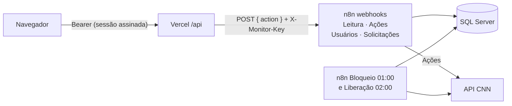

# CNN — Bloqueio por falta e painel de liberação

Bloqueia no Clínica nas Nuvens (CNN) o paciente que faltou e libera quando o prazo termina. Antes do prazo, só com uma **solicitação de desbloqueio** aprovada pelo administrador, num painel web com rastreabilidade.

| Peça | Onde | O que faz |
|---|---|---|
| Bloqueio automático | n8n, `workflows/bloqueioPacientesFaltas.json`, 01:00 | Grava as faltas, bloqueia (`{ "ativo": false }`) e registra cada PATCH na auditoria |
| Painel | Vercel (HTML estático + `api/`) | Lista os bloqueados, recebe e decide solicitações de desbloqueio, libera, bloqueia um paciente, mostra relatórios, histórico e configuração |
| CNN Painel - Leitura | n8n, `workflows/cnn-painel-leitura.json` (webhook) | Consultas do painel (só leitura) |
| CNN Painel - Ações | n8n, `workflows/cnn-painel-acoes.json` (webhook) | Liberar e bloquear pelo painel, com auditoria |
| CNN Painel - Usuários | n8n, `workflows/cnn-painel-usuarios.json` (webhook) | Login e gestão de usuários (perfis Leitor, Editor, Admin) |
| CNN Painel - Solicitações | n8n, `workflows/cnn-painel-solicitacoes.json` (webhook) | Pedidos de desbloqueio: abrir, aprovar, recusar, cancelar |
| Liberação automática | n8n, `workflows/liberacaoPacientesFaltas.json`, 02:00 | Libera quem cumpriu o prazo (só quem o sistema bloqueou), com auditoria |
| Banco | SQL Server `INTEGRACAO` | `CtlCnnFaltaPaciente` (faltas), `CtlCnnFaltaProcedimento` (procedimentos), `CtlCnnCadastro` (nomes do CNN), `CtlCnnControlePaciente` (controle), `CtlCnnAcaoPaciente` (auditoria), `CtlCnnSolicitacao` (solicitações de desbloqueio), `CtlCnnUsuario` e `CtlCnnUsuarioEvento` (usuários) |



## Regra

**Bloqueio:** todo paciente com falta no período analisado (do início do ciclo até hoje) e com o prazo ainda correndo é bloqueado se estiver ativo no CNN. Quem já está inativo não recebe PATCH, só é registrado. Quem já cumpriu o prazo não é bloqueado.

**Liberação:** o prazo conta da falta vigente. Quando ele termina, a rotina das 02:00 libera. Antes disso, só com uma solicitação de desbloqueio aprovada pelo administrador.

| Falta vigente no ciclo | Pode ser liberado após |
|---|---|
| 1ª | 60 dias a partir da data dessa falta |
| 2ª | 90 dias |
| 3ª ou mais | 180 dias |

Ciclo: começa em 1º de outubro. Fonte única: [`workflows/code/_regra.js`](workflows/code/_regra.js). A liberação pelo painel pode ser antes do prazo, com motivo obrigatório; o bloqueio das 01:00 respeita essa liberação até surgir uma falta nova.

## Comandos

```bash
npm run dev       # servidor local em http://localhost:3000 (lê .env.local)
npm run inject    # copia workflows/code/*.js para dentro dos JSON dos workflows
npm run check     # confere os workflows (compila o código dos nós, referências, inject em dia)
npm run admin    # gera senha aleatória e o INSERT do primeiro admin (colar no SSMS)
```

Sem dependências de npm: Node 20.6 ou mais novo.

## Usuários e perfis

| Perfil | Pode |
|---|---|
| Leitor | Ver pacientes, relatórios, histórico e configuração; **abrir solicitações de desbloqueio** |
| Editor | Tudo do leitor, mais bloquear, registrar, liberar quem cumpriu o prazo e liberar solicitações aprovadas |
| Admin | Tudo do editor, mais **aprovar e recusar solicitações** e a tela **Usuários** (criar, mudar perfil, desativar, redefinir senha) |

Os usuários ficam no banco (`CtlCnnUsuario`), não em variável de ambiente. O primeiro admin é inserido à mão (`npm run admin`); os demais, pela tela. Ver [docs/operacao.md](docs/operacao.md#usuários-do-painel).

## Documentação

- **Para todos:** [docs/visao-geral.md](docs/visao-geral.md) (sem termos técnicos) e [docs/regras.md](docs/regras.md) (as regras de negócio).
- **Segurança:** [docs/seguranca-resumo.md](docs/seguranca-resumo.md) (para a liderança) e [docs/seguranca.md](docs/seguranca.md) (técnica: segredos, chaves, testes e riscos).
- **Word:** [docs/word/](docs/word/), gerado com `npm run word`.

[docs/README.md](docs/README.md): índice, arquitetura, banco, painel, um documento por workflow e operação (instalação, solicitações, liberação automática, deploy).
