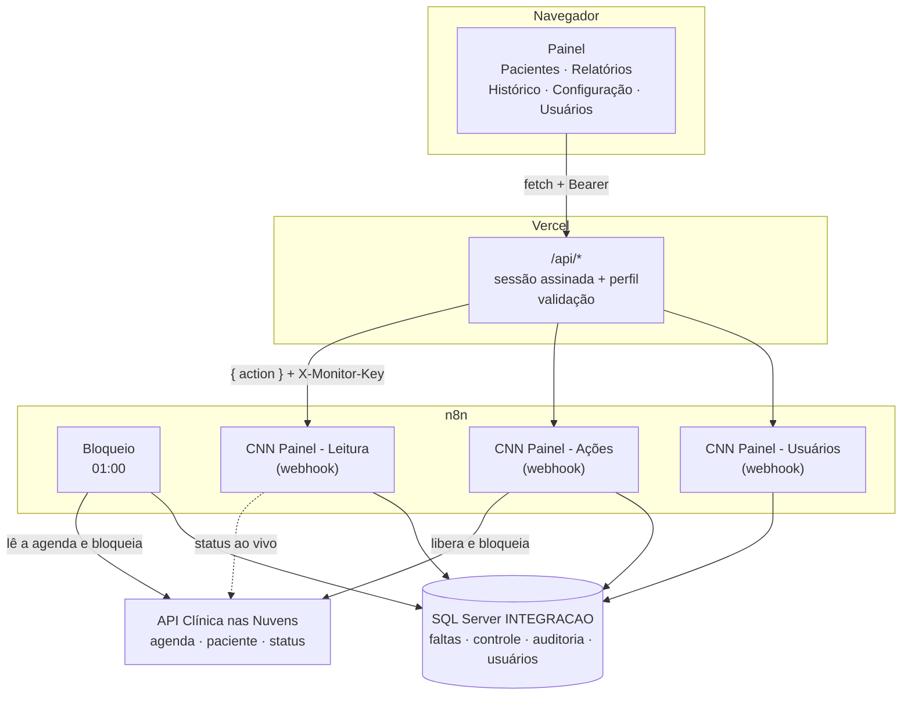

# Documentação — CNN bloqueio por falta e painel de liberação

## Em um minuto

- **O que faz:** bloqueia no Clínica nas Nuvens (CNN) o paciente que faltou a um agendamento. Prazo pela falta vigente do ciclo: 1ª falta = 60 dias, 2ª = 90, 3ª ou mais = 180.
- **Bloqueio:** automático, num workflow n8n às 01:00. Grava as faltas em `INTEGRACAO.dbo.CtlCnnFaltaPaciente` e manda `{ "ativo": false }`.
- **Liberação:** **manual**, pelo painel web, com motivo obrigatório. Pode ser antes do fim do prazo. A liberação automática das 02:00 foi desativada.
- **Painel rápido:** ao entrar, prepara todas as telas de uma vez; depois, a navegação não espera o servidor.
- **Bloquear pelo painel:** roda o fluxo de bloqueio só para um paciente (busca a agenda dele, grava as faltas novas e bloqueia pelo prazo da falta vigente).
- **Usuários:** cada pessoa tem login próprio, com perfil Leitor (só vê), Editor (libera e bloqueia) ou Admin (também gerencia usuários). Os usuários ficam em `dbo.CtlCnnUsuario`; o admin cuida deles pela tela Usuários.
- **Rastreabilidade:** cada PATCH no CNN, automático ou pelo painel, vira uma linha em `dbo.CtlCnnAcaoPaciente` (quem, quando, motivo, resposta da API). A situação atual de cada paciente fica em `dbo.CtlCnnControlePaciente`.
- **Ciclo:** começa em 1º de outubro. De outubro a dezembro, 1/10 do ano corrente; de janeiro a setembro, 1/10 do ano anterior.
- **Onde fica a regra:** [`workflows/code/_regra.js`](../workflows/code/_regra.js), copiada para todos os workflows por `npm run inject`. A tela Configuração mostra os valores em uso.

## Fluxograma geral

## Documentos

**Comece por aqui:** [visao-geral.md](visao-geral.md) (sem termos técnicos) e [regras.md](regras.md) (todas as regras de negócio, numeradas).

| Documento | Para quem | O que tem |
|---|---|---|
| [visao-geral.md](visao-geral.md) | Todos, inclusive quem não é técnico | O que o sistema faz, telas, situações do paciente, perfis, perguntas frequentes, glossário |
| [regras.md](regras.md) | Todos | As regras de negócio (R1 a R69): faltas, ciclo, prazos, bloqueio, liberação, auditoria, usuários, LGPD, desempenho |
| [arquitetura.md](arquitetura.md) | Quem mantém | Peças, ligações, rotas, sequências, segurança, configuração e deploy |
| [front-end.md](front-end.md) | Quem opera e quem mantém | O painel: telas, situações do paciente, liberar e bloquear, login |
| [bloqueio.md](bloqueio.md) | Quem mantém ou opera | Workflow de bloqueio (01:00), nó a nó |
| [fluxos/leitura.md](fluxos/leitura.md) | Quem mantém | Workflow CNN Painel - Leitura (consultas do painel) |
| [fluxos/acoes.md](fluxos/acoes.md) | Quem mantém | Workflow CNN Painel - Ações (liberar e bloquear pelo painel) |
| [fluxos/usuarios.md](fluxos/usuarios.md) | Quem mantém | Workflow CNN Painel - Usuários (login, perfis, gestão de usuários) |
| [liberacao.md](liberacao.md) | Quem mantém | Workflow de liberação automática (**desativado**) |
| [api-cnn.md](api-cnn.md) | Quem mantém | Integração com a API do CNN: endpoints, campos, autenticação, paginação |
| [banco-de-dados.md](banco-de-dados.md) | Quem mantém ou opera | Tabelas, colunas, índices, consultas úteis |
| [script-sql.md](script-sql.md) | Quem instala | Scripts de criação, migração e carga inicial |
| [operacao.md](operacao.md) | Quem opera | Instalação, corte da liberação automática, rotina, usuários, deploy e problemas conhecidos |
| [../CHANGELOG.md](../CHANGELOG.md) | Todos | O que mudou, por data |

As notas do canvas do n8n citam `docs/bloqueio.md` e `docs/liberacao.md`. Por isso esses nomes não devem mudar.

A versão em Word fica em [word/](word/) e é **gerada a partir destes `.md`** pelo gerador em [word/gerador/](word/gerador/): um arquivo completo (`00 - Documentação completa.docx`) e um por documento. Depois de mudar a documentação, gere de novo (ver [operacao.md](operacao.md#como-publicar-cada-tipo-de-mudança)).

## Mapa do repositório

| Caminho | O que é |
|---|---|
| [README.md](../README.md), [CHANGELOG.md](../CHANGELOG.md) | Resumo e histórico de mudanças |
| `index.html`, `relatorios.html`, `historico.html`, `configuracao.html`, `usuarios.html` | Páginas do painel (`/pacientes`, `/relatorios`, `/historico`, `/configuracao`, `/usuarios`) |
| [css/app.css](../css/app.css), [js/](../js/) | Estilo e módulos do navegador (`session.js`, `pagina.js`, um `.js` por página) |
| [api/](../api/) | Funções da Vercel, uma por rota |
| [lib/](../lib/) | Código do servidor: sessão, senha e perfis (`auth.js`), chamada ao n8n (`n8n.js`), revalidação da sessão (`usuarios.js`), liberar/bloquear (`acao.js`) |
| [workflows/](../workflows/) | Os cinco workflows n8n exportados (JSON) |
| [workflows/code/](../workflows/code/) | Código dos nós Code, `_regra.js`, `_sql.js` e `inject.mjs` |
| [sql/](../sql/) | Scripts de banco (idempotentes) e carga inicial |
| [scripts/](../scripts/) | `criar-admin.mjs` (`npm run admin`, primeiro admin) e `checar.mjs` (`npm run check`) |
| [docs/word/gerador/](word/gerador/) | Gerador dos `.docx` (`npm run word`) |
| `dev-server.js` | Servidor local que imita a Vercel (só desenvolvimento) |
| `vercel.json`, `.vercelignore`, `.env.example` | Rotas, duração das funções, o que não publicar, variáveis |
| [apidocs.json](../apidocs.json) | Swagger 2.0 da API do CNN (cópia antiga; não tem o `PATCH /paciente/{id}/status`) |
