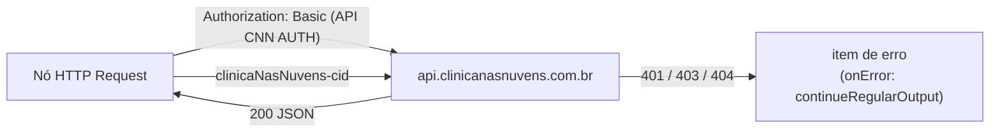

# Integração com a API do Clínica nas Nuvens

Voltar ao [índice](README.md). Referência: [apidocs.json](../apidocs.json) (Swagger 2.0, host `api.clinicanasnuvens.com.br`).

## Para que serve

É a fonte das faltas e o lugar onde o bloqueio e a liberação acontecem. Todos os workflows usam a mesma URL base, a mesma credencial e o mesmo header.

## Quando é chamada

| Momento | Fluxo | Chamadas |
|---|---|---|
| 01:00 | [Bloqueio](bloqueio.md) | listas de cadastro (`/tipo-consulta/lista`, `/executor-agenda/lista`, `/agenda-rotulo/lista`, `/local-agenda/lista`, `/especialidade/lista`), `GET /agenda/lista` (todas as páginas), `GET /paciente/{id}` por paciente, `PATCH /paciente/{id}/status` por paciente a bloquear |
| Liberar no painel | [Ações](fluxos/acoes.md) | `GET /paciente/{id}` (confere `ativo`), `PATCH /paciente/{id}/status` com `{ "ativo": true }` |
| Bloquear no painel | [Ações](fluxos/acoes.md) | `/executor-agenda/lista`, `GET /agenda/lista` com `codigoPaciente`, `GET /paciente/{id}`, `GET /paciente/{id}`, `PATCH` com `{ "ativo": false }` |
| Detalhe no painel | [Leitura](fluxos/leitura.md) | `GET /paciente/{id}` (status ao vivo; só leitura) |
| ~~02:00~~ | [Liberação](liberacao.md) (desativada) | — |

## Autenticação

- Basic auth pela credencial `API CNN AUTH` do n8n (`genericAuthType: httpBasicAuth`). Usuário e senha ficam só no n8n.
- Header `clinicaNasNuvens-cid` em toda requisição. Identifica a clínica. O Swagger declara esse header em todos os endpoints.
- O valor do header está escrito em cada nó HTTP. Não copie para documentos.

## Endpoints

### `GET /agenda/lista`

| Parâmetro | Valor usado | Observação |
|---|---|---|
| `dataInicial` | 1/10 do ciclo (`yyyy-10-01`) | Calculado com `$now.setZone('America/Sao_Paulo')` |
| `dataFinal` | Hoje (`yyyy-MM-dd`) | |
| `dataPor` | `AGENDAMENTO` | O Swagger aceita `AGENDAMENTO` ou `CRIACAO` |
| `pagina` | `0`, depois `$pageCount` | Atualizado a cada página |
| `registrosPorPagina` | `100` | |

A resposta é `PageAPI«AgendaFormRetornoAPI»`, com os agendamentos em `lista`. Campos lidos pelo fluxo:

| Campo | Uso |
|---|---|
| `id` | `IdAgenda` |
| `idPaciente` | `IdPaciente` e chamada ao `GET /paciente/{id}` |
| `data` | `DataFalta` (10 primeiros caracteres) |
| `horaInicio`, `horaFim` | `HoraInicio`, `HoraFim` |
| `status` | Filtro `FALTOU` e `StatusAgenda` |
| `idPessoaExecutor` | `IdPessoaExecutor`. É o **`idpessoa`** do executor (não o `id`): casado com a `/executor-agenda/lista` |
| `idTipoConsulta`, `idRotulo`, `idLocalAgenda` | `IdTipoConsulta`, `IdRotulo`, `IdLocalAgenda`. Nomes nas listas de cadastro |
| `procedimentos[]` | `CtlCnnFaltaProcedimento` (`idTipoProcedimento`, `nome`, `idEspecialidade`, `quantidade`). Pode vir vazio: algumas clínicas não preenchem |
| `idLocalAgenda`, `idTipoConsulta` | Colunas de mesmo nome |
| `observacoes` | `Observacoes` |
| `emailPaciente`, `telefoneCelularPaciente` | Reserva quando o paciente não tem contato |

Status que o Swagger lista: `AGENDADO`, `CONFIRMADO`, `CONFIRMADO_PACIENTE`, `CANCELADO`, `CANCELADO_PACIENTE`, `EM_ESPERA`, `EM_ANDAMENTO`, `FINALIZADO`, `FALTOU`, `PAGAMENTO`, `PRE_ATENDIMENTO`, `REMARCOU`. Só `FALTOU` interessa.

### `GET /paciente/{id}`

Resposta `PacienteRetornoAPI`. Campos lidos:

| Campo | Uso |
|---|---|
| `id` | Confere se a resposta é válida |
| `nome` | `NomePaciente` |
| `cpfcnpj` | `CpfCnpj` |
| `contato.email` | `EmailPaciente` |
| `contato.telefoneCelular` | `TelefonePaciente` |
| `ativo` | Bloqueio: pula quem já está `false`. Liberação: só segue quem está `false` |

O Swagger traz `ativo` como booleano, sem explicar o significado. Na prática `true` = ativo (liberado) e `false` = inativo (bloqueado).

### Listas de cadastro

Todas paginadas (`pagina`, `registrosPorPagina=100`, `{ lista, pagina, totalPaginas }`), lidas uma vez por execução do bloqueio e gravadas em `CtlCnnCadastro`:

| Lista | Campos usados | `Tipo` em `CtlCnnCadastro` |
|---|---|---|
| `/tipo-consulta/lista?somenteAtivos=false` | `id`, `nome`, `reconsulta` | `TIPO_CONSULTA` (`Extra = RECONSULTA`) |
| `/executor-agenda/lista?somenteAtivos=false` | `id`, **`idpessoa`**, `nome`, `tipoExecutor` | `EXECUTOR` (`Id = idpessoa`) |
| `/agenda-rotulo/lista` | `id`, `nome`, `corRotulo` | `ROTULO` |
| `/local-agenda/lista?somenteAtivos=false` | `id`, `nome` | `LOCAL_AGENDA` |
| `/especialidade/lista` | `id`, `nome` | `ESPECIALIDADE` |

### `GET /executor-agenda/{id}` (não usado mais)

Espera o `id` do executor, que **não** é o `idPessoaExecutor` da agenda. Por isso o fluxo antigo, que mandava o `idPessoaExecutor`, nunca achava o profissional e `NomeExecutor` ficava vazio. Resposta `ExecutorAgendaDetalhadoRetornoAPI`:

| Campo | Uso |
|---|---|
| `id` | `IdExecutorAgenda` |
| `nome` | `NomeExecutor` |
| `tipoExecutor` | `TipoExecutor` (`PROFISSIONAL` ou `CLIENTE_FORNECEDOR`) |

### `PATCH /paciente/{id}/status`

| Fluxo | Corpo | Efeito |
|---|---|---|
| Bloqueio | `{ "ativo": false }` | Inativa o paciente |
| Liberação | `{ "ativo": true }` | Ativa o paciente |

Esse endpoint não está no `apidocs.json`. O corpo é uma expressão n8n inteira (`={{ { ativo: false } }}`), não JSON com `{{ }}` no meio.

## Limites e ritmo

| Item | Valor | Nó |
|---|---|---|
| Registros por página | 100 | `GET agenda do ciclo` |
| Máximo de requisições da agenda | 1000 (`maxRequests`, `limitPagesFetched: true`) | `GET agenda do ciclo` |
| Intervalo entre páginas | 200 ms (`requestInterval`) | `GET agenda do ciclo` |
| Fim da paginação | `Array.isArray($response.body.lista) && $response.body.lista.length === 0` | `GET agenda do ciclo` |
| GET de paciente | 1 por vez (`batchSize: 1`), sem intervalo, uma vez por paciente | `GET paciente por id` |
| PATCH | 1 por vez, 3000 ms entre chamadas (`batchInterval`) | `PATCH status paciente` |

A API devolve no máximo 100 agendamentos por chamada e não filtra por status: para achar todas as faltas, o bloqueio lê **todas** as páginas do ciclo. Com 1000 páginas de 100, o teto é 100.000 agendamentos por execução. O PATCH leva cerca de 3 s por paciente.

## Erros

Todos os nós HTTP usam `onError: continueRegularOutput`. A resposta de erro vira um item comum. Os nós de código tratam como ausente a resposta com `error`, `message` ou sem `id`:

| Chamada que falhou | Efeito |
|---|---|
| `GET /agenda/lista` | Sem `lista`, o bloqueio termina como "sem faltas" |
| `GET /paciente/{id}` no bloqueio | A falta é gravada com `NomePaciente` e `CpfCnpj` `NULL` (e-mail e telefone caem no que veio do agendamento). O PATCH é enviado mesmo assim |
| Uma lista de cadastro | Os nomes daquele tipo não são atualizados nesta noite; o bloqueio segue |
| `GET /paciente/{id}` na liberação | O paciente é pulado e volta a ser tentado na noite seguinte |
| `PATCH /paciente/{id}/status` | Nada é refeito na execução. No dia seguinte o fluxo tenta de novo, porque relê tudo |

Uma linha gravada com `NULL` é completada numa noite seguinte: o `UPDATE` das faltas já gravadas preenche nome, CPF e contato vazios e atualiza os dados da agenda.
