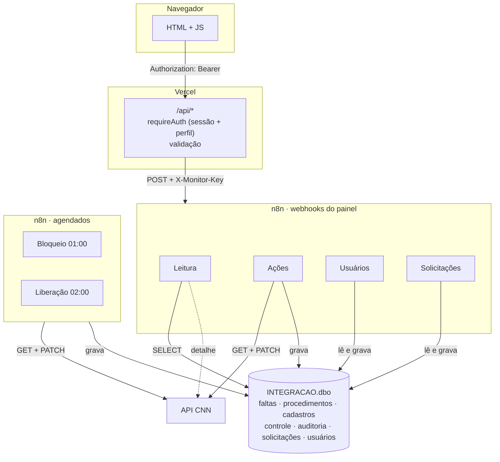
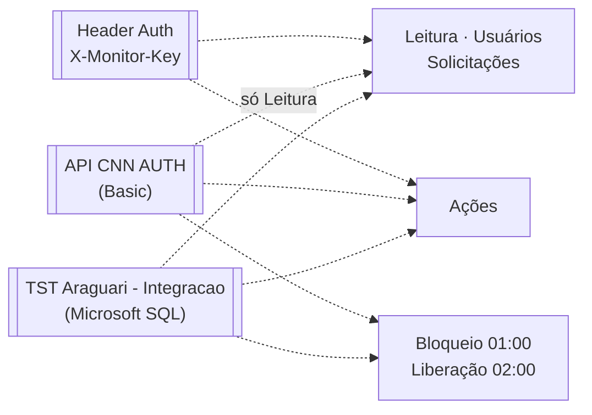
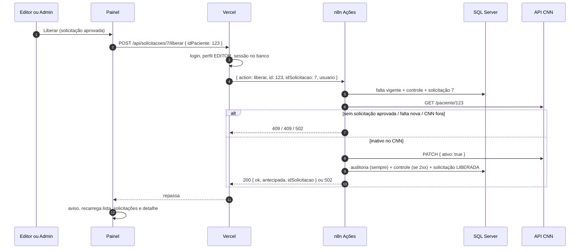
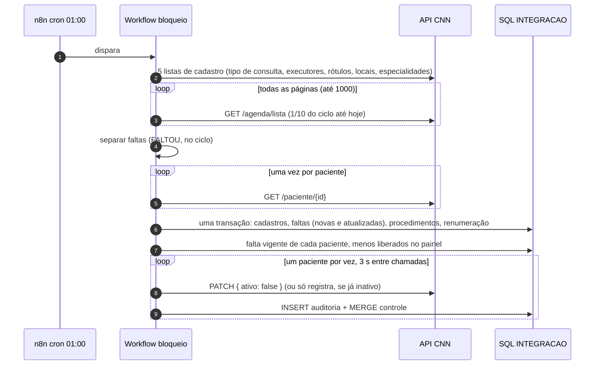
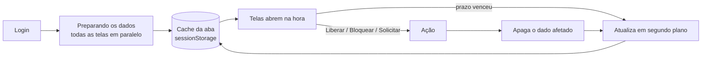
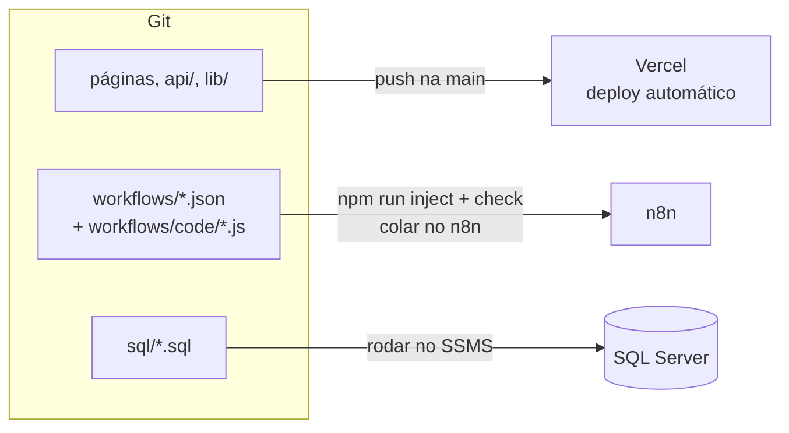

# Arquitetura

Voltar ao [índice](README.md).

Três camadas, no padrão do painel de monitoramento (`Clariens-Painel-monitoramento-N8N/docs/guia-novo-painel.md`):

1. **O navegador só fala com a Vercel.** Ele nunca vê a URL do n8n, o segredo do webhook, nem as credenciais do banco ou do CNN.
2. **A Vercel não fala com o banco nem com o CNN.** Ela confere o login, valida a entrada e repassa um pedido curto (`{ action, ... }`) ao n8n.
3. **O n8n faz o trabalho.** Ele guarda as credenciais, monta o SQL e as chamadas ao CNN e devolve um JSON pronto (`{ statusCode, response }`).

Além do painel, há dois workflows agendados: o bloqueio das 01:00 e a liberação automática das 02:00.

## Onde cada peça está

**Unidades.** Tudo abaixo vale para cada unidade (Salvador e Pouso Alegre): o navegador manda a unidade escolhida em `X-Unidade`, a Vercel confere se ela está na sessão e repassa `idUnidade` e `codigoUnidade` ao n8n, e o n8n filtra o SQL e escolhe o CID do CNN por ela. O bloqueio das 01:00 roda um subfluxo por unidade. Detalhes em [unidades.md](unidades.md).

| Peça | Onde roda | No repositório |
|---|---|---|
| Painel (páginas, css, js) | Vercel (estático) | `*.html`, [css/](../css/), [js/](../js/) |
| API do painel | Vercel (funções Node) | [api/](../api/), [lib/](../lib/). São **9 funções**: o plano Hobby da Vercel aceita até 12 por deploy. Pacientes, solicitações e usuários têm uma função cada (`api/pacientes.js`, `api/solicitacoes.js`, `api/usuarios.js`). O `vercel.json` reescreve `/api/pacientes/:id/liberar` e afins para essa função, com `id` e `op` na query, e o código de cada rota fica em [lib/rotas/](../lib/rotas/). Rota nova: acrescente em `lib/rotas/` e no despachante, não um arquivo novo em `api/` |
| Workflow de bloqueio (01:00) | n8n | [workflows/bloqueioPacientesFaltas.json](../workflows/bloqueioPacientesFaltas.json) |
| Workflow CNN Painel - Leitura | n8n (webhook) | [workflows/cnn-painel-leitura.json](../workflows/cnn-painel-leitura.json) |
| Workflow CNN Painel - Ações | n8n (webhook) | [workflows/cnn-painel-acoes.json](../workflows/cnn-painel-acoes.json) |
| Workflow CNN Painel - Usuários | n8n (webhook) | [workflows/cnn-painel-usuarios.json](../workflows/cnn-painel-usuarios.json) |
| Workflow CNN Painel - Solicitações | n8n (webhook) | [workflows/cnn-painel-solicitacoes.json](../workflows/cnn-painel-solicitacoes.json) |
| Workflow de liberação automática (02:00) | n8n | [workflows/liberacaoPacientesFaltas.json](../workflows/liberacaoPacientesFaltas.json) |
| Código dos nós Code | Copiado para os JSON por `npm run inject` | [workflows/code/](../workflows/code/) |
| Tabelas | SQL Server, banco `INTEGRACAO`, schema `dbo` | [sql/](../sql/) |
| API do CNN | `https://api.clinicanasnuvens.com.br` | [apidocs.json](../apidocs.json) (Swagger antigo) |

Os endereços do n8n e do SQL Server não estão no repositório: as URLs dos webhooks ficam nas variáveis da Vercel; o resto, nas credenciais do n8n.

## Como as peças se ligam



Os quatro workflows do painel recebem o mesmo `POST { action }` com o cabeçalho `X-Monitor-Key`. O que cada um lê e grava está nas tabelas abaixo.

As credenciais do n8n e os workflows que usam cada uma:



As tabelas do banco: `CtlCnnFaltaPaciente`, `CtlCnnFaltaProcedimento`, `CtlCnnCadastro`, `CtlCnnControlePaciente`, `CtlCnnAcaoPaciente`, `CtlCnnSolicitacao`, `CtlCnnUsuario` e `CtlCnnUsuarioEvento` (detalhes em [banco-de-dados.md](banco-de-dados.md)).

Regras de convivência:

- Faltas, controle e auditoria só são gravados pelo bloqueio (01:00), pela liberação (02:00) e pelas Ações. A Leitura só lê. Solicitações e Usuários gravam só as próprias tabelas.
- `{ "ativo": true }` sai das Ações (liberar) e da liberação das 02:00. `{ "ativo": false }` sai do bloqueio e das Ações (bloquear).
- **Antes do prazo**, as Ações só liberam com uma solicitação aprovada (`idSolicitacao`). **Depois do prazo**, liberam direto, e a rotina das 02:00 libera sozinha.
- O bloqueio respeita a liberação: pula quem está `LIBERADO` no controle com a mesma falta vigente, e quem já cumpriu o prazo.
- Todo PATCH, de qualquer origem, vira linha em `CtlCnnAcaoPaciente`. A mesma transação fecha as solicitações que a ação resolve ou invalida.

## Rotas do painel (Vercel)

| Método | Rota | Workflow / action | Perfil e validação |
|---|---|---|---|
| POST | `/api/sessao` | Usuários `login-buscar`, `login-resultado` | público; login, senha |
| POST | `/api/senha` | Usuários `login-buscar`, `trocar-senha` | qualquer perfil (inclusive com senha temporária); senha atual; nova com 6+ caracteres, um número e um caractere especial |
| GET | `/api/usuarios` | Usuários `listar` | ADMIN |
| POST | `/api/usuarios` | Usuários `sessao`, `criar` | ADMIN; login, nome, perfil |
| PATCH | `/api/usuarios/:login` | Usuários `sessao`, `alterar` ou `redefinir-senha` | ADMIN; não mexe no próprio perfil nem se desativa |
| GET | `/api/pacientes` | Leitura `pacientes` | login |
| GET | `/api/pacientes/:id` | Leitura `paciente` | login, id inteiro |
| POST | `/api/pacientes/:id/liberar` | Usuários `sessao`, Ações `liberar` | EDITOR; id, motivo (5 a 500), corpo JSON. Antes do prazo, o n8n responde 409 `SOLICITACAO_NECESSARIA` |
| POST | `/api/pacientes/:id/bloquear` | Usuários `sessao`, Ações `bloquear` | EDITOR; id, motivo, corpo JSON |
| GET | `/api/faltas?de&ate` | Leitura `faltas` | login, datas |
| GET | `/api/acoes?de&ate&acao&origem&resultado&usuario&paciente&page` | Leitura `acoes` | login, valores permitidos |
| GET | `/api/parametros` | Leitura `parametros` | login |
| GET | `/api/solicitacoes` | Solicitações `listar` | login |
| POST | `/api/solicitacoes` | Usuários `sessao`, Solicitações `criar` (com `aprovarELiberar`: depois Ações `liberar`) | login; `idPaciente`, motivo (5 a 500). `aprovarELiberar`: ADMIN |
| PATCH | `/api/solicitacoes/:id` | Usuários `sessao`, Solicitações `aprovar`, `recusar` ou `cancelar` | aprovar e recusar: ADMIN (recusar com motivo); cancelar: quem abriu ou ADMIN |
| POST | `/api/solicitacoes/:id/liberar` | Usuários `sessao`, Ações `liberar` com `idSolicitacao` | EDITOR; `idPaciente`. `aprovar: true`: ADMIN |

Todas respondem com `Cache-Control: no-store`. As rotas marcadas "login" aceitam qualquer perfil (LEITOR ou acima). Respostas: 400 (entrada), 401 (sem sessão, sessão vencida ou acesso alterado desde o login), 403 (`SEM_PERMISSAO` ou `TROCAR_SENHA`), 429 (login bloqueado por tentativas), 405 (método), o status que o n8n devolver (404, 409, 502…), 502 (n8n inalcançável), 504 (n8n demorou mais de 55 s), 500 (variável de ambiente ausente, com o nome dela).

Contrato com o n8n:

```
Vercel → n8n   POST <webhook>     { "action": "liberar", "id": 123, "motivo": "...", "usuario": "ana" }
                                  header X-Monitor-Key: <N8N_WEBHOOK_SECRET>
n8n → Vercel   HTTP <statusCode>  <response>   ex.: 200 { ok: true, ... }  ou  409 { "error": "Paciente já está ativo no CNN." }
```

## APIs do CNN usadas

| Método | Rota | Quem chama | Para quê |
|---|---|---|---|
| GET | `/agenda/lista` | Bloqueio (ciclo inteiro); Ações no bloquear (`codigoPaciente`) | Agendamentos `FALTOU` |
| GET | `/paciente/{id}` | Bloqueio (uma vez por paciente), liberação das 02:00, Ações, Leitura (detalhe) | Nome, CPF, contato, `ativo` |
| GET | `/executor-agenda/lista` | Bloqueio, Ações no bloquear | Profissionais (casados pelo `idpessoa`) |
| GET | `/tipo-consulta/lista`, `/agenda-rotulo/lista`, `/local-agenda/lista`, `/especialidade/lista` | Bloqueio | Nomes para a lista e os relatórios |
| PATCH | `/paciente/{id}/status` | Bloqueio (`false`), liberação das 02:00 (`true`), Ações (`true` ou `false`) | Bloquear / liberar |

Detalhes: [api-cnn.md](api-cnn.md).

## Caminho de cada requisição

### Liberar pelo painel (a partir de uma solicitação)



Sem solicitação (`POST /api/pacientes/123/liberar`), o caminho é o mesmo, mas só segue se o prazo já terminou (Apto). O pedido em si (abrir, aprovar, recusar, cancelar) passa pelo [workflow Solicitações](fluxos/solicitacoes.md), que só grava no banco.

### Bloquear pelo painel

Igual, com três passos antes da consulta: `GET /agenda/lista?codigoPaciente=123` desde o início do ciclo → grava as faltas novas (mesmo código do bloqueio) → falta vigente. Ver [fluxos/acoes.md](fluxos/acoes.md).

### Bloqueio (01:00)



O bloqueio deixa de fora quem já cumpriu o prazo da falta vigente. Detalhes em [bloqueio.md](bloqueio.md).

### Liberação automática (02:00)

Uma hora depois do bloqueio, o workflow de liberação lê quem está `BLOQUEADO` no controle pela falta vigente e já cumpriu o prazo, consulta cada um no CNN, manda `{ "ativo": true }` (ou só registra, se já está ativo) e grava auditoria, controle e o encerramento das solicitações abertas numa transação. Detalhes em [liberacao.md](liberacao.md).

## O painel no navegador

O painel não espera o servidor a cada tela. Ao entrar, busca **todas as telas em paralelo** e guarda o resultado na aba (`sessionStorage`). Cada tela abre com o dado guardado; quando o prazo dele vence, mostra o guardado na hora e atualiza em segundo plano. Depois de uma ação, o dado afetado é buscado de novo.



Prazos e detalhes em [front-end.md](front-end.md#cache-e-filtros).

## Tratamento de erro

- **Painel:** toda resposta não 2xx vira mensagem no rodapé da página ou no diálogo da ação. 401 reabre o login.
- **Vercel:** `callN8n` (em [lib/n8n.js](../lib/n8n.js)) repassa o status e a mensagem do n8n; responde 502 se não alcança o webhook e 504 se passa de 55 s.
- **n8n (webhooks):** nós HTTP e SQL com `onError: continueRegularOutput`. Os nós Code transformam o erro em `{ statusCode, response }`: o webhook sempre responde. SQL com `alwaysOutputData`.
- **Bloqueio (01:00) e liberação (02:00):** um erro não para a execução. O PATCH que falha fica registrado na auditoria (`Sucesso = 0`); na liberação, a rotina tenta de novo na noite seguinte.
- **Error workflow:** configure o Error Handler do painel de monitoramento nos seis workflows ativos (bloqueio, liberação automática, Leitura, Ações, Usuários e Solicitações), para que uma falha apareça lá.

## Segurança por camada

Resumo abaixo; o detalhe (segredos, como criar e trocar as chaves, testes e riscos) está em [seguranca.md](seguranca.md).

| Camada | Como é protegida | Cuidados |
|---|---|---|
| Navegador | Login individual. A aba guarda só o token da sessão (8 h) no `sessionStorage`, nunca a senha. Fechou a aba, saiu | Use HTTPS (padrão da Vercel). Não compartilhe usuários: a auditoria grava o nome |
| Vercel | Senha conferida com scrypt e comparação em tempo constante; sessão assinada com `SESSION_SECRET` (HMAC-SHA256), com as unidades da pessoa; perfil e unidade (`X-Unidade`) conferidos em cada rota; escritas revalidam o usuário no banco (ativo, perfil, `VersaoSessao`); 5 senhas erradas bloqueiam o login por 15 min. Arquivos internos (`workflows/`, `sql/`, `docs/`, `.env*`, resultados de execução) ficam fora do deploy (`.vercelignore`). Cabeçalhos de segurança em todas as respostas (`vercel.json`) | `N8N_ACOES_URL` só em Production; Preview não deve alterar paciente |
| Webhooks n8n | Credencial Header Auth (`X-Monitor-Key`), path UUID. O n8n valida a entrada de novo | Segredo novo, sem reaproveitar o do monitoramento |
| API CNN | Credencial `API CNN AUTH` e header `clinicaNasNuvens-cid` da unidade, lido de `$vars['CNN_CID_' + código]` | O CID fica nas Variables do n8n (ou no ambiente do servidor), não nos fluxos. O `npm run check` recusa CID escrito no nó |
| SQL Server | Credencial `TST Araguari - Integracao`. Todo SQL filtra `IdUnidade = @unidade`. SQL montado por texto com `sqlN`/`sqlS`/`sqlDate` ([`_sql.js`](../workflows/code/_sql.js)); listas de IDs só com números | Permissões: `SELECT/INSERT/UPDATE` nas tabelas do sistema (inclusive `CtlCnnSolicitacao`); `DELETE` só em `CtlCnnFaltaProcedimento` |
| Dados pessoais | CPF mascarado no n8n; e-mail e telefone não saem do banco; CSV sem contato | Dado de saúde (LGPD). Nada de paciente em logs, no repositório ou em tickets |

## Configuração

| Item | Onde |
|---|---|
| Prazos 60/90/180, início do ciclo, fuso | [`workflows/code/_regra.js`](../workflows/code/_regra.js) → `npm run inject` |
| Horários | Bloqueio: nó `Todo dia 01:00` (cron `0 1 * * *`). Liberação: nó `Todo dia 02:00` (cron `0 2 * * *`). Fuso da instância n8n = `America/Sao_Paulo` |
| Usuários do painel | Tabela `dbo.CtlCnnUsuario`, pela tela Usuários (admin). Sessão: `SESSION_SECRET` (Vercel) |
| Webhooks | `N8N_LEITURA_URL`, `N8N_ACOES_URL`, `N8N_USUARIOS_URL`, `N8N_SOLICITACOES_URL`, `N8N_WEBHOOK_SECRET` (Vercel) |
| Duração das funções | `vercel.json` → `maxDuration: 60` |
| Credenciais | n8n: `API CNN AUTH`, `TST Araguari - Integracao`, Header Auth do painel |
| Unidades | Tabela `dbo.CtlCnnUnidade`; CID de cada uma nas Variables do n8n, `CNN_CID_<código>` ([unidades.md](unidades.md)) |

Lista das variáveis em [.env.example](../.env.example).

## Deploy



Passo a passo em [operacao.md](operacao.md).
