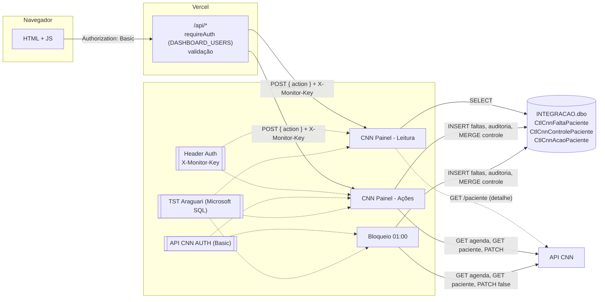
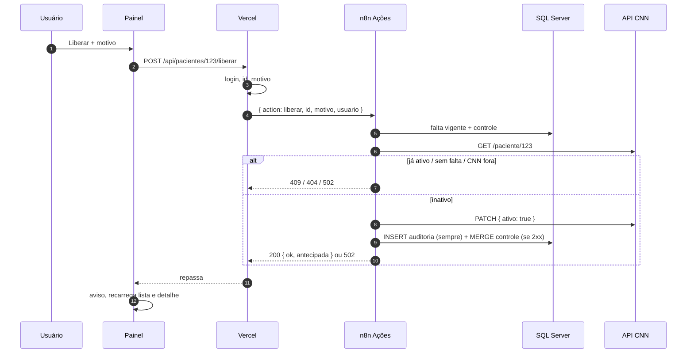
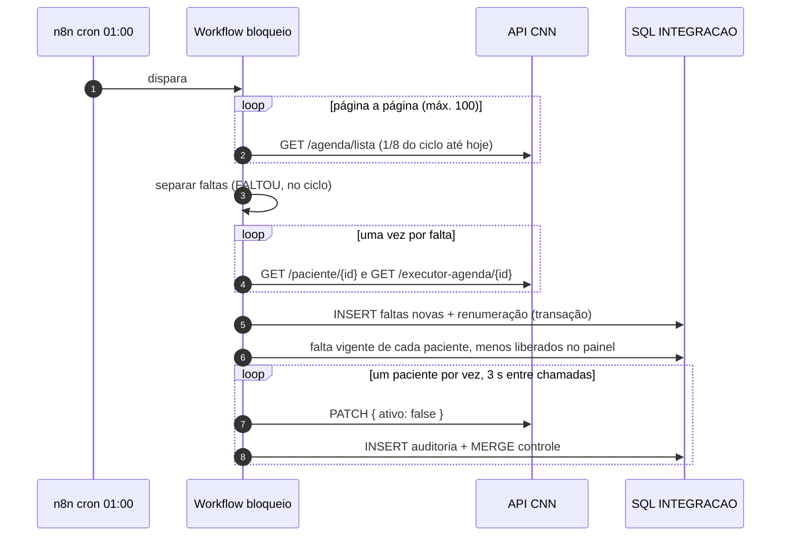
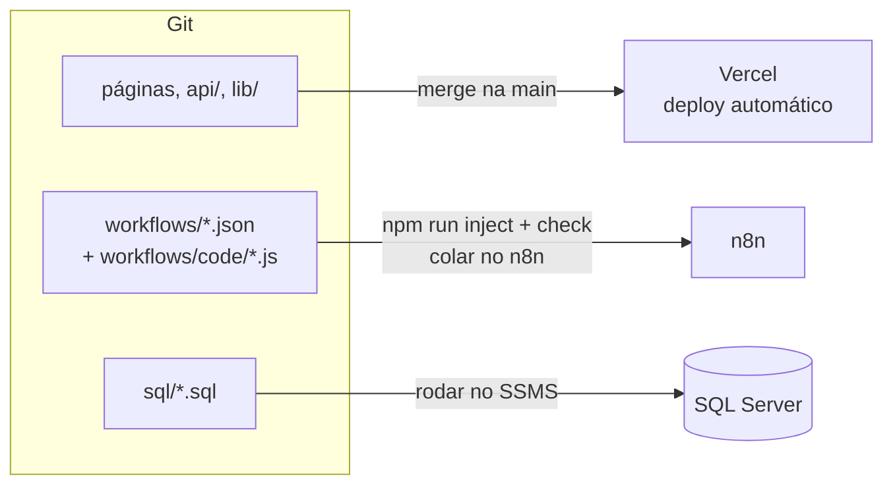

# Arquitetura

Voltar ao [índice](README.md).

Três camadas, no padrão do painel de monitoramento (`Clariens-Painel-monitoramento-N8N/docs/guia-novo-painel.md`):

1. **O navegador só fala com a Vercel.** Ele nunca vê a URL do n8n, o segredo do webhook, nem as credenciais do banco ou do CNN.
2. **A Vercel não fala com o banco nem com o CNN.** Ela confere o login, valida a entrada e repassa um pedido curto (`{ action, ... }`) ao n8n.
3. **O n8n faz o trabalho.** Ele guarda as credenciais, monta o SQL e as chamadas ao CNN e devolve um JSON pronto (`{ statusCode, response }`).

Além do painel, o bloqueio das 01:00 continua como workflow agendado.

## Onde cada peça está

| Peça | Onde roda | No repositório |
|---|---|---|
| Painel (páginas, css, js) | Vercel (estático) | `*.html`, [css/](../css/), [js/](../js/) |
| API do painel | Vercel (funções Node) | [api/](../api/), [lib/](../lib/) |
| Workflow de bloqueio (01:00) | n8n | [workflows/bloqueioPacientesFaltas.json](../workflows/bloqueioPacientesFaltas.json) |
| Workflow CNN Painel - Leitura | n8n (webhook) | [workflows/cnn-painel-leitura.json](../workflows/cnn-painel-leitura.json) |
| Workflow CNN Painel - Ações | n8n (webhook) | [workflows/cnn-painel-acoes.json](../workflows/cnn-painel-acoes.json) |
| Workflow de liberação | n8n, **inativo** | [workflows/liberacaoPacientesFaltas.json](../workflows/liberacaoPacientesFaltas.json) |
| Código dos nós Code | Copiado para os JSON por `npm run inject` | [workflows/code/](../workflows/code/) |
| Tabelas | SQL Server, banco `INTEGRACAO`, schema `dbo` | [sql/](../sql/) |
| API do CNN | `https://api.clinicanasnuvens.com.br` | [apidocs.json](../apidocs.json) (Swagger antigo) |

Os endereços do n8n e do SQL Server não estão no repositório: as URLs dos webhooks ficam nas variáveis da Vercel; o resto, nas credenciais do n8n.

## Como as peças se ligam



Regras de convivência:

- Só o bloqueio (01:00) e as Ações gravam. A Leitura só lê.
- `{ "ativo": true }` só sai das Ações (liberar). `{ "ativo": false }` sai do bloqueio e das Ações (bloquear).
- O bloqueio respeita a liberação manual: pula quem está `LIBERADO` no controle com a mesma falta vigente.
- Todo PATCH, de qualquer origem, vira linha em `CtlCnnAcaoPaciente`.

## Rotas do painel (Vercel)

| Método | Rota | Workflow / action | Valida |
|---|---|---|---|
| GET | `/api/pacientes` | Leitura `pacientes` | login |
| GET | `/api/pacientes/:id` | Leitura `paciente` | login, id inteiro |
| POST | `/api/pacientes/:id/liberar` | Ações `liberar` | login, id, motivo (5 a 500), corpo JSON |
| POST | `/api/pacientes/:id/bloquear` | Ações `bloquear` | login, id, motivo, corpo JSON |
| GET | `/api/faltas?de&ate` | Leitura `faltas` | login, datas |
| GET | `/api/acoes?de&ate&acao&origem&resultado&usuario&paciente&page` | Leitura `acoes` | login, valores permitidos |
| GET | `/api/parametros` | Leitura `parametros` | login |

Todas respondem com `Cache-Control: no-store`. Respostas: 400 (entrada), 401 (login), 405 (método), o status que o n8n devolver (404, 409, 502…), 502 (n8n inalcançável), 504 (n8n demorou mais de 55 s), 500 (variável de ambiente ausente, com o nome dela).

Contrato com o n8n:

```
Vercel → n8n   POST <webhook>     { "action": "liberar", "id": 123, "motivo": "...", "usuario": "ana" }
                                  header X-Monitor-Key: <N8N_WEBHOOK_SECRET>
n8n → Vercel   HTTP <statusCode>  <response>   ex.: 200 { ok: true, ... }  ou  409 { "error": "Paciente já está ativo no CNN." }
```

## APIs do CNN usadas

| Método | Rota | Quem chama | Para quê |
|---|---|---|---|
| GET | `/agenda/lista` | Bloqueio (ciclo inteiro); Ações no bloquear (`codigoPaciente`) | Agendamentos `FALTOU` |
| GET | `/paciente/{id}` | Bloqueio, Ações, Leitura (detalhe) | Nome, CPF, contato, `ativo` |
| GET | `/executor-agenda/{id}` | Bloqueio, Ações no bloquear | Profissional do horário |
| PATCH | `/paciente/{id}/status` | Bloqueio (`false`), Ações (`true` ou `false`) | Bloquear / liberar |

Detalhes: [api-cnn.md](api-cnn.md).

## Caminho de cada requisição

### Liberar pelo painel



### Bloquear pelo painel

Igual, com três passos antes da consulta: `GET /agenda/lista?codigoPaciente=123` desde o início do ciclo → grava as faltas novas (mesmo código do bloqueio) → falta vigente. Ver [fluxos/acoes.md](fluxos/acoes.md).

### Bloqueio (01:00)



## Tratamento de erro

- **Painel:** toda resposta não 2xx vira mensagem no rodapé da página ou no diálogo da ação. 401 reabre o login.
- **Vercel:** `callN8n` (em [lib/n8n.js](../lib/n8n.js)) repassa o status e a mensagem do n8n; responde 502 se não alcança o webhook e 504 se passa de 55 s.
- **n8n (webhooks):** nós HTTP e SQL com `onError: continueRegularOutput`. Os nós Code transformam o erro em `{ statusCode, response }`: o webhook sempre responde. SQL com `alwaysOutputData`.
- **Bloqueio (01:00):** como antes, um erro não para a execução. Agora o PATCH que falha também fica registrado na auditoria (`Sucesso = 0`).
- **Error workflow:** configure o Error Handler do painel de monitoramento nos três workflows ativos, para que uma falha apareça lá.

## Segurança por camada

| Camada | Como é protegida | Cuidados |
|---|---|---|
| Navegador | Login individual. A senha fica em base64 no `sessionStorage` da aba e some ao fechar | Use HTTPS (padrão da Vercel). Não compartilhe usuários: a auditoria grava o nome |
| Vercel | `DASHBOARD_USERS` com hash scrypt; comparação em tempo constante. Arquivos internos (`workflows/`, `sql/`, `docs/`, `.env*`) ficam fora do deploy (`.vercelignore`) | `N8N_ACOES_URL` só em Production; Preview não deve alterar paciente |
| Webhooks n8n | Credencial Header Auth (`X-Monitor-Key`), path UUID. O n8n valida a entrada de novo | Segredo novo, sem reaproveitar o do monitoramento |
| API CNN | Credencial `API CNN AUTH` e header `clinicaNasNuvens-cid` | O `clinicaNasNuvens-cid` está escrito nos nós e, por isso, nos JSON do repositório. Repositório interno |
| SQL Server | Credencial `TST Araguari`. SQL montado por texto com `sqlN`/`sqlS`/`sqlDate` ([`_sql.js`](../workflows/code/_sql.js)); listas de IDs só com números | Permissões: `SELECT/INSERT/UPDATE` nas tabelas do sistema |
| Dados pessoais | CPF mascarado no n8n; e-mail e telefone não saem do banco; CSV sem contato | Dado de saúde (LGPD). Nada de paciente em logs, no repositório ou em tickets |

## Configuração

| Item | Onde |
|---|---|
| Prazos 60/90/180, início do ciclo, fuso | [`workflows/code/_regra.js`](../workflows/code/_regra.js) → `npm run inject` |
| Horário do bloqueio | Nó `Todo dia 01:00` (cron `0 1 * * *`); fuso da instância n8n = `America/Sao_Paulo` |
| Usuários do painel | `DASHBOARD_USERS` (Vercel) |
| Webhooks | `N8N_LEITURA_URL`, `N8N_ACOES_URL`, `N8N_WEBHOOK_SECRET` (Vercel) |
| Duração das funções | `vercel.json` → `maxDuration: 60` |
| Credenciais | n8n: `API CNN AUTH`, `TST Araguari`, Header Auth do painel |

Lista das variáveis em [.env.example](../.env.example).

## Deploy



Passo a passo em [operacao.md](operacao.md).
