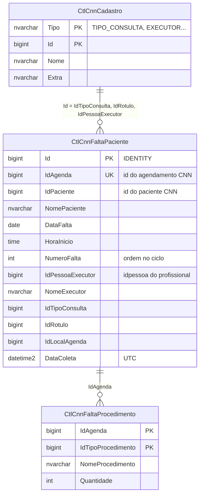
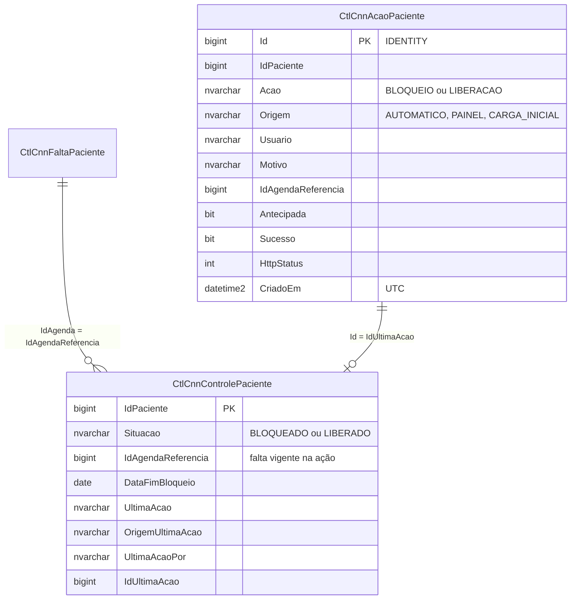
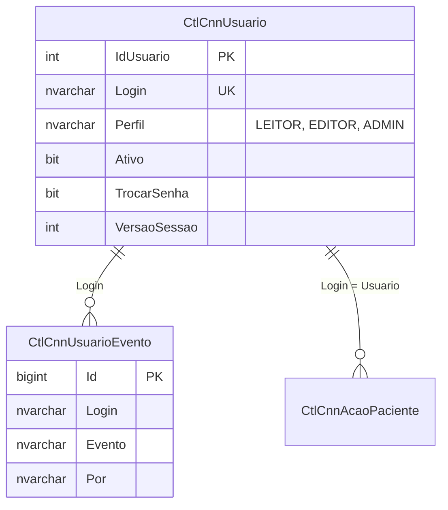

# Banco de dados

Voltar ao [índice](README.md). Scripts: [sql/criar_tabelas_bloqueio.sql](../sql/criar_tabelas_bloqueio.sql), [sql/criar_tabelas_painel.sql](../sql/criar_tabelas_painel.sql) , [sql/criar_tabelas_usuarios.sql](../sql/criar_tabelas_usuarios.sql) e [sql/carga_inicial_controle.sql](../sql/carga_inicial_controle.sql) (detalhes em [script-sql.md](script-sql.md)).

SQL Server, banco `INTEGRACAO`, schema `dbo`. Os workflows acessam pela credencial `TST Araguari` do n8n.

## Resumo

| Tabela | O que guarda | Quem grava | Quem lê | Retenção |
|---|---|---|---|---|
| `dbo.CtlCnnFaltaPaciente` | Uma linha por agendamento `FALTOU` (`IdAgenda` único), com a ordem da falta no ciclo | [Bloqueio](bloqueio.md) (`gravar faltas`) e [Ações](fluxos/acoes.md) no bloquear (mesmo código) | Bloqueio, [Leitura](fluxos/leitura.md), Ações | Sem prazo. Nenhum fluxo apaga linhas |
| `dbo.CtlCnnControlePaciente` | **Tabela de controle**: uma linha por paciente com a situação atual (`BLOQUEADO`/`LIBERADO`), a falta de referência e a última ação | Bloqueio (`registrar bloqueio`), Ações (`registrar ação`), carga inicial | Bloqueio (`consultar bloqueios`), Leitura, Ações | Sem prazo. `MERGE` por paciente |
| `dbo.CtlCnnAcaoPaciente` | **Auditoria**: uma linha por PATCH no CNN, automático ou pelo painel, com quem, motivo e resposta da API | Bloqueio (`registrar bloqueio`), Ações (`registrar ação`) | Leitura (histórico, detalhe) | Sem prazo. Só `INSERT` |
| `dbo.CtlCnnFaltaProcedimento` | Procedimentos de cada falta (`procedimentos[]` do agendamento), uma linha por tipo | Bloqueio e Ações (`gravar faltas`): apaga e grava de novo os das faltas lidas | Leitura (lista, detalhe, relatórios) | Acompanha a falta |
| `dbo.CtlCnnCadastro` | Nomes das listas do CNN: tipo de consulta, profissional (por `idpessoa`), rótulo, local, especialidade | Bloqueio (`gravar faltas`, `MERGE`); Ações só os profissionais | Leitura | Sem prazo. `MERGE` por `(Tipo, Id)` |
| `dbo.CtlCnnUsuario` | Usuários do painel: perfil, ativo, hash da senha, tentativas de login | [Usuários](fluxos/usuarios.md); o primeiro admin, à mão (`npm run admin`) | Usuários | Sem prazo. Ninguém é excluído, só desativado |
| `dbo.CtlCnnUsuarioEvento` | Eventos de usuário: criação, perfil, senha, falhas de login | Usuários | Usuários (tela) | Sem prazo. Só `INSERT` |

Tabelas que **não** existem mais (`criar_tabelas_bloqueio.sql` apaga se encontrar): `dbo.CtlCnnBloqueioPaciente` e `dbo.CtlCnnRegraBloqueioFalta`. Não há tabela de regra: os prazos e o ciclo ficam em [`workflows/code/_regra.js`](../workflows/code/_regra.js).

O prazo de bloqueio não é coluna. `DiasBloqueio` e `DataFimBloqueio` são calculados na hora a partir de `NumeroFalta` e `DataFalta`.

## Diagrama

As tabelas não têm chave estrangeira: as ligações abaixo são lógicas. Para ficar legível, o modelo está em três partes; uma tabela que aparece sem colunas está detalhada em outra parte. Os diagramas mostram só as colunas principais; a lista completa está no dicionário de dados.

### Faltas e cadastros



### Bloqueios e liberações



### Usuários do painel



## Dicionário de dados

### `dbo.CtlCnnFaltaPaciente`

| Coluna | Tipo | Nulo | Descrição |
|---|---|---|---|
| `Id` | `BIGINT IDENTITY(1, 1)` | Não | Chave interna |
| `IdAgenda` | `BIGINT` | Não | `id` do agendamento no CNN. Único |
| `IdPaciente` | `BIGINT` | Não | `idPaciente` do agendamento |
| `NomePaciente` | `NVARCHAR(200)` | Sim | `nome` do `GET /paciente/{id}` no dia da gravação |
| `CpfCnpj` | `NVARCHAR(20)` | Sim | `cpfcnpj` do paciente |
| `EmailPaciente` | `NVARCHAR(200)` | Sim | `contato.email` do paciente ou `emailPaciente` do agendamento |
| `TelefonePaciente` | `NVARCHAR(30)` | Sim | `contato.telefoneCelular` do paciente ou `telefoneCelularPaciente` do agendamento |
| `DataFalta` | `DATE` | Não | Data do agendamento que faltou. Início do prazo quando a linha é a vigente |
| `HoraInicio` | `TIME(0)` | Sim | `horaInicio` do agendamento |
| `HoraFim` | `TIME(0)` | Sim | `horaFim` do agendamento |
| `StatusAgenda` | `NVARCHAR(50)` | Não | `status` no momento da gravação. Sempre `FALTOU`, porque só essas linhas são gravadas |
| `NumeroFalta` | `INT` | Não | Ordem da falta do paciente no ciclo (1, 2, 3…). Define o prazo quando é a maior do ciclo |
| `IdPessoaExecutor` | `BIGINT` | Sim | `idPessoaExecutor` do agendamento |
| `IdExecutorAgenda` | `BIGINT` | Sim | `id` do executor na `/executor-agenda/lista` (casado por `idpessoa`) |
| `NomeExecutor` | `NVARCHAR(200)` | Sim | Nome do profissional do horário. A Leitura prefere o nome de `CtlCnnCadastro` (`EXECUTOR`) |
| `TipoExecutor` | `NVARCHAR(50)` | Sim | `PROFISSIONAL` ou `CLIENTE_FORNECEDOR` |
| `IdLocalAgenda` | `BIGINT` | Sim | `idLocalAgenda` do agendamento |
| `IdTipoConsulta` | `BIGINT` | Sim | `idTipoConsulta` do agendamento. Nome em `CtlCnnCadastro` (`TIPO_CONSULTA`) |
| `IdRotulo` | `BIGINT` | Sim | `idRotulo` do agendamento. Nome em `CtlCnnCadastro` (`ROTULO`) |
| `Observacoes` | `NVARCHAR(500)` | Sim | `observacoes` do agendamento |
| `DataColeta` | `DATETIME2(0)` | Não | Quando a linha foi gravada. Default `SYSUTCDATETIME()`, em UTC |

### Restrições e índices

| Nome | Tipo | Colunas |
|---|---|---|
| `PK_CtlCnnFaltaPaciente` | Chave primária clustered | `Id` |
| `UQ_CtlCnnFaltaPaciente_IdAgenda` | Único | `IdAgenda` |
| `IX_CtlCnnFaltaPaciente_IdPaciente_NumeroFalta` | Não clustered | `IdPaciente, NumeroFalta` INCLUDE `DataFalta, StatusAgenda, NomePaciente, IdAgenda` |
| `DF_CtlCnnFaltaPaciente_DataColeta` | Default | `DataColeta = SYSUTCDATETIME()` |

Índices antigos que o script remove: `IX_CtlCnnFaltaPaciente_IdPaciente_DataAgenda` e `IX_CtlCnnFaltaPaciente_IdPaciente_DataFalta`.

### `dbo.CtlCnnFaltaProcedimento`

| Coluna | Tipo | Nulo | Descrição |
|---|---|---|---|
| `IdAgenda` | `BIGINT` | Não | Falta (`CtlCnnFaltaPaciente.IdAgenda`) |
| `IdTipoProcedimento` | `BIGINT` | Não | `idTipoProcedimento` do procedimento |
| `NomeProcedimento` | `NVARCHAR(200)` | Sim | `nome` do procedimento, como veio na agenda |
| `IdEspecialidade` | `BIGINT` | Sim | `idEspecialidade` (nome em `CtlCnnCadastro`, `ESPECIALIDADE`) |
| `Quantidade` | `INT` | Sim | Soma das quantidades do mesmo tipo |

Chave: `(IdAgenda, IdTipoProcedimento)`. Falta sem procedimento não tem linha aqui (algumas clínicas não preenchem o campo).

### `dbo.CtlCnnCadastro`

| Coluna | Tipo | Nulo | Descrição |
|---|---|---|---|
| `Tipo` | `NVARCHAR(20)` | Não | `TIPO_CONSULTA`, `EXECUTOR`, `ROTULO`, `LOCAL_AGENDA` ou `ESPECIALIDADE` |
| `Id` | `BIGINT` | Não | Id no CNN. Para `EXECUTOR`, é o **`idpessoa`** (o `idPessoaExecutor` da agenda) |
| `Nome` | `NVARCHAR(200)` | Sim | Nome no CNN |
| `Extra` | `NVARCHAR(100)` | Sim | `RECONSULTA` (tipo de consulta), `tipoExecutor` (executor), cor (rótulo) |
| `AtualizadoEm` | `DATETIME2(0)` | Não | UTC. Muda quando o nome muda |

Chave: `(Tipo, Id)`.

### `dbo.CtlCnnControlePaciente`

| Coluna | Tipo | Nulo | Descrição |
|---|---|---|---|
| `IdPaciente` | `BIGINT` | Não | Chave. `id` do paciente no CNN |
| `NomePaciente` | `NVARCHAR(200)` | Sim | Nome na última ação |
| `Situacao` | `NVARCHAR(20)` | Não | `BLOQUEADO` ou `LIBERADO` (CHECK) |
| `IdAgendaReferencia` | `BIGINT` | Sim | Falta vigente quando a ação aconteceu. **`LIBERADO` com a mesma falta vigente = o bloqueio das 01:00 pula o paciente** |
| `NumeroFalta`, `DataInicioBloqueio`, `DataFimBloqueio` | `INT`, `DATE`, `DATE` | Sim | Prazo no momento da ação |
| `UltimaAcao` | `NVARCHAR(20)` | Não | `BLOQUEIO` ou `LIBERACAO` |
| `OrigemUltimaAcao` | `NVARCHAR(20)` | Não | `AUTOMATICO`, `PAINEL` ou `CARGA_INICIAL` |
| `UltimaAcaoPor` | `NVARCHAR(100)` | Sim | Usuário do painel, `n8n` ou `carga-inicial` |
| `MotivoUltimaAcao` | `NVARCHAR(500)` | Sim | Motivo digitado no painel (ou texto automático) |
| `IdUltimaAcao` | `BIGINT` | Sim | `Id` da linha em `CtlCnnAcaoPaciente` |
| `UltimaAcaoEm` | `DATETIME2(0)` | Não | UTC. Default `SYSUTCDATETIME()` |

Só muda quando o PATCH dá certo.

### `dbo.CtlCnnAcaoPaciente`

| Coluna | Tipo | Nulo | Descrição |
|---|---|---|---|
| `Id` | `BIGINT IDENTITY` | Não | Chave |
| `IdPaciente`, `NomePaciente` | `BIGINT`, `NVARCHAR(200)` | Não, Sim | Paciente |
| `Acao` | `NVARCHAR(20)` | Não | `BLOQUEIO` ou `LIBERACAO` |
| `Origem` | `NVARCHAR(20)` | Não | `AUTOMATICO` (01:00), `PAINEL` ou `CARGA_INICIAL` |
| `Usuario` | `NVARCHAR(100)` | Não | Quem fez (`n8n` no automático) |
| `Motivo` | `NVARCHAR(500)` | Sim | Motivo digitado (obrigatório no painel) |
| `IdAgendaReferencia`, `NumeroFalta`, `DataInicioBloqueio`, `DataFimBloqueio` | | Sim | Falta vigente e prazo no momento |
| `Antecipada` | `BIT` | Não | Liberação com o prazo ainda correndo |
| `AtivoAntes` | `BIT` | Sim | `ativo` que o GET no CNN trouxe antes do PATCH |
| `Sucesso` | `BIT` | Não | O CNN aceitou o PATCH (2xx) |
| `HttpStatus` | `INT` | Sim | Status HTTP do PATCH |
| `RespostaApi` | `NVARCHAR(1000)` | Sim | Corpo ou erro quando falhou |
| `IdExecucaoN8n` | `NVARCHAR(50)` | Sim | Execução do n8n que fez o PATCH |
| `CriadoEm` | `DATETIME2(0)` | Não | UTC. Default `SYSUTCDATETIME()` |

Índices: `IX_CtlCnnAcaoPaciente_IdPaciente_CriadoEm`, `IX_CtlCnnAcaoPaciente_CriadoEm` e, no controle, `IX_CtlCnnControlePaciente_Situacao`. Em `CtlCnnFaltaPaciente` entra `IX_CtlCnnFaltaPaciente_DataFalta` para os relatórios por período.

### `dbo.CtlCnnUsuario`

| Coluna | Tipo | Nulo | Descrição |
|---|---|---|---|
| `IdUsuario` | `INT IDENTITY` | Não | Chave |
| `Login` | `NVARCHAR(50)` | Não | Único. Letras, números, `.`, `_` ou `-` |
| `Nome` | `NVARCHAR(100)` | Não | Nome exibido |
| `Perfil` | `NVARCHAR(10)` | Não | `LEITOR`, `EDITOR` ou `ADMIN` |
| `Ativo` | `BIT` | Não | Desativado não entra. Default 1 |
| `SenhaSalt`, `SenhaHash` | `CHAR(32)`, `CHAR(128)` | Não | scrypt em hex. A senha em texto nunca é gravada |
| `TrocarSenha` | `BIT` | Não | 1 = senha temporária; o painel obriga a troca no próximo acesso |
| `VersaoSessao` | `INT` | Não | Sobe ao mudar perfil, desativar ou trocar/redefinir a senha. Sessões abertas com a versão antiga perdem as ações |
| `TentativasFalhas`, `BloqueadoAte` | `INT`, `DATETIME2(0)` | Não, Sim | 5 erros seguidos bloqueiam por 15 min (UTC) |
| `UltimoAcessoEm`, `CriadoEm`, `CriadoPor`, `AlteradoEm`, `AlteradoPor` | | | UTC |

### `dbo.CtlCnnUsuarioEvento`

| Coluna | Tipo | Descrição |
|---|---|---|
| `Id` | `BIGINT IDENTITY` | Chave |
| `Login` | `NVARCHAR(50)` | Usuário afetado |
| `Evento` | `NVARCHAR(30)` | `CRIADO`, `PERFIL_ALTERADO`, `NOME_ALTERADO`, `DESATIVADO`, `REATIVADO`, `SENHA_REDEFINIDA`, `SENHA_TROCADA`, `LOGIN_FALHA`, `LOGIN_BLOQUEADO` |
| `Detalhe` | `NVARCHAR(500)` | Ex.: `LEITOR → EDITOR` |
| `Por` | `NVARCHAR(50)` | Quem fez (o admin; o próprio usuário na troca de senha; vazio nas falhas de login) |
| `CriadoEm` | `DATETIME2(0)` | UTC |

### Situação do paciente no painel

Calculada pelo workflow [Leitura](fluxos/leitura.md#situação-de-cada-paciente):

| Controle aponta para a falta vigente? | `Situacao` | Prazo | Selo no painel |
|---|---|---|---|
| Não (ou sem linha) | — | correndo ou vencido | Aguardando bloqueio (toda falta do período bloqueia) |
| Sim | `BLOQUEADO` | correndo / vencido | Bloqueado / Apto a liberar |
| Sim | `LIBERADO` | correndo | Liberado antes do prazo |
| Sim | `LIBERADO` | vencido | Liberado |

### Campos calculados (não gravados)

| Campo | Cálculo | Onde |
|---|---|---|
| Falta vigente | Linha com `MAX(NumeroFalta)` do paciente e `DataFalta >= 1/10 do ciclo` | `consultar bloqueios`, `consultar vencidos` |
| `DiasBloqueio` | `NumeroFalta >= 3` → 180, `= 2` → 90, senão 60 | `montar info bloqueio` (JS), `consultar vencidos` (SQL) |
| `DataFimBloqueio` | `DataFalta` + `DiasBloqueio` | Idem |
| `nivelBloqueio` | `Math.min(NumeroFalta, 3)` | `montar info bloqueio` |

### Como `NumeroFalta` é mantido

1. No insert: a falta nova entra com `NumeroFalta = 0` (provisório).
2. Logo depois, na mesma transação: `ROW_NUMBER()` por paciente, ordenado por `DataFalta, IdAgenda`, só dentro do ciclo e só para os pacientes lidos nesta execução.
3. Linhas de ciclos anteriores ficam com o último número que receberam.

## Onde cada informação aparece nas execuções do n8n

O painel está descrito em [front-end.md](front-end.md). Abaixo, o que aparece na saída dos nós do bloqueio (e, para referência, da liberação automática desativada).

| Tela | Elemento | Origem |
|---|---|---|
| n8n, bloqueio, saída de `consultar bloqueios` | `IdAgenda`, `IdPaciente`, `NomePaciente`, `DataFalta`, `NumeroFalta` | Colunas de mesmo nome, linha vigente |
| n8n, bloqueio, saída de `montar info bloqueio` | `idPaciente` | `IdPaciente` |
| | `nomePaciente` | `NomePaciente` |
| | `numeroFalta` | `NumeroFalta` |
| | `nivelBloqueio`, `diasBloqueio` | Calculados de `NumeroFalta` |
| | `dataInicioBloqueio` | `DataFalta` |
| | `dataFimBloqueio` | `DataFalta` + dias |
| | `idAgenda` | `IdAgenda` |
| | `mensagem` | `NomePaciente` (ou `IdPaciente`), `NumeroFalta` e data fim |
| n8n, bloqueio, saída de `preparar insert SQL` | `quantidadeFaltas`, `idsPacientes`, `listaIds` | Agenda do CNN (ainda não é a tabela) |
| n8n, liberação, saída de `consultar vencidos` | `DiasBloqueio`, `DataFimBloqueio` | Calculados no SQL de `NumeroFalta` e `DataFalta` |
| n8n, liberação, saída de `so quem esta inativo` | `idPaciente`, `nomePaciente`, `numeroFalta`, `diasBloqueio`, `dataInicioBloqueio`, `dataFimBloqueio`, `idAgenda` | Mesmas colunas acima |
| | `ativoCnn` | `ativo` do `GET /paciente/{id}` (não é da tabela) |
| | `mensagem` | `NomePaciente` (ou `IdPaciente`) e `DataFimBloqueio` |
| CNN, ficha do paciente | Situação ativo / inativo | Flag `ativo` alterado pelo PATCH. Não fica na tabela |

## Consultas úteis

Todas rodam em `INTEGRACAO`. Troque as datas de exemplo. `@inicio` é 1/10 do ciclo e `@hoje` é a data de hoje em São Paulo.

### Histórico de um paciente

```sql
DECLARE @id BIGINT = 0; -- troque pelo IdPaciente

SELECT IdAgenda, IdPaciente, NomePaciente, DataFalta, NumeroFalta, NomeExecutor, DataColeta
FROM dbo.CtlCnnFaltaPaciente
WHERE IdPaciente = @id
ORDER BY DataFalta, IdAgenda;
```

### Situação de cada paciente no ciclo

```sql
DECLARE @inicio DATE = '2026-10-01';
DECLARE @hoje   DATE = '2026-09-30';

;WITH Vigente AS (
    SELECT f.IdPaciente, f.NomePaciente, f.DataFalta, f.NumeroFalta,
           CASE WHEN f.NumeroFalta >= 3 THEN 180 WHEN f.NumeroFalta = 2 THEN 90 ELSE 60 END AS DiasBloqueio
    FROM dbo.CtlCnnFaltaPaciente f
    INNER JOIN (
        SELECT IdPaciente, MAX(NumeroFalta) AS NumeroFalta
        FROM dbo.CtlCnnFaltaPaciente
        WHERE DataFalta >= @inicio
        GROUP BY IdPaciente
    ) atual
        ON atual.IdPaciente = f.IdPaciente
       AND atual.NumeroFalta = f.NumeroFalta
    WHERE f.DataFalta >= @inicio
)
SELECT IdPaciente, NomePaciente, DataFalta, NumeroFalta, DiasBloqueio,
       DATEADD(day, DiasBloqueio, DataFalta) AS DataFimBloqueio,
       CASE WHEN DATEADD(day, DiasBloqueio, DataFalta) >= @hoje
            THEN 'deve estar bloqueado' ELSE 'deve estar liberado' END AS Situacao
FROM Vigente
ORDER BY DataFimBloqueio;
```

`deve estar bloqueado` é o que o bloqueio aplica. `deve estar liberado` é o que a liberação pega (`DataFimBloqueio < @hoje`).

### Bloqueios que atravessaram a virada do ciclo

Pacientes cuja última falta é do ciclo anterior, cujo prazo não tinha vencido até 31/07 e que não têm falta no ciclo atual. O bloqueio das 01:00 não os vê mais; o painel os lista com "ciclo anterior" enquanto estiverem `BLOQUEADO` no controle (ver [operacao.md](operacao.md#rotina)).

```sql
DECLARE @inicio DATE = '2026-10-01';
DECLARE @inicioAnterior DATE = DATEADD(year, -1, @inicio);

;WITH CicloAnterior AS (
    SELECT f.IdPaciente, f.NomePaciente, f.DataFalta, f.NumeroFalta,
           ROW_NUMBER() OVER (PARTITION BY f.IdPaciente ORDER BY f.NumeroFalta DESC, f.DataFalta DESC) AS Ordem
    FROM dbo.CtlCnnFaltaPaciente f
    WHERE f.DataFalta >= @inicioAnterior
      AND f.DataFalta < @inicio
),
Vigente AS (
    SELECT IdPaciente, NomePaciente, DataFalta, NumeroFalta,
           DATEADD(day, CASE WHEN NumeroFalta >= 3 THEN 180 WHEN NumeroFalta = 2 THEN 90 ELSE 60 END, DataFalta) AS DataFimBloqueio
    FROM CicloAnterior
    WHERE Ordem = 1
)
SELECT v.*
FROM Vigente v
WHERE v.DataFimBloqueio >= DATEADD(day, -1, @inicio)
  AND NOT EXISTS (
        SELECT 1
        FROM dbo.CtlCnnFaltaPaciente n
        WHERE n.IdPaciente = v.IdPaciente
          AND n.DataFalta >= @inicio
  )
ORDER BY v.DataFimBloqueio;
```

### Faltas gravadas por dia

```sql
SELECT CAST(DataColeta AS DATE) AS DiaColetaUtc, COUNT(*) AS Faltas
FROM dbo.CtlCnnFaltaPaciente
GROUP BY CAST(DataColeta AS DATE)
ORDER BY DiaColetaUtc DESC;
```

O bloqueio roda à 01:00 de São Paulo, que em UTC já é o mesmo dia. Uma data sem linhas depois de um dia com faltas na agenda pede investigação.

### Numeração quebrada no ciclo

Deve voltar vazio. Qualquer linha indica `NumeroFalta` repetido ou fora da ordem por data.

```sql
DECLARE @inicio DATE = '2026-10-01';

;WITH Esperado AS (
    SELECT Id, IdPaciente, DataFalta, IdAgenda, NumeroFalta,
           ROW_NUMBER() OVER (PARTITION BY IdPaciente ORDER BY DataFalta, IdAgenda) AS NumeroEsperado
    FROM dbo.CtlCnnFaltaPaciente
    WHERE DataFalta >= @inicio
)
SELECT *
FROM Esperado
WHERE NumeroFalta <> NumeroEsperado
ORDER BY IdPaciente, DataFalta;
```

### Auditoria do dia

```sql
SELECT Id, DATEADD(HOUR, -3, CriadoEm) AS QuandoSaoPaulo, IdPaciente, NomePaciente, Acao, Origem, Usuario, Motivo, Antecipada, Sucesso, HttpStatus
FROM dbo.CtlCnnAcaoPaciente
WHERE CriadoEm >= DATEADD(HOUR, 3, CAST(CAST(DATEADD(HOUR, -3, SYSUTCDATETIME()) AS DATE) AS DATETIME2))
ORDER BY CriadoEm DESC;
```

### PATCH que falharam

```sql
SELECT TOP (100) Id, CriadoEm, IdPaciente, Acao, Origem, Usuario, HttpStatus, RespostaApi, IdExecucaoN8n
FROM dbo.CtlCnnAcaoPaciente
WHERE Sucesso = 0
ORDER BY CriadoEm DESC;
```

### Controle diferente da última auditoria

Deve voltar vazio: o controle só muda com PATCH que deu certo.

```sql
SELECT c.IdPaciente, c.Situacao, c.UltimaAcao, a.Acao, a.Sucesso
FROM dbo.CtlCnnControlePaciente c
INNER JOIN dbo.CtlCnnAcaoPaciente a
    ON a.Id = c.IdUltimaAcao
WHERE a.Sucesso = 0
   OR a.Acao <> c.UltimaAcao;
```

### Linhas gravadas sem dados do CNN

Faltas em que o GET do paciente ou do executor falhou no dia.

```sql
SELECT IdAgenda, IdPaciente, DataFalta, NumeroFalta, DataColeta
FROM dbo.CtlCnnFaltaPaciente
WHERE NomePaciente IS NULL
   OR IdExecutorAgenda IS NULL
ORDER BY DataColeta DESC;
```

`IdExecutorAgenda` também fica `NULL` quando o agendamento não tem `idPessoaExecutor`.
