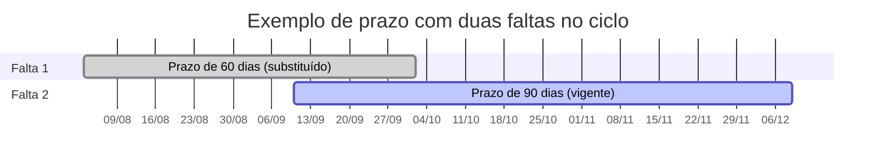
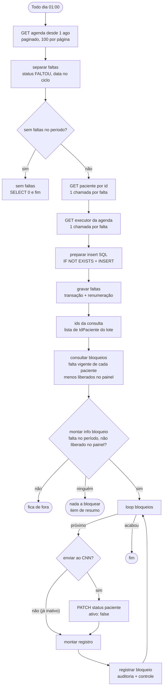

# Fluxo de bloqueio por falta

Voltar ao [índice](README.md). Arquivo: [workflows/bloqueioPacientesFaltas.json](../workflows/bloqueioPacientesFaltas.json). Código dos nós: `workflows/code/bloqueio-*.js`, com a regra em [`_regra.js`](../workflows/code/_regra.js).

## Para que serve

Acha os agendamentos com status `FALTOU` no ciclo, grava cada falta nova em `dbo.CtlCnnFaltaPaciente` e bloqueia no CNN (`{ "ativo": false }`) **todo paciente com falta no período que esteja ativo**. O prazo 60/90/180 não entra nessa decisão. Cada PATCH vira uma linha na auditoria (`dbo.CtlCnnAcaoPaciente`, `Origem = AUTOMATICO`) e atualiza a tabela de controle.

Não libera ninguém. A liberação é manual, pelo painel ([fluxos/acoes.md](fluxos/acoes.md)). Quem foi liberado pelo painel **não é bloqueado de novo pela mesma falta vigente**; uma falta nova bloqueia normalmente.

O botão **Bloquear** do painel reutiliza o código deste fluxo (`separar faltas`, `preparar insert SQL`) para um paciente só.

## Quando roda

- Todo dia à 01:00, pelo nó `Todo dia 01:00` (cron `0 1 * * *`).
- Não há gatilho manual no workflow. Para testar, execute pelo editor do n8n.
- O horário do cron segue o fuso do n8n, que precisa ser `America/Sao_Paulo`.

## Regra

- **Bloqueia todo paciente com falta no período** (de 1/8 do ciclo até hoje) que esteja **ativo** no CNN, com o prazo de liberação vencido ou não.
- O prazo abaixo **não decide o bloqueio**. Ele diz a partir de quando o paciente pode ser **liberado** pelo painel, e é gravado no controle (`DataFimBloqueio`).

| `NumeroFalta` vigente | Pode ser liberado após |
|---|---|
| 1 | 60 dias |
| 2 | 90 dias |
| 3 ou mais | 180 dias |

- Falta vigente = a linha com `MAX(NumeroFalta)` do paciente desde 1/8 do ciclo.
- Início do prazo = `DataFalta` dessa linha. Fim = início + dias.
- Não bloqueia quem está `LIBERADO` na tabela de controle com `IdAgendaReferencia` igual à falta vigente (liberado ou isento pelo painel).
- Quem **já está inativo** no CNN não recebe PATCH. Se ainda não há bloqueio registrado para a falta vigente, o paciente entra no laço só para **registrar** (`apenasRegistrar`). O controle passa a espelhar o CNN, e o painel tira o paciente de "Aguardando bloqueio".
- Ciclo: de agosto a dezembro, 1/8 do ano corrente. De janeiro a julho, 1/8 do ano anterior.

Exemplo: 1ª falta em 2026-08-03 → bloqueado na execução seguinte e liberável a partir de 2026-10-02. Se a 2ª falta vier em 2026-09-10, a vigente passa a ser a 2ª e o paciente só pode ser liberado a partir de 2026-12-09 (90 dias a partir de 2026-09-10). Se ele ainda estiver ativo em 10/10 com essa falta (por exemplo, porque o fluxo não rodou), é bloqueado mesmo assim.

## Fluxograma

## Passo a passo

| # | Nó | Tipo | O que faz |
|---|---|---|---|
| 1 | `Todo dia 01:00` | Schedule Trigger | Dispara com o cron `0 1 * * *` |
| 2 | `GET agenda desde 1 ago` | HTTP Request | `GET /agenda/lista` de 1/8 do ciclo até hoje, `dataPor=AGENDAMENTO`, 100 por página. Roda uma vez (`executeOnce`). Para quando `lista` volta vazia ou após 100 requisições |
| 3 | [`separar faltas`](../workflows/code/bloqueio-separar-faltas.js) | Code | Fica com `status === 'FALTOU'`, com `id` e `idPaciente`, e `data` entre 1/8 e hoje. Ordena por data e `id`. Sem nenhuma, devolve um item `{ semFaltas: true }` |
| 4 | `sem faltas no periodo?` | If | `semFaltas = true` vai para o nó `sem faltas`. O resto segue |
| 5 | `sem faltas` | Microsoft SQL | `SELECT CAST(0 AS int) AS quantidadeFaltas`. Só fecha o ramo |
| 6 | `GET paciente por id` | HTTP Request | `GET /paciente/{idPaciente}` para cada falta, uma de cada vez |
| 7 | `GET executor da agenda` | HTTP Request | `GET /executor-agenda/{idPessoaExecutor}` para cada falta. É o profissional do horário |
| 8 | [`preparar insert SQL`](../workflows/code/bloqueio-preparar-insert.js) | Code | Junta falta, paciente e executor pela posição do item. Monta um `IF NOT EXISTS (… IdAgenda …) INSERT` por falta |
| 9 | `gravar faltas` | Microsoft SQL | Executa o lote montado em `preparar insert SQL` (`={{ $json.query }}`): inserts numa transação (`SET XACT_ABORT ON`) e renumeração de `NumeroFalta` dos pacientes do lote |
| 10 | [`ids da consulta`](../workflows/code/bloqueio-ids-consulta.js) | Code | Monta a consulta de `consultar bloqueios` com a lista de pacientes do lote. Se `preparar insert SQL` não rodou, não devolve nada |
| 11 | `consultar bloqueios` | Microsoft SQL | Devolve a linha vigente (`MAX(NumeroFalta)` no ciclo) de cada paciente do lote, **menos** quem está `LIBERADO` no controle com essa mesma falta |
| 12 | [`montar info bloqueio`](../workflows/code/bloqueio-montar-info.js) | Code | Emite um item por paciente com falta no período (sem olhar o prazo; calcula a data a partir da qual pode liberar). Quem o GET trouxe `ativo: false` sai com `apenasRegistrar: true`, ou fica de fora se o controle já tem o bloqueio dessa falta |
| 12a | `há o que bloquear?` | If | Sem ninguém para bloquear, `montar info bloqueio` devolve um item `{ nadaABloquear: true }` com o resumo (analisados, prazo vencido, já registrados). Esse item vai para o nó final `nada a bloquear`, e a execução termina mostrando o motivo |
| 13 | `loop bloqueios` | Split in Batches | Passa os itens um por vez |
| 13a | `enviar ao CNN?` | If | `apenasRegistrar` = true vai direto para `montar registro`, sem PATCH |
| 14 | `PATCH status paciente` | HTTP Request | `PATCH /paciente/{id}/status` com `={{ { ativo: false } }}`. 1 por vez, 3000 ms entre chamadas. Resposta completa (`fullResponse`, `neverError`) para guardar o status HTTP; timeout de 15 s |
| 15 | [`montar registro`](../workflows/code/bloqueio-montar-registro.js) | Code | Junta o paciente do laço (`$('loop bloqueios')`) e a resposta do PATCH. Monta o SQL de auditoria e controle (`sqlRegistrarAcao` de [`_sql.js`](../workflows/code/_sql.js)) |
| 16 | `registrar bloqueio` | Microsoft SQL | Numa transação: `INSERT` em `CtlCnnAcaoPaciente` (`Origem = AUTOMATICO`, `Usuario = n8n`, sucesso ou falha) e, se o PATCH deu certo, `MERGE` em `CtlCnnControlePaciente` (`BLOQUEADO`). Volta para o `loop bloqueios` |

### Como o `INSERT` é montado

`preparar insert SQL` usa quatro funções de conversão, de [`_sql.js`](../workflows/code/_sql.js):

| Função | Faz | Valor vazio ou inválido |
|---|---|---|
| `sqlN` | Número inteiro (`Math.trunc`) | `NULL` |
| `sqlS(valor, max)` | Texto `N'…'`, corta em `max` caracteres, dobra aspas simples | `NULL` |
| `sqlDate` | `CONVERT(date, 'yyyy-MM-dd', 23)` | `NULL` se não casar com `^\d{4}-\d{2}-\d{2}$` |
| `sqlTime` | `CONVERT(time(0), 'HH:mm:ss')`. Aceita `HH:mm` e completa `:00` | `NULL` |

De onde vem cada coluna gravada:

| Coluna | Origem |
|---|---|
| `IdAgenda` | `id` do agendamento |
| `IdPaciente` | `idPaciente` do agendamento |
| `NomePaciente` | `nome` do `GET /paciente` (200) |
| `CpfCnpj` | `cpfcnpj` do `GET /paciente` (20) |
| `EmailPaciente` | `contato.email` do paciente; senão `emailPaciente` do agendamento (200) |
| `TelefonePaciente` | `contato.telefoneCelular` do paciente; senão `telefoneCelularPaciente` do agendamento (30) |
| `DataFalta` | `dataFalta` (10 primeiros caracteres de `data`) |
| `HoraInicio`, `HoraFim` | `horaInicio`, `horaFim` do agendamento |
| `StatusAgenda` | `status` do agendamento (50) |
| `IdPessoaExecutor` | `idPessoaExecutor` do agendamento |
| `IdExecutorAgenda`, `NomeExecutor`, `TipoExecutor` | `id`, `nome` (200), `tipoExecutor` (50) do `GET /executor-agenda` |
| `IdLocalAgenda`, `IdTipoConsulta` | Do agendamento |
| `Observacoes` | `observacoes` do agendamento (500) |
| `NumeroFalta` | `COUNT` das faltas do paciente no ciclo + 1 |
| `DataColeta` | Não é enviada. Default `SYSUTCDATETIME()` da tabela |

Os números entre parênteses são o corte feito por `sqlS`. Se o GET do paciente ou do executor falhar, as colunas que dependem dele ficam `NULL`.

### Renumeração

Depois dos inserts, `gravar faltas` recalcula `NumeroFalta` com `ROW_NUMBER() OVER (PARTITION BY IdPaciente ORDER BY DataFalta, IdAgenda)`. Só para os pacientes do lote e só para `DataFalta >= 1/8 do ciclo`. Só atualiza linhas cujo número mudou.

Isso corrige a ordem quando uma falta mais antiga chega depois de uma mais nova.

## Entradas e saídas

| | O quê |
|---|---|
| Entrada | Agenda do ciclo (`GET /agenda/lista`) |
| Entrada | Ficha de cada paciente com falta (`GET /paciente/{id}`) |
| Entrada | Executor de cada agendamento (`GET /executor-agenda/{id}`) |
| Entrada | Linhas já gravadas em `dbo.CtlCnnFaltaPaciente` |
| Saída | Linhas novas em `dbo.CtlCnnFaltaPaciente` e `NumeroFalta` renumerado |
| Saída | `PATCH /paciente/{id}/status` com `{ "ativo": false }` |
| Saída | Uma linha por PATCH em `dbo.CtlCnnAcaoPaciente` e a situação `BLOQUEADO` em `dbo.CtlCnnControlePaciente` |
| Saída | Itens da execução no n8n com `acao: 'BLOQUEAR'`, `dataFimBloqueio` e `mensagem` |

## Limites conhecidos

- **Relê o ciclo inteiro todo dia.** A agenda vem desde 1/8, então o volume cresce até julho. Máximo de 100 requisições × 100 registros = 10.000 agendamentos de qualquer status. O que passar disso é ignorado sem aviso.
- **Chama o CNN por falta, não por paciente.** `GET paciente por id` e `GET executor da agenda` rodam para cada falta do ciclo, inclusive as já gravadas.
- **Rebloqueia todo dia.** Se alguém reativar um paciente ainda no prazo **direto no CNN**, ele volta a ser bloqueado à 01:00 do dia seguinte. Pelo painel isso não acontece: a liberação fica no controle e é respeitada.
- **Auditoria depois do PATCH.** Se `registrar bloqueio` falhar, o paciente fica bloqueado no CNN sem linha na auditoria. O erro aparece na saída do nó, na execução do n8n.
- **Falta desfeita continua contando.** Se o status mudar de `FALTOU` para outro no CNN, a linha não é apagada e segue na contagem.
- **Nome e contato são fotografia.** São gravados no insert e não são atualizados depois. Se o GET do paciente ou do executor falhou naquele dia, as colunas ficam `NULL` para sempre.
- **Erros não param o fluxo.** Todos os nós HTTP e SQL usam `onError: continueRegularOutput`. Ver [arquitetura.md](arquitetura.md#tratamento-de-erro).
- **Pareamento por posição.** `preparar insert SQL` junta falta, paciente e executor pelo índice do item. Depende de cada GET devolver exatamente um item por entrada, o que o `continueRegularOutput` garante.
- **Paciente sem `ativo` conhecido é bloqueado.** Se o GET do paciente falhou, ele não entra no mapa de `ativo` e o PATCH é enviado mesmo assim.
- **Formato de data.** O código assume que `data` do agendamento começa com `yyyy-MM-dd`.

## Configuração

| Item | Valor | Nó |
|---|---|---|
| Cron | `0 1 * * *` | `Todo dia 01:00` |
| Página | `registrosPorPagina=100`, `pagina` = `$pageCount` | `GET agenda desde 1 ago` |
| Fim da paginação | `lista` vazia | `GET agenda desde 1 ago` |
| Máximo de requisições | `maxRequests: 100` | `GET agenda desde 1 ago` |
| Intervalo entre páginas | `requestInterval: 200` ms | `GET agenda desde 1 ago` |
| Lote dos GETs | `batchSize: 1` | `GET paciente por id`, `GET executor da agenda` |
| Lote do PATCH | `batchSize: 1`, `batchInterval: 3000` ms | `PATCH status paciente` |
| Corpo do PATCH | `={{ { ativo: false } }}` | `PATCH status paciente` |
| Prazos e ciclo | `REGRA` em [`_regra.js`](../workflows/code/_regra.js) | Nós Code (via `npm run inject`) e URL de `GET agenda desde 1 ago` (1/8 escrito na expressão) |
| Credenciais | `API CNN AUTH`, `TST Araguari` | Nós HTTP e SQL |

O corpo do PATCH precisa ser uma expressão inteira. Colocar `{{ }}` no meio de um JSON estático quebra o envio.

O código dos nós Code não se edita no n8n: edite `workflows/code/*.js`, rode `npm run inject` e `npm run check` e cole o JSON. Ver [operacao.md](operacao.md#como-publicar-cada-tipo-de-mudança).
