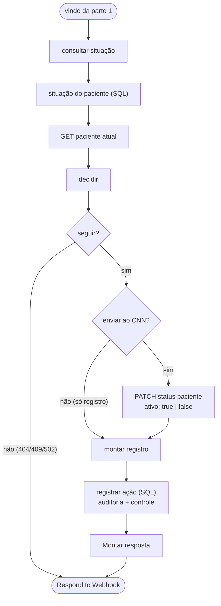

# Workflow CNN Painel - Ações

Voltar ao [índice](../README.md). Arquivo: [workflows/cnn-painel-acoes.json](../../workflows/cnn-painel-acoes.json). Código: `workflows/code/acoes-*.js` e, no bloquear, os mesmos `bloqueio-*.js` do bloqueio das 01:00.

## Para que serve

Executa as duas ações do painel sobre **um** paciente:

- **liberar:** `{ "ativo": true }` no CNN. Pode ser antes do fim do prazo.
- **bloquear:** o fluxo de bloqueio só para esse paciente: busca a agenda dele, grava as faltas novas, acha a falta vigente e manda `{ "ativo": false }`.

Antes do PATCH confere banco e CNN; depois grava a auditoria **sempre** e a tabela de controle **só se o CNN aceitou**.

## Quando roda

`POST /api/pacientes/:id/liberar` e `/bloquear` na Vercel → webhook POST com `{ action, id, motivo, usuario }` e Header Auth (`X-Monitor-Key`).

**Settings:** salvar **todas** as execuções (sucesso e erro). Cada ação fica registrada também no n8n; o número da execução vai para a auditoria (`IdExecucaoN8n`).

## Fluxograma

O fluxo tem duas partes: primeiro valida o pedido e, no bloqueio, grava as faltas novas do paciente; depois confere a situação, fala com o CNN e registra a ação.

### Parte 1: receber o pedido e atualizar as faltas

### Parte 2: decidir, falar com o CNN e registrar

## Regras do nó `decidir`

| Situação | Liberar | Bloquear |
|---|---|---|
| Paciente sem falta na tabela | 404 | 404 |
| Falta vigente fora do ciclo atual | segue (libera bloqueio que atravessou a virada) | 404 |
| Prazo de liberação vencido | segue | segue (o prazo não impede o bloqueio) |
| GET no CNN deu 404 | 404 | 404 |
| GET no CNN falhou | 502 | 502 |
| CNN já `ativo: true`, com bloqueio registrado para a falta vigente (ou prazo vencido) | 409 `JA_ATIVO`: alguém liberou na plataforma (ou só registro, ver abaixo) | segue |
| CNN já `ativo: true`, **sem** bloqueio registrado para a falta vigente do ciclo | 409 `NAO_BLOQUEADO`: ainda não foi bloqueado; o painel oferece **isentar a falta** | segue |
| CNN já `ativo: false` | segue | 409 `JA_BLOQUEADO` (ou só registro) |

O 409 evita PATCH repetido (duplo clique, duas pessoas ao mesmo tempo) e não grava auditoria, porque nada mudou.

### CNN já no estado pedido: só registrar

Acontece quando alguém liberou ou bloqueou o paciente **direto na plataforma do CNN**: o banco diz uma coisa e o CNN outra. Exemplo: o painel mostra "Bloqueado", mas o CNN já está `ativo: true`.

1. A primeira chamada responde 409 com `codigo: "JA_ATIVO"`, `"NAO_BLOQUEADO"` ou `"JA_BLOQUEADO"`. `NAO_BLOQUEADO` é o paciente que **nunca foi bloqueado** por essa falta. Ninguém o liberou, então o registro aqui é uma **isenção** da falta (`isencao: true`, texto "falta isenta no painel antes do bloqueio").
2. O painel pergunta se o usuário quer **registrar** a situação. O detalhe do paciente também mostra a divergência, com o botão "Registrar liberação feita no CNN".
3. A segunda chamada vai com `apenasRegistrar: true`. O nó `enviar ao CNN?` pula o PATCH e `montar registro` grava:
   - auditoria com `Sucesso = 1`, `HttpStatus = NULL` e `RespostaApi = "Sem PATCH: paciente já estava ativo no CNN; …"`;
   - controle com `LIBERADO` (ou `BLOQUEADO`) e `IdAgendaReferencia` = a falta vigente.
4. Resultado: no liberar, o bloqueio das 01:00 deixa de considerar essa falta e as anteriores. Só uma falta nova bloqueia de novo.

`apenasRegistrar` só vale se o CNN estiver mesmo no estado pedido. Se o paciente ainda estiver inativo, o liberar segue com o PATCH normal.

`antecipada = true` quando é liberação com o prazo ainda correndo.

## Depois do PATCH

| PATCH | Auditoria (`CtlCnnAcaoPaciente`) | Controle (`CtlCnnControlePaciente`) | Resposta |
|---|---|---|---|
| 2xx | `Sucesso = 1`, `HttpStatus` | `MERGE`: `LIBERADO`/`BLOQUEADO`, `IdAgendaReferencia` = falta vigente, quem, motivo | 200 `{ ok, acao, antecipada, dataFimBloqueio, mensagem, idAcao }` |
| erro | `Sucesso = 0`, `HttpStatus`, `RespostaApi` | não muda | 502 "A API do CNN recusou (HTTP …): …" |

Os dois comandos SQL rodam numa transação (`SET XACT_ABORT ON`). Se a gravação falhar depois de um PATCH que deu certo, a resposta continua 200, com `avisoAuditoria` (o painel mostra o aviso em vermelho). O CNN já foi alterado; corrija a auditoria à mão a partir da execução no n8n.

## Liberação manual e o bloqueio das 01:00

O controle guarda `IdAgendaReferencia` = a falta vigente no momento da liberação. O bloqueio das 01:00 pula quem está `LIBERADO` com essa mesma falta vigente ([bloqueio.md](../bloqueio.md)). Quando entra uma falta nova, a vigente muda e o paciente volta a ser bloqueado normalmente.

## Limites e tempo

- HTTP com timeout de 15 s cada; agenda do paciente com até 20 páginas de 100.
- A Vercel espera até 55 s (`lib/n8n.js`) e a função tem `maxDuration` de 60 s. Se passar disso, o painel mostra "O n8n não respondeu a tempo. Confira o histórico antes de repetir a ação." A ação pode ter sido concluída.
- **A confirmar no primeiro teste:** que o parâmetro `codigoPaciente` do `GET /agenda/lista` filtra pelo `idPaciente`. Se a API ignorar o filtro, `separar faltas` ainda descarta as faltas de outros pacientes, mas a busca fica lenta (agenda inteira) e pode estourar o tempo.
