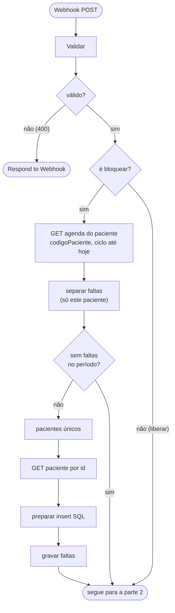

# Workflow CNN Painel - Ações

Voltar ao [índice](../README.md). Arquivo: [workflows/cnn-painel-acoes.json](../../workflows/cnn-painel-acoes.json). Código: `workflows/code/acoes-*.js` e, no bloquear, os mesmos `bloqueio-*.js` do bloqueio das 01:00.

## Para que serve

Executa as duas ações do painel sobre **um** paciente:

- **liberar:** `{ "ativo": true }` no CNN. Depois do prazo, direto. **Antes do prazo, só com uma [solicitação de desbloqueio](solicitacoes.md)** aprovada pelo administrador (`idSolicitacao`).
- **bloquear:** o fluxo de bloqueio só para esse paciente: busca a agenda dele, grava as faltas novas, acha a falta vigente e manda `{ "ativo": false }`.

Antes do PATCH confere banco e CNN; depois grava a auditoria **sempre** e a tabela de controle **só se o CNN aceitou**.

## Quando roda

Na Vercel, todas viram um webhook POST com Header Auth (`X-Monitor-Key`):

| Rota da Vercel | Corpo enviado ao n8n |
|---|---|
| `POST /api/pacientes/:id/liberar` e `/bloquear` | `{ action, id, motivo, usuario, apenasRegistrar? }` |
| `POST /api/solicitacoes/:id/liberar` | `{ action: "liberar", id, idSolicitacao, aprovar?, usuario }` (sem motivo: vale o da solicitação) |
| `POST /api/solicitacoes` com `aprovarELiberar` (atalho do admin) | o mesmo, com `aprovar: true`, logo depois de criar a solicitação |

**Settings:** salvar **todas** as execuções (sucesso e erro). Cada ação fica registrada também no n8n; o número da execução vai para a auditoria (`IdExecucaoN8n`).

## Fluxograma

O fluxo tem duas partes: primeiro valida o pedido e, no bloqueio, grava as faltas novas do paciente; depois confere a situação, fala com o CNN e registra a ação.

### Parte 1: receber o pedido e atualizar as faltas

### Parte 2: decidir, falar com o CNN e registrar

## Regras do nó `decidir`

| Situação | Liberar | Bloquear |
|---|---|---|
| Paciente sem falta na tabela | 404 | 404 |
| Falta vigente fora do ciclo atual | segue as regras abaixo (libera bloqueio que atravessou a virada) | 404 |
| GET no CNN deu 404 | 404 | 404 |
| GET no CNN falhou | 502 | 502 |
| Prazo **cumprido** | segue, sem solicitação ("Apto") | 409 `PRAZO_CUMPRIDO`: quem cumpriu o prazo não é bloqueado |
| Prazo **correndo**, sem `idSolicitacao` | 409 `SOLICITACAO_NECESSARIA` (vale também para o admin) | segue |
| Com `idSolicitacao`: solicitação não existe | 404 | — |
| Com `idSolicitacao`: de outro paciente, ou não está `APROVADA` (nem `PENDENTE` com `aprovar`) | 409 `SOLICITACAO_INVALIDA` | — |
| Com `idSolicitacao`: feita para uma falta que não é mais a vigente | 409 `SOLICITACAO_DESATUALIZADA` | — |
| CNN já `ativo: true`, prazo cumprido, com bloqueio registrado (ou falta de ciclo anterior) | 409 `JA_ATIVO`: alguém liberou na plataforma (ou só registro, ver abaixo) | segue |
| CNN já `ativo: true`, prazo cumprido, **sem** bloqueio registrado | 409 `NAO_BLOQUEADO` | segue |
| CNN já `ativo: true`, **com solicitação válida** | segue **sem PATCH**: isenção (ainda não bloqueado) ou liberação só registrada | — |
| CNN já `ativo: false` | segue | 409 `JA_BLOQUEADO` (ou só registro) |

A ordem das conferências é: falta, ciclo e prazo do bloquear, CNN (404/502), solicitação e, por último, o estado no CNN.

O 409 evita PATCH repetido (duplo clique, duas pessoas ao mesmo tempo) e não grava auditoria, porque nada mudou.

### CNN já no estado pedido: só registrar

Acontece quando alguém liberou ou bloqueou o paciente **direto na plataforma do CNN**: o banco diz uma coisa e o CNN outra. Exemplo: o painel mostra "Bloqueado", mas o CNN já está `ativo: true`.

1. A primeira chamada responde 409 com `codigo: "JA_ATIVO"`, `"NAO_BLOQUEADO"` ou `"JA_BLOQUEADO"` (no liberar, só depois do prazo; antes dele vale a solicitação). `NAO_BLOQUEADO` é o paciente que **nunca foi bloqueado** por essa falta.
2. O painel pergunta se o usuário quer **registrar** a situação. O detalhe do paciente também mostra a divergência, com o botão "Registrar liberação feita no CNN".
3. A segunda chamada vai com `apenasRegistrar: true`. O nó `enviar ao CNN?` pula o PATCH e `montar registro` grava:
   - auditoria com `Sucesso = 1`, `HttpStatus = NULL` e `RespostaApi = "Sem PATCH: paciente já estava ativo no CNN; …"`;
   - controle com `LIBERADO` (ou `BLOQUEADO`) e `IdAgendaReferencia` = a falta vigente.
4. Resultado: no liberar, o bloqueio das 01:00 deixa de considerar essa falta e as anteriores. Só uma falta nova bloqueia de novo.

`apenasRegistrar` só vale se o CNN estiver mesmo no estado pedido. Se o paciente ainda estiver inativo, o liberar segue com o PATCH normal.

`antecipada = true` quando é liberação com o prazo ainda correndo (sempre com solicitação).

### Liberação por solicitação

- **`consultar situação`:** com `idSolicitacao`, traz a solicitação (`Status`, paciente, falta, motivo, quem pediu) junto da falta vigente e do controle.
- **`decidir`:** confere a solicitação (tabela acima). Com o paciente ainda ativo no CNN e sem bloqueio registrado, a liberação é uma **isenção da falta** (`isencao: true`), sem PATCH e sem o 409 `NAO_BLOQUEADO`.
- **`montar registro`:** sem motivo próprio, a auditoria recebe "Solicitação #N (quem pediu): motivo". O `sqlRegistrarAcao` grava `IdSolicitacao` e, na mesma transação, marca a solicitação `LIBERADA` (`LiberadoPor`, `LiberadoEm`, `IdAcao`; no "Aprovar e liberar", também `DecididoPor`).
- **CNN recusou no "Aprovar e liberar":** a solicitação fica `APROVADA`, e a resposta 502 avisa que dá para tentar liberar de novo.

## Depois do PATCH

| PATCH | Auditoria (`CtlCnnAcaoPaciente`) | Controle (`CtlCnnControlePaciente`) | Resposta |
|---|---|---|---|
| 2xx | `Sucesso = 1`, `HttpStatus`, `IdSolicitacao` (se veio de uma) | `MERGE`: `LIBERADO`/`BLOQUEADO`, `IdAgendaReferencia` = falta vigente, quem, motivo | 200 `{ ok, acao, antecipada, idSolicitacao, dataFimBloqueio, mensagem, idAcao }` |
| erro | `Sucesso = 0`, `HttpStatus`, `RespostaApi` | não muda | 502 "A API do CNN recusou (HTTP …): …" |

Os comandos SQL rodam numa transação (`SET XACT_ABORT ON`). Com sucesso, a mesma transação também atualiza as solicitações: a usada fica `LIBERADA`; as outras abertas do paciente são `ENCERRADA` (numa liberação) ou, num bloqueio por falta nova, as de falta anterior. Se a gravação falhar depois de um PATCH que deu certo, a resposta continua 200, com `avisoAuditoria` (o painel mostra o aviso em vermelho). O CNN já foi alterado; corrija a auditoria à mão a partir da execução no n8n.

## Liberação pelo painel e o bloqueio das 01:00

O controle guarda `IdAgendaReferencia` = a falta vigente no momento da liberação. O bloqueio das 01:00 pula quem está `LIBERADO` com essa mesma falta vigente ([bloqueio.md](../bloqueio.md)). Quando entra uma falta nova, a vigente muda e o paciente volta a ser bloqueado normalmente.

## Limites e tempo

- HTTP com timeout de 15 s cada; agenda do paciente com até 20 páginas de 100.
- A Vercel espera até 55 s (`lib/n8n.js`) e a função tem `maxDuration` de 60 s. Se passar disso, o painel mostra "O n8n não respondeu a tempo. Confira o histórico antes de repetir a ação." A ação pode ter sido concluída.
- **A confirmar no primeiro teste:** que o parâmetro `codigoPaciente` do `GET /agenda/lista` filtra pelo `idPaciente`. Se a API ignorar o filtro, `separar faltas` ainda descarta as faltas de outros pacientes, mas a busca fica lenta (agenda inteira) e pode estourar o tempo.
