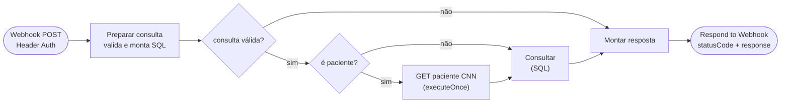

# Workflow CNN Painel - Leitura

Voltar ao [índice](../README.md). Arquivo: [workflows/cnn-painel-leitura.json](../../workflows/cnn-painel-leitura.json). Código: [leitura-preparar.js](../../workflows/code/leitura-preparar.js), [leitura-montar-resposta.js](../../workflows/code/leitura-montar-resposta.js).

## Para que serve

Atende todas as consultas do painel. Só lê: `SELECT` no banco e, no detalhe de um paciente, um `GET /paciente/{id}` no CNN para mostrar o status ao vivo. Nunca chama o PATCH.

## Quando roda

A cada chamada da Vercel em `GET /api/pacientes`, `/api/pacientes/:id`, `/api/faltas`, `/api/acoes` e `/api/parametros`. Webhook POST com credencial Header Auth (`X-Monitor-Key`).

**Settings:** Save successful production executions = **Do not save** (cada atualização da tela é uma execução). Erros são salvos.

## Fluxograma

O SQL recebe sempre **um** item (o do GET ou o do IF) e lê a consulta de `$('Preparar consulta')`. Cada `SELECT` leva a coluna `_secao`: o nó SQL junta os resultados num array só e `Montar resposta` separa por ela.

## Ações

| `action` | Parâmetros | Devolve |
|---|---|---|
| `pacientes` | — | `ciclo`, `resumo` (contagens por situação, faltas no ciclo e no mês, última coleta, controle carregado), `items` (uma linha por paciente, com `tipoConsulta`, `procedimentos`, `profissional` e `rotulo` da falta vigente) |
| `paciente` | `id` | `nome`, `cpf` mascarado, `cnn` (`ativo` ao vivo), `vigente` (falta, prazo, situação, tipo de consulta, procedimentos, profissional), `controle`, `faltas` (cada uma com tipo de consulta, procedimentos, profissional e rótulo), `acoes` (até 200) |
| `faltas` | `de`, `ate` (padrão: ciclo atual até hoje) | `total` (com `comProcedimento`), `porMes`, `porDiaSemana`, `porProfissional` (top 30), `porTipoConsulta` (top 30), `porProcedimento` (top 30), `porRotulo` (top 20), `porPeriodo` (manhã < 12h, tarde < 18h, noite), `reincidencia`, `reincidentes` (top 20), `linhas` (até 5.000, para o CSV) |
| `acoes` | `de`, `ate`, `acao`, `origem`, `resultado`, `usuario`, `paciente`, `page` | `contagem`, `items` (50 por página), `usuarios` (para o filtro) |
| `parametros` | — | `regra` (de `_regra.js`), `ciclo`, `status` (última coleta, último bloqueio automático, última ação no painel, linhas), `cadastros` (quantos nomes de cada tipo e quando foram atualizados) |

Nomes de profissional, tipo de consulta e rótulo vêm de `CtlCnnCadastro` (profissional pelo `IdPessoaExecutor`; sem cadastro, cai no `NomeExecutor` gravado). Procedimentos vêm de `CtlCnnFaltaProcedimento`, juntos numa string com `FOR XML PATH` (funciona em qualquer versão do SQL Server). Sem nome ainda, os relatórios mostram "Código …".

Ação desconhecida ou parâmetro inválido → 400. Falha no SQL → 502 com a mensagem. Paciente sem faltas nem controle → 404.

## Situação de cada paciente

Calculada em `Montar resposta` (`situacaoDe`):

1. Se a tabela de controle aponta para a falta vigente (`IdAgendaReferencia = IdAgenda`), vale a `Situacao` dela: `BLOQUEADO` + prazo correndo = `bloqueado`; + vencido = `apto`; `LIBERADO` + prazo correndo = `liberado_antecipado`; + vencido = `liberado`.
2. Senão, ninguém registrou o bloqueio dessa falta:
   - prazo correndo: `pendente` ("Aguardando bloqueio", situação `PENDENTE`), e a execução das 01:00 bloqueia;
   - prazo cumprido: `liberado` (situação `CUMPRIDO`), porque o bloqueio não bloqueia mais quem cumpriu o prazo.

Cada item traz também `solicitacao` (a solicitação de desbloqueio aberta, com `id`, `status`, `solicitadoPor`, `em` e `valida`, que diz se ela é da falta vigente), e o resumo traz `solicitacoesPendentes` e `solicitacoesAprovadas` (o contador do menu). O detalhe (`paciente`) traz a seção `solicitacoes` com o histórico do paciente, e as ações trazem `idSolicitacao`.

O resumo traz `pendentes` além de `bloqueados`, `aptos`, `liberadosAntecipados` e `liberados`.

Quem entra na lista: todo paciente com falta no ciclo, mais quem está `BLOQUEADO` no controle por falta de ciclo anterior.

## Dados sensíveis

`CpfCnpj` sai mascarado (`***.456.789-**`). E-mail e telefone não são consultados. Nada de dados de paciente nos logs.
