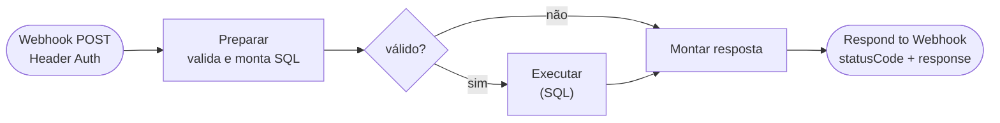
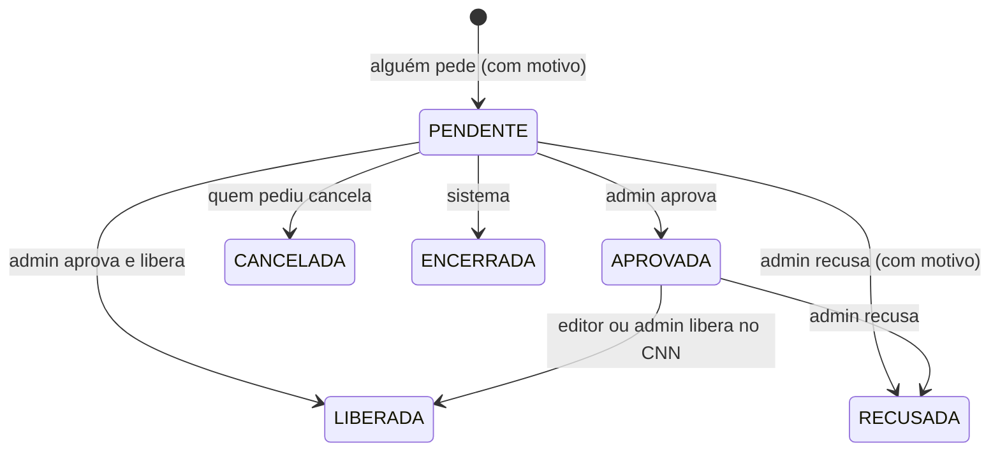

# Workflow CNN Painel - Solicitações

Voltar ao [índice](../README.md). Arquivo: [workflows/cnn-painel-solicitacoes.json](../../workflows/cnn-painel-solicitacoes.json). Código: [solicitacoes-preparar.js](../../workflows/code/solicitacoes-preparar.js), [solicitacoes-montar-resposta.js](../../workflows/code/solicitacoes-montar-resposta.js). Tabela: [sql/criar_tabelas_solicitacoes.sql](../../sql/criar_tabelas_solicitacoes.sql).

## Para que serve

Guarda os **pedidos de desbloqueio** de pacientes (`dbo.CtlCnnSolicitacao`). Antes, o pedido ia por e-mail ao administrador e o controle ficava fora da plataforma. Agora fica tudo no painel:

1. **Qualquer usuário** (inclusive Leitor) abre uma solicitação, com o motivo. Normalmente é a recepção ou a secretaria, depois que o paciente liga e justifica a falta.
2. **Só o administrador** aprova ou recusa.
3. **Editor ou administrador** libera no CNN uma solicitação aprovada. O admin também pode **aprovar e liberar** de uma vez.
4. Todos veem a lista: paciente, quem pediu, quando, motivo, decisão e quem liberou.

A solicitação só existe para quem **ainda está no prazo** (bloqueado, ou aguardando bloqueio). Quem cumpriu o prazo é liberado pela [liberação automática das 02:00](../liberacao.md), sem pedido.

Este workflow **não fala com o CNN**. A liberação de uma solicitação passa pelo [workflow Ações](acoes.md), que confere a solicitação, faz o PATCH e fecha a solicitação na mesma transação da auditoria.

## Quando roda

| Chamada da Vercel | `action` | Perfil |
|---|---|---|
| `GET /api/solicitacoes` (tela Solicitações e contador do menu) | `listar` | Todos |
| `POST /api/solicitacoes { idPaciente, motivo }` | `criar` | Todos |
| `PATCH /api/solicitacoes/:id { acao: "aprovar" }` | `aprovar` | Admin |
| `PATCH /api/solicitacoes/:id { acao: "recusar", motivo }` | `recusar` | Admin |
| `PATCH /api/solicitacoes/:id { acao: "cancelar", motivo? }` | `cancelar` | Quem abriu, ou Admin |

As outras duas rotas da Vercel chamam o **Ações**, não este workflow:

- `POST /api/solicitacoes/:id/liberar { idPaciente, aprovar? }`: Editor ou Admin; `aprovar: true` só para o Admin.
- `POST /api/solicitacoes { ..., aprovarELiberar: true }`: o atalho do Admin, que primeiro chama `criar` aqui e depois o Ações.

Webhook POST com a mesma credencial Header Auth (`X-Monitor-Key`) dos outros workflows. Variável na Vercel: `N8N_SOLICITACOES_URL`.

**Settings:** Save successful production executions = **Do not save** (a lista tem nomes de pacientes). Erros são salvos. Error workflow: o Error Handler do monitoramento.

## Fluxograma

## Situações da solicitação

Uma solicitação **aprovada** (ainda não liberada) também pode ser cancelada por quem pediu, ou encerrada pelo sistema, como a pendente.

| Situação | Na tela | Quem muda |
|---|---|---|
| `PENDENTE` | Aguardando aprovação | Aberta por qualquer usuário |
| `APROVADA` | Aprovada · falta liberar | Admin (Aprovar) |
| `LIBERADA` | Liberada | Editor ou admin (Liberar), ou admin (Aprovar e liberar). Aponta para a ação da auditoria (`IdAcao`) |
| `RECUSADA` | Recusada | Admin, com motivo obrigatório |
| `CANCELADA` | Cancelada | Quem abriu (ou admin), motivo opcional |
| `ENCERRADA` | Encerrada | O sistema, quando a solicitação perde o sentido (veja abaixo) |

**Encerramento pelo sistema** (feito pelo `sqlRegistrarAcao`, na mesma transação da auditoria, ou pelo próprio `aprovar`):

- **Liberação automática** do paciente (prazo cumprido): "Prazo cumprido: paciente liberado pela rotina automática."
- **Liberação por outro caminho** (Apto liberado direto pelo painel): "Paciente liberado por <usuário>."
- **Bloqueio por uma falta nova:** "Nova falta registrada: a solicitação era da falta anterior."
- **Aprovar** uma solicitação cuja falta não é mais a vigente, ou cujo prazo acabou: encerra e responde 409.

## Ações

| `action` | Parâmetros | Faz | Devolve |
|---|---|---|---|
| `listar` | — | Todas as abertas e as 300 fechadas mais recentes, com a falta vigente de agora e o controle do paciente | `itens` (com `desatualizada`, `prazoCumprido`, `bloqueado`), `contagem` por situação, `hoje` |
| `criar` | `idPaciente`, `motivo` (5 a 500), `usuario` | Confere a falta vigente, o prazo, o controle e se já há uma aberta; grava `PENDENTE` com a falta vigente (`IdAgendaReferencia`, número, data, fim do prazo) | 201 `{ id, idPaciente, status }`. Recusa: 404 `SEM_FALTA`; 409 `PRAZO_CUMPRIDO`, `JA_LIBERADO`, `JA_EXISTE` (com o número da aberta na mensagem) |
| `aprovar` | `id`, `usuario` | `PENDENTE` → `APROVADA`, se a falta ainda é a vigente e o prazo corre | `ok`; 404 `NAO_ENCONTRADA`; 409 `STATUS_INVALIDO`, `DESATUALIZADA`, `PRAZO_CUMPRIDO` (estas duas encerram a solicitação) |
| `recusar` | `id`, `motivo` (5 a 500), `usuario` | Aberta → `RECUSADA`, com o motivo | `ok`; 404; 409 `STATUS_INVALIDO` |
| `cancelar` | `id`, `motivo?`, `usuario`, `admin` | Aberta → `CANCELADA`, se quem pede é quem abriu ou um admin | `ok`; 403 `NAO_PERMITIDO`; 404; 409 `STATUS_INVALIDO` |

Escritas rodam em transação (`XACT_ABORT`) e leem a solicitação com `UPDLOCK, HOLDLOCK`: dois cliques ao mesmo tempo não aprovam nem recusam duas vezes. O índice único filtrado `UX_CtlCnnSolicitacao_Aberta` garante **uma solicitação aberta por paciente** mesmo que o webhook seja chamado direto.

## Quem pode receber solicitação

O `criar` aceita o paciente quando todas as condições abaixo valem (as mesmas que a tela usa para mostrar o botão **Solicitar desbloqueio**):

1. Tem falta vigente: a de maior número no ciclo, ou, sem falta no ciclo, a mais recente de antes dele.
2. A falta é do ciclo atual, **ou** é de um ciclo anterior com bloqueio registrado para ela (bloqueio que atravessou a virada de 1º de outubro).
3. O prazo dessa falta **ainda corre** (fim do prazo ≥ hoje).
4. O paciente **não foi liberado** no painel para essa falta.
5. Não há outra solicitação aberta para ele.

## Liberar a partir da solicitação (workflow Ações)

A Vercel chama o Ações com `{ action: "liberar", id, idSolicitacao, aprovar?, usuario }`. Lá:

- **`consultar situação`:** traz a solicitação junto da falta vigente e do controle.
- **`decidir`:** antes do fim do prazo, liberar exige a solicitação deste paciente e desta falta, e ela precisa estar `APROVADA`, ou `PENDENTE` com `aprovar`. Os códigos de recusa são:
  - `SOLICITACAO_NECESSARIA`: sem solicitação;
  - `SOLICITACAO_INVALIDA`: outro paciente ou situação errada;
  - `SOLICITACAO_DESATUALIZADA`: falta nova depois do pedido.

  Com uma solicitação válida e o paciente ainda ativo no CNN (aguardando bloqueio), a liberação vira **isenção da falta**: registra sem PATCH.
- **`montar registro`:** o motivo da auditoria passa a ser "Solicitação #N (quem pediu): motivo". O `sqlRegistrarAcao` grava `IdSolicitacao` na auditoria e marca a solicitação `LIBERADA` (com quem liberou e, no "Aprovar e liberar", quem aprovou). Se o CNN recusar no "Aprovar e liberar", a solicitação fica `APROVADA` e dá para tentar liberar de novo.

Detalhes em [acoes.md](acoes.md).

## Na tela

- **Menu:** item **Solicitações** com o número de pendentes. Para o admin, que aprova, o número fica em destaque.
- **Tela Solicitações:**
  - **Resumo e lista:** indicadores (aguardando, aprovadas, liberadas, recusadas e canceladas), filtro por situação, busca e "só as minhas".
  - **Botões por perfil:**
    - Admin: Aprovar, Aprovar e liberar, Recusar;
    - Editor e Admin: Liberar no CNN, nas aprovadas;
    - quem abriu: Cancelar.
  - **Nova solicitação:** a busca de paciente mostra só quem pode receber solicitação.
- **Tela Pacientes:**
  - **Sem solicitação aberta, no prazo:** **Solicitar desbloqueio** para todos; para o admin, **Liberar** (o atalho, que abre, aprova e libera num passo, tudo registrado).
  - **Com solicitação aberta:** um selo (Solicitado ou Aprovado) que leva à tela Solicitações. Com a aprovada, Editor e Admin veem **Liberar**.
  - **No detalhe:** a seção **Solicitações de desbloqueio**, com o histórico do paciente.

Mais sobre as telas em [front-end.md](../front-end.md).
