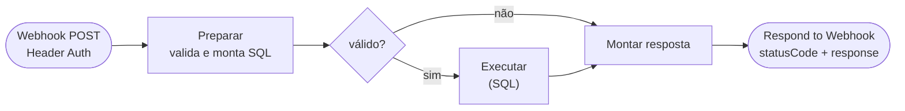

# Workflow CNN Painel - Usuários

Voltar ao [índice](../README.md). Arquivo: [workflows/cnn-painel-usuarios.json](../../workflows/cnn-painel-usuarios.json). Código: [usuarios-preparar.js](../../workflows/code/usuarios-preparar.js), [usuarios-montar-resposta.js](../../workflows/code/usuarios-montar-resposta.js). Tabelas: [sql/criar_tabelas_usuarios.sql](../../sql/criar_tabelas_usuarios.sql).

## Para que serve

Guarda e lê os usuários do painel no SQL Server (`dbo.CtlCnnUsuario`) e registra os eventos de usuário (`dbo.CtlCnnUsuarioEvento`). Não fala com o CNN.

A senha em texto **nunca chega ao n8n**. A Vercel calcula salt e hash (scrypt, o mesmo `hashPassword` de [lib/auth.js](../../lib/auth.js)) e manda só os dois. No login, o n8n devolve salt e hash e a Vercel confere.

## Quando roda

| Chamada da Vercel | `action` |
|---|---|
| Login (`POST /api/sessao`) | `login-buscar`, depois `login-resultado` |
| Troca da própria senha (`POST /api/senha`) | `login-buscar`, `trocar-senha` |
| Antes de cada escrita: liberar, bloquear, solicitações (abrir, aprovar, recusar, cancelar), criar ou alterar usuário | `sessao` |
| Tela Usuários (`/api/usuarios`, `/api/usuarios/:login`) | `listar`, `criar`, `alterar`, `redefinir-senha` |

Webhook POST com a mesma credencial Header Auth (`X-Monitor-Key`) dos outros workflows.

**Settings:** Save successful production executions = **Do not save**. O login devolve o hash da senha, que não deve ficar guardado nas execuções; o rastro fica em `CtlCnnUsuarioEvento`. Erros são salvos.

## Fluxograma

## Ações

| `action` | Parâmetros | Faz | Devolve |
|---|---|---|---|
| `login-buscar` | `login` | Lê o usuário | `usuario` com perfil, ativo, salt, hash, `trocarSenha`, `versaoSessao`, `bloqueado`/`bloqueadoAte` (ou `null`) |
| `login-resultado` | `login`, `sucesso` | Certo: zera as tentativas e grava `UltimoAcessoEm`. Errado: soma uma tentativa; na 5ª, bloqueia por 15 minutos e recomeça a contagem. Grava `LOGIN_FALHA` ou `LOGIN_BLOQUEADO` | `bloqueadoAte` quando acabou de bloquear |
| `sessao` | `login` | Lê ativo, perfil e `VersaoSessao` | `usuario` (ou `null`) |
| `listar` | — | Usuários (sem salt e hash) e os últimos 100 eventos | `usuarios`, `eventos` |
| `criar` | `login`, `nome`, `perfil`, `salt`, `hash`, `por` | Cria com `TrocarSenha = 1`. Evento `CRIADO` | `ok`, ou 409 `LOGIN_EXISTE` |
| `alterar` | `login`, `nome?`, `perfil?`, `ativo?`, `por` | Muda o que veio. Mudar perfil ou ativo sobe `VersaoSessao`. Eventos `NOME_ALTERADO`, `PERFIL_ALTERADO`, `DESATIVADO`, `REATIVADO` | `ok`; 404 `NAO_ENCONTRADO`; 409 `ULTIMO_ADMIN` |
| `redefinir-senha` | `login`, `salt`, `hash`, `por` | Senha temporária nova, `TrocarSenha = 1`, sobe a versão, desbloqueia. Evento `SENHA_REDEFINIDA` | `ok` |
| `trocar-senha` | `login`, `salt`, `hash` | A própria senha: `TrocarSenha = 0`, sobe a versão. Evento `SENHA_TROCADA` | `ok`, `versaoSessao` |

Escritas rodam em transação (`XACT_ABORT`) e devolvem uma linha `Resultado`. A guarda do último admin fica no SQL: ninguém consegue rebaixar ou desativar o único `ADMIN` ativo, nem chamando o webhook direto.

## Unidades do usuário

- `login-buscar` e `sessao` devolvem `unidades: [{ id, codigo, nome }]`. O Admin recebe **todas as ativas**; Leitor e Editor, as de `dbo.CtlCnnUsuarioUnidade`.
- `listar` devolve as unidades de cada pessoa (`unidades: [ids]`) e o catálogo (`unidades` na raiz), para a tela marcar.
- `criar` exige ao menos uma unidade para Leitor e Editor (`unidades: [ids]`); o Admin não precisa.
- `alterar` aceita `unidades` (troca todas). Se mudou, grava o evento `UNIDADES_ALTERADAS` e sobe a `VersaoSessao`. Quem não é Admin não pode ficar sem unidade (`SEM_UNIDADE`, 409); unidade inexistente ou desativada responde `UNIDADE_INVALIDA` (400).
- Login de Leitor ou Editor sem nenhuma unidade é recusado pela Vercel (403 `SEM_UNIDADE`).

## Sessão e `VersaoSessao`

- O login devolve um token assinado pela Vercel (`SESSION_SECRET`), com login, perfil e a `VersaoSessao` do momento. Ele vale por 8 horas.
- **Leituras** confiam no token até ele expirar.
- **Escritas** (liberar, bloquear, usuários) chamam `sessao` antes. Se o usuário foi desativado, mudou de perfil ou teve a senha trocada ou redefinida (a versão não bate), a resposta é 401 e a pessoa entra de novo. Assim desativar alguém vale **na hora** para as ações.

## Perfis

| Perfil | Pode |
|---|---|
| `LEITOR` | Ver pacientes, solicitações, relatórios, histórico e configuração; abrir solicitações de desbloqueio |
| `EDITOR` | Tudo do leitor, mais bloquear, registrar, liberar quem cumpriu o prazo e liberar solicitações aprovadas |
| `ADMIN` | Tudo do editor, mais aprovar e recusar solicitações e a tela Usuários |

A permissão é conferida na API (403 `SEM_PERMISSAO`). A tela só esconde os botões.
