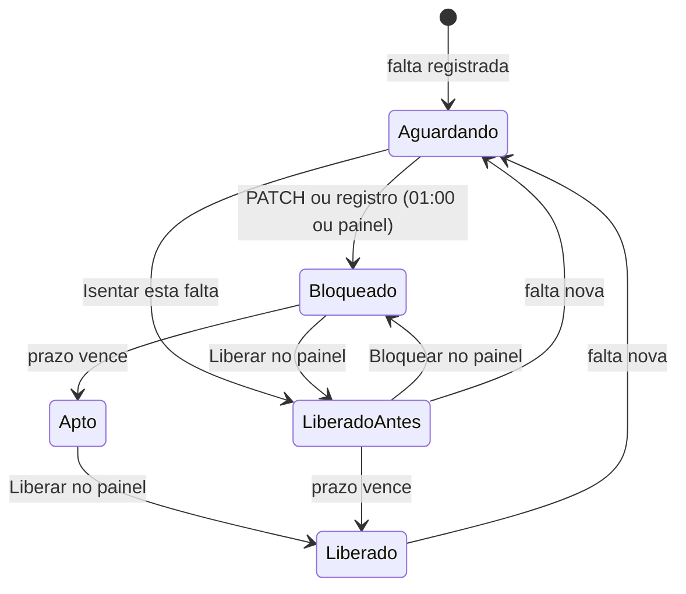

# Interface (painel)

Voltar ao [índice](README.md).

O painel é HTML estático com módulos JS, publicado na Vercel. Ele só fala com `/api/*`. Não vê a URL do n8n, o segredo do webhook, a credencial do banco nem a do CNN.

## Telas

| Rota | Arquivo | Para quê |
|---|---|---|
| `/pacientes` (e `/`) | `index.html` + `js/pacientes.js` | Lista dos pacientes com falta no ciclo, liberar e bloquear, detalhe |
| `/relatorios` | `relatorios.html` + `js/relatorios.js` | Faltas por período: mês, dia da semana, profissional, reincidência, CSV |
| `/historico` | `historico.html` + `js/historico.js` | Auditoria de cada PATCH (automático e painel), com filtros |
| `/configuracao` | `configuracao.html` + `js/configuracao.js` | Prazos, ciclo e horário em uso (só leitura) |

Partes comuns: `js/session.js` (login na aba, `request()`, cache), `js/pagina.js` (diálogo de login, barra de status, erro, aviso), `js/layout.js` (menu lateral), `js/formato.js` (datas e selos).

### Pacientes

- **Números do topo:** bloqueados no prazo, aptos a liberar, liberados antes do prazo, faltas no ciclo e no mês. Clicar num dos três primeiros filtra a lista.
- **Lista:** uma linha por paciente com falta no ciclo, mais os que continuam bloqueados por falta de ciclo anterior. Mostra faltas no ciclo, a falta vigente, o fim do prazo ("faltam N dias" / "venceu há N dias"), a situação, a última ação e o botão.
- **Filtros** (no navegador, sem nova consulta): busca por nome ou ID, situação, número de faltas, ordenação.
- **Detalhe** (clique no nome): a falta vigente e o prazo, o **status ao vivo no CNN** (ativo / inativo), todas as faltas do paciente e o histórico de ações. O CPF aparece mascarado.
- A lista fica em cache por 60 s na aba e é recarregada a cada 5 minutos e depois de cada ação.

### Situação do paciente

| Selo | Quando | Botão na lista |
|---|---|---|
| **Aguardando bloqueio** (borda tracejada) | Falta no prazo, mas **nenhum bloqueio registrado** para ela. Ainda não foi bloqueado no CNN, ou foi bloqueado fora do sistema | Bloquear |
| **Bloqueado** | Bloqueio registrado (automação ou painel) para a falta vigente, prazo de liberação correndo | Liberar (antecipada) |
| **Apto a liberar** | Bloqueio registrado e prazo de liberação cumprido | Liberar |
| **Liberado antes do prazo** | Liberado (ou falta isenta) pelo painel com o prazo ainda correndo | Bloquear |
| **Liberado** | Liberado com o prazo vencido | — |

A situação vem da tabela de controle **quando ela aponta para a falta vigente**. Sem registro para a falta vigente (falta nova, ou carga feita sem PATCH), o paciente aparece como **Aguardando bloqueio** até a execução das 01:00 bloquear ou registrar. Só o detalhe consulta o CNN ao vivo. Detalhe em [banco-de-dados.md](banco-de-dados.md#situação-do-paciente-no-painel).

No detalhe, um paciente **Aguardando bloqueio** e ainda ativo no CNN tem dois botões: **Bloquear no CNN** e **Isentar esta falta**. Isentar registra a liberação sem enviar nada ao CNN, e o bloqueio das 01:00 deixa de bloquear por essa falta. Se ele já estiver inativo no CNN, o detalhe oferece **Registrar bloqueio feito no CNN**.

### Liberar e bloquear

1. O diálogo mostra o paciente, a falta vigente e o prazo. Na liberação antes do prazo aparece um aviso.
2. **Motivo obrigatório** (5 a 500 caracteres).
3. Durante a chamada o botão fica desabilitado ("Liberando…" / "Bloqueando…") e o diálogo não fecha.
4. Deu certo: o diálogo fecha, aparece um aviso e a lista e o detalhe recarregam.
5. Deu errado: a mensagem da API aparece no diálogo (ex.: "A API do CNN recusou (HTTP 500): …").
6. **O CNN já está no estado pedido** (alguém liberou ou bloqueou direto na plataforma): o diálogo muda para "Paciente já ativo no CNN" e oferece **Registrar liberação**. Confirmando, nada é enviado ao CNN: o controle e o histórico passam a refletir o CNN, e o bloqueio das 01:00 deixa de considerar essa falta. No histórico a linha aparece como "Só registro". O detalhe do paciente mostra essa divergência entre banco e CNN e o botão "Registrar liberação feita no CNN".

O botão **Bloquear** do painel vale para paciente com falta no ciclo atual, com o prazo de liberação vencido ou não (o prazo só define quando ele pode ser liberado). O que acontece por trás está em [fluxos/acoes.md](fluxos/acoes.md).

### Relatórios

Período por atalho (ciclo atual, ciclo anterior, mês atual, 30 dias) ou datas. Mostra totais, faltas por mês, por dia da semana, por profissional (top 30), pacientes por quantidade de faltas e os 20 que mais faltaram. Passe o mouse (ou o foco) numa barra para ver o valor.

**Exportar CSV:** uma linha por falta (data, hora, paciente, nº da falta, profissional, agendamento), separado por `;`, com BOM para o Excel. Sem CPF, e-mail ou telefone. Limite de 5.000 linhas (as mais recentes).

### Histórico

Uma linha por PATCH: quando, paciente, ação, quem (usuário do painel ou "Automático (01:00)"), motivo, falta e prazo, resultado (com o HTTP e a resposta do CNN quando falhou, e o número da execução no n8n). Filtros por período, ação, origem, usuário, resultado e ID do paciente. 50 por página.

### Configuração

Só leitura. Mostra os prazos, o início do ciclo, o fuso, o horário do bloqueio, se a liberação automática está ligada e a data da última coleta, do último bloqueio automático e da última ação no painel. Para mudar, veja [operacao.md](operacao.md#como-publicar-cada-tipo-de-mudança).

## Login

- Cada pessoa tem um usuário próprio em `DASHBOARD_USERS` (Vercel). Ver [operacao.md](operacao.md#usuários-do-painel).
- O diálogo de login guarda `usuário:senha` em base64 no `sessionStorage` da aba e manda em toda chamada como `Authorization: Basic …`. Fechou a aba, o login some. **Sair** limpa o login e o cache.
- Um 401 reabre o diálogo. A API não manda `WWW-Authenticate`, para o navegador não abrir a caixa nativa de login por cima.
- O nome do usuário vai para o n8n e para a auditoria em toda ação.

## Dados pessoais

- A lista mostra nome e ID. O detalhe mostra o CPF mascarado (`***.456.789-**`), calculado no n8n: o CPF completo não chega ao navegador.
- E-mail e telefone não são consultados pelo painel.
- O cache fica só no `sessionStorage` da aba, por 60 s.
