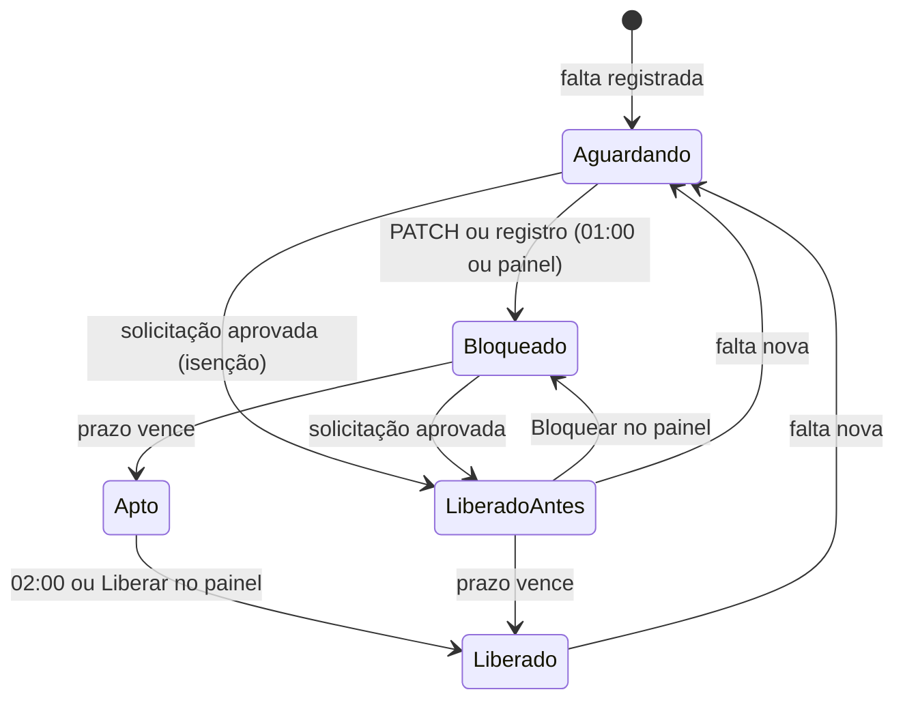

# Interface (painel)

Voltar ao [índice](README.md).

O painel é HTML estático com módulos JS, publicado na Vercel. Ele só fala com `/api/*`. Não vê a URL do n8n, o segredo do webhook, a credencial do banco nem a do CNN.

## Telas

| Rota | Arquivo | Para quê |
|---|---|---|
| `/pacientes` (e `/`) | `index.html` + `js/pacientes.js` | Lista dos pacientes com falta no ciclo, solicitar desbloqueio, liberar e bloquear, detalhe |
| `/solicitacoes` | `solicitacoes.html` + `js/solicitacoes.js` | Solicitações de desbloqueio: abrir, aprovar, recusar, cancelar, liberar |
| `/dashboard` | `dashboard.html` + `js/dashboard.js` + `js/graficos.js` | Indicadores e gráficos: hoje, faltas, bloqueios e liberações, solicitações |
| `/relatorios` | `relatorios.html` + `js/relatorios.js` | Faltas por período: mês, dia da semana, profissional, reincidência, CSV |
| `/historico` | `historico.html` + `js/historico.js` | Auditoria de cada PATCH (automático e painel), com filtros |
| `/configuracao` | `configuracao.html` + `js/configuracao.js` | Prazos, ciclo e horário em uso (só leitura) |
| `/usuarios` | `usuarios.html` + `js/usuarios.js` | Usuários, perfis e eventos (só admin) |

Partes comuns: `js/session.js` (sessão na aba, `request()`, `pode(perfil)`, cache), `js/pagina.js` (login, troca de senha, barra de status, erro, aviso), `js/layout.js` (menu lateral), `js/formato.js` (datas e selos), `js/solicitacao.js` (chamadas de solicitação, usadas por Pacientes e Solicitações).

### Pacientes

- **Números do topo:** aguardando bloqueio, bloqueados no prazo, aptos a liberar, liberados antes do prazo, faltas no ciclo e no mês. Clicar num dos quatro primeiros filtra a lista.
- **Lista:** uma linha por paciente com falta no ciclo, mais os que continuam bloqueados por falta de ciclo anterior. Mostra o nome com o número de faltas no ciclo (selo; vermelho com 3 ou mais), a falta vigente com o **procedimento em vermelho ao lado da data** (sem procedimento, o tipo de consulta; mais de um, o primeiro e "+N") e o profissional embaixo, o fim do prazo ("faltam N dias" / "venceu há N dias"), a situação, a última ação e o botão.
- **Filtros** (no navegador, sem nova consulta): busca por nome ou ID, situação, número de faltas, tipo de consulta (com a quantidade de cada um), ordenação.
- **Detalhe** (clique no nome): a falta vigente (o que o paciente ia fazer e com qual profissional) e o prazo, o **status ao vivo no CNN** (ativo / inativo), a solicitação aberta (se houver), todas as faltas, as **solicitações de desbloqueio** e o histórico de ações. O CPF aparece mascarado.
- A lista fica em cache por 2 minutos na aba (ver [Cache e filtros](#cache-e-filtros)) e é recarregada depois de cada ação.

### Situação do paciente

| Selo | Quando | Botão na lista |
|---|---|---|
| **Aguardando bloqueio** (borda tracejada) | Falta no prazo, mas **nenhum bloqueio registrado** para ela. Ainda não foi bloqueado no CNN, ou foi bloqueado fora do sistema | Solicitar desbloqueio (admin: Liberar, que isenta a falta) · Bloquear (Editor e Admin) |
| **Bloqueado** | Bloqueio registrado (automação ou painel) para a falta vigente, prazo correndo | Solicitar desbloqueio (admin: Liberar, o atalho) |
| **Apto a liberar** | Bloqueio registrado e prazo cumprido; a rotina das 02:00 libera | Liberar (Editor e Admin) |
| **Liberado antes do prazo** | Liberado (ou falta isenta) por uma solicitação aprovada, com o prazo ainda correndo | Bloquear (Editor e Admin) |
| **Liberado** | Liberado com o prazo cumprido, ou falta cujo prazo terminou sem bloqueio registrado (não será bloqueado) | — |

Com uma solicitação aberta, a linha mostra o selo **Solicitado** ou **Aprovado** (leva à tela Solicitações) no lugar de "Solicitar desbloqueio". Com a aprovada, Editor e Admin veem **Liberar**; com a pendente, o admin vê **Aprovar e liberar**.

A situação vem da tabela de controle **quando ela aponta para a falta vigente**. Sem registro para a falta vigente (falta nova, ou carga feita sem PATCH), o paciente aparece como **Aguardando bloqueio** até a execução das 01:00 bloquear ou registrar. Só o detalhe consulta o CNN ao vivo. Detalhe em [banco-de-dados.md](banco-de-dados.md#situação-do-paciente-no-painel).

No detalhe, um paciente **Aguardando bloqueio** e ainda ativo no CNN tem **Bloquear no CNN** e o caminho da solicitação (**Solicitar desbloqueio**; para o admin, **Isentar esta falta**, que abre e aprova a solicitação num passo). Aprovada, a solicitação **isenta a falta**: registra a liberação sem enviar nada ao CNN, e o bloqueio das 01:00 deixa de bloquear por ela. Se ele já estiver inativo no CNN, o detalhe oferece **Registrar bloqueio feito no CNN**.

### Liberar, bloquear e solicitar

O mesmo diálogo de motivo serve para quatro ações:

| Botão | Quem | O que faz |
|---|---|---|
| **Solicitar desbloqueio** | Todos | Abre uma solicitação (`POST /api/solicitacoes`). O admin aprova depois |
| **Liberar** (antes do prazo) | Admin | Atalho: abre a solicitação, aprova e libera no CNN de uma vez (`aprovarELiberar`). Fica registrado como solicitação aprovada por ele |
| **Liberar** (prazo cumprido) | Editor e Admin | Libera direto (`POST /api/pacientes/:id/liberar`), como a rotina das 02:00 faria |
| **Bloquear** | Editor e Admin | Bloqueia na hora (`POST /api/pacientes/:id/bloquear`) |

1. O diálogo mostra o paciente, a falta vigente e o prazo, e um aviso que explica a ação.
2. **Motivo obrigatório** (5 a 500 caracteres).
3. Durante a chamada o botão fica desabilitado ("Enviando…", "Liberando…" ou "Bloqueando…") e o diálogo não fecha.
4. Deu certo: o diálogo fecha, aparece um aviso e a lista e o detalhe recarregam.
5. Deu errado: a mensagem da API aparece no diálogo (ex.: "A API do CNN recusou (HTTP 500): …").
6. **O CNN já está no estado pedido** (alguém liberou ou bloqueou direto na plataforma, com o prazo cumprido): o diálogo muda para "Paciente já ativo no CNN" e oferece **Registrar liberação**. Confirmando, nada é enviado ao CNN: o controle e o histórico passam a refletir o CNN. No histórico a linha aparece como "Só registro".

A liberação de uma solicitação **já aprovada** (Editor ou Admin) e o **Aprovar e liberar** do admin não pedem motivo: valem o motivo de quem pediu e uma confirmação.

O botão **Bloquear** do painel vale para paciente com falta no ciclo atual e com o prazo ainda correndo (quem cumpriu o prazo não é bloqueado). O que acontece por trás está em [fluxos/acoes.md](fluxos/acoes.md).

### Solicitações

- **Menu:** **Solicitações** com o número de pendentes. Para o admin o número fica em destaque. O número vem do que já está na aba (a lista de solicitações ou o resumo de Pacientes).
- **Números do topo:** aguardando aprovação, aprovadas (falta liberar), liberadas, recusadas e canceladas (e quantas o sistema encerrou). Clicar filtra a lista.
- **Filtros** (no navegador): situação (padrão: abertas), busca por paciente, ID, número da solicitação, motivo ou quem pediu, e **Só as minhas**.
- **Lista:** paciente (leva ao detalhe), falta e prazo, motivo, quem pediu e quando, situação com a decisão (quem, quando, por quê) e quem liberou. Uma solicitação aberta cuja falta mudou, ou cujo prazo acabou, aparece com um aviso.
- **Botões por perfil:**

  | Situação | Quem | Botões |
  |---|---|---|
  | Pendente | Admin | Aprovar, Aprovar e liberar, Recusar (diálogo com motivo obrigatório) |
  | Aprovada | Editor e Admin | Liberar no CNN (Admin: também Recusar) |
  | Pendente ou aprovada | Quem abriu (ou Admin) | Cancelar (motivo opcional) |

- **Nova solicitação:** busca o paciente na lista de Pacientes da aba (atualizada por trás ao abrir) e mostra só quem pode receber solicitação: bloqueado ou aguardando bloqueio, prazo correndo, sem solicitação aberta. `/solicitacoes?paciente=ID` abre o diálogo com o paciente escolhido.
- **`/solicitacoes?id=N`** (link do detalhe e do histórico) destaca a solicitação.
- A tela mostra o que está na aba e, se o dado tiver mais de 5 segundos, busca de novo por trás: quem aprova vê o pedido que acabou de chegar.

Regras e situações em [fluxos/solicitacoes.md](fluxos/solicitacoes.md).

### Dashboard

Indicadores e gráficos num lugar só, em quatro seções:

- **Hoje** (situação atual, sem depender do período):
  - indicadores de aguardando, bloqueados, aptos, liberados antes do prazo e solicitações aguardando;
  - rosca da situação dos pacientes;
  - colunas por semana de quem sai do bloqueio nos próximos 30 dias;
  - rosca de pacientes por número de faltas no ciclo.
- **Faltas no período:**
  - indicadores com a variação em relação ao período anterior de mesmo tamanho (subiu em vermelho, desceu em verde);
  - linha de faltas por dia, com a média de 7 dias;
  - faltas por mês (linha com 3 meses ou mais; colunas com menos);
  - radar por dia da semana;
  - mapa de calor dia da semana × horário;
  - roscas por período do dia, tipo de consulta (os 6 maiores e "Outros") e número da falta;
  - barras de profissionais, procedimentos, locais e especialidades (top 10).
- **Bloqueios e liberações no período:**
  - indicadores de bloqueios, liberações (quantas antes do prazo), falhas no CNN, média de dias bloqueado até a liberação e média de dias poupados nas liberações antecipadas;
  - colunas empilhadas por mês e tipo: bloqueio automático, bloqueio pelo painel, liberação automática, por solicitação, após o prazo pelo painel;
  - rosca de como os pacientes foram liberados;
  - barras de ações pelo painel por usuário.
- **Solicitações no período:**
  - indicadores de pedidos, taxa de aprovação (aprovadas ÷ aprovadas + recusadas), tempo médio do pedido à decisão do admin e da aprovação à liberação;
  - rosca por situação;
  - colunas de pedidos por dia;
  - barras de quem mais pede.

**De onde vêm os dados:**
- **Já estavam na aba:** `/api/pacientes`, `/api/solicitacoes` e `/api/faltas` (o mesmo cache de Relatórios).
- **Só o que faltava:** `/api/dashboard` (ação `dashboard` da [Leitura](fluxos/leitura.md)).

**Gráficos:**
- **Biblioteca:** feitos com **Chart.js 4.4.9**, servido pelo próprio site (`js/vendor/chart.umd.min.js`, versão fixa, licença MIT ao lado). Nada vem de CDN.
- **Cores e tema:** as cores saem dos tokens do CSS (`--serie-1` a `--serie-6` e os de situação). Trocar o tema redesenha tudo.
- **Acessibilidade:** cada gráfico tem uma descrição em texto para leitor de tela. Sem dados, aparece "Sem dados no período".
- **Movimento reduzido:** com `prefers-reduced-motion`, não há animação.

### Relatórios

Período por atalho (ciclo atual, ciclo anterior, mês atual, 30 dias) ou datas. Mostra totais, faltas por mês, por dia da semana, por profissional (top 30), por tipo de consulta, por período do dia (manhã, tarde, noite), por rótulo da agenda, procedimentos com mais faltas (com quantas faltas têm procedimento; se a clínica não preenche, o gráfico avisa), pacientes por quantidade de faltas e os 20 que mais faltaram. Passe o mouse (ou o foco) numa barra para ver o valor.

**Exportar CSV:** uma linha por falta (data, hora, paciente, nº da falta, tipo de consulta, procedimentos, profissional, rótulo, agendamento), separado por `;`, com BOM para o Excel. Sem CPF, e-mail ou telefone. Limite de 5.000 linhas (as mais recentes).

### Histórico

Uma linha por PATCH: quando, paciente, ação (com o link da solicitação, quando veio de uma), quem (usuário do painel ou "Automático", da 01:00 ou das 02:00), motivo, falta e prazo, resultado (com o HTTP e a resposta do CNN quando falhou, e o número da execução no n8n). Filtros por período, ação, origem, usuário, resultado e ID do paciente. 50 por página.

### Configuração

Só leitura. Mostra os prazos, o início do ciclo, o fuso, os horários do bloqueio e da liberação automática, a data da última coleta, do último bloqueio e da última liberação automáticos e da última ação no painel, e os cadastros do CNN carregados (quantos nomes de cada tipo e quando foram atualizados). Para mudar, veja [operacao.md](operacao.md#como-publicar-cada-tipo-de-mudança).

### Usuários (só admin)

- **Tabela:** nome e login, perfil, situação (ativo, desativado, login bloqueado, senha temporária ainda não trocada), último acesso e quem criou.
- **Novo usuário:** login, nome e perfil. Ao salvar, aparece a **senha temporária uma vez**, com botão copiar. Repasse por um canal seguro; no primeiro acesso a pessoa define a própria senha.
- **Por linha:** Editar (nome e perfil), Redefinir senha (gera outra temporária e encerra a sessão aberta da pessoa), Desativar ou Reativar. Ninguém é excluído: o nome continua no histórico.
- O admin não muda o próprio perfil nem se desativa por aqui, e o banco não deixa sobrar zero admins ativos.
- **Eventos recentes:** criação, mudança de perfil ou nome, desativação, senha trocada ou redefinida e senhas erradas.

## Carregamento nas ações

Toda ação que espera o n8n (e o CNN) mostra o carregamento **no próprio botão**, com `ocupado(botao, texto)` ([js/pagina.js](../js/pagina.js)):

- o botão fica desabilitado, com um spinner e o texto da ação ("Liberando…", "Aprovando…", "Recusando…", "Bloqueando…", "Enviando…", "Salvando…", "Gerando senha…");
- depois de 3 segundos, mostra quantos já passaram ("Liberando… 8 s");
- depois de 15 segundos, a dica do botão avisa que o CNN pode levar até 1 minuto;
- os outros botões da mesma linha (ou o Cancelar do diálogo) ficam desabilitados, e o Esc não fecha o diálogo enquanto a ação roda;
- no fim, o botão volta ao normal.

Vale para Pacientes (diálogo de ação e liberação por solicitação), Solicitações (aprovar, aprovar e liberar, liberar, recusar, cancelar, nova solicitação), Usuários (salvar, redefinir senha, desativar, reativar) e troca de senha.

O botão **Entrar** do login tem um brilho que passa pelo texto e uma seta que desliza no hover. Entrando, mostra "Entrando" com três pontinhos piscando e o spinner. Com `prefers-reduced-motion`, nada se mexe.

## Unidade escolhida

Tudo o que as telas mostram é da **unidade escolhida** (Salvador ou Pouso Alegre). Ver [unidades.md](unidades.md).

- **Escolha ao entrar:** quem tem mais de uma unidade vê **"Em qual unidade você vai trabalhar?"** logo depois do login (ou depois da troca obrigatória de senha), **antes** da tela "Preparando os dados…". Sem Cancelar e sem Esc. Quem tem uma unidade só entra direto.
- **Onde aparece:** um chip com a unidade no topo da tela, ao lado do botão do menu (com mais de uma unidade, clicar nele abre a troca), e a linha **Unidade** no menu lateral, com **Trocar**.
- **Trocar:** abre a mesma escolha, com Cancelar e a unidade atual marcada. Unidade ainda não vista na aba prepara as telas de novo; unidade já vista abre na hora, com o cache dela.
- **Na API:** `request()` ([js/session.js](../js/session.js)) manda `X-Unidade: <IdUnidade>` em toda chamada. A unidade escolhida fica em `clariens.cnn.unidade` (`sessionStorage`). Sem unidade, a API responde `UNIDADE_OBRIGATORIA` e a página abre a escolha.
- **Código:** `garantirUnidade`, `escolherUnidade`, `atualizarUnidade` e `trocarDeUnidade` em [js/pagina.js](../js/pagina.js). O diálogo e as linhas da unidade são montados pelo JS, sem repetir nas 7 páginas.
- **Login antigo** (de antes da multiunidade, sem a lista de unidades): a aba pede o login de novo.

## Cache e filtros

Trocar de tela não chama a API (nem o n8n) enquanto o dado da aba estiver no prazo. Tudo fica no `sessionStorage`: some ao fechar a aba, e o login, o 401 e o Sair limpam. **Cada unidade tem o seu cache:** as chaves ficam em `clariens.cnn.cache:u<IdUnidade>:<chave>` (ex.: `clariens.cnn.cache:u2:pacientes`), e as chaves da tabela abaixo são as que vêm depois do prefixo. Funções em `js/session.js`: `comCache` ("cache primeiro"), `prefetchCache`, `clearCache`, `clearCaches(prefixo)`, `lerFiltros`/`salvarFiltros`.

| Tela | Chave | Prazo |
|---|---|---|
| Pacientes | `pacientes` | 2 min |
| Detalhe do paciente | `paciente:<id>` | 1 min (tem o status ao vivo no CNN) |
| Relatórios | `faltas:<de>:<ate>` (um por período) | 10 min |
| Dashboard | `dashboard:<de>:<ate>` (um por período), mais `faltas`, `pacientes` e `solicitacoes` | 10 min |
| Histórico | `acoes:<filtros e página>` | 2 min |
| Configuração | `parametros` | 30 min |
| Usuários | `usuarios` | 2 min |
| Solicitações | `solicitacoes` | 1 min (e busca de novo por trás ao abrir a tela) |

- **Ao entrar** (login ou aba sem nada guardado), a tela **"Preparando os dados…"** busca Pacientes, Solicitações, Relatórios (ciclo atual), Dashboard (ciclo atual), Histórico, Configuração e, para admin, Usuários **ao mesmo tempo**. Depois disso, trocar de tela é instantâneo. Uma busca que falha não trava as outras: aquela tela busca sozinha ao abrir.
- **Dado vencido aparece na hora** (até 12 h) e é atualizado em segundo plano: a barra mostra "atualizando…" e, quando chega, a tela se redesenha e mostra "atualizado às HH:MM". Só o detalhe do paciente espera a busca, por causa do status ao vivo no CNN.
- **Atualizar agora** ignora o cache e regrava. Quando o prazo vence (aba visível, sem diálogo aberto), a tela busca de novo sozinha. A barra mostra "atualizado às HH:MM" com a hora do dado.
- **Pré-carga:** Pacientes deixa prontos Relatórios (ciclo atual), Configuração e Solicitações; Solicitações deixa Pacientes pronto; Relatórios, Histórico e Configuração deixam Pacientes pronto.
- **Filtros lembrados na aba** (`clariens.cnn.filtros:<tela>`): Pacientes (busca, situação, faltas, tipo de consulta, ordem; filtra no navegador), Relatórios (período) e Histórico (filtros e página; cada combinação tem seu cache).
- **Depois de uma ação** (liberar, bloquear, registrar): apaga `pacientes`, o `paciente:<id>`, `solicitacoes`, `acoes:*` e `faltas:*` e recarrega da API. Depois de pedir, aprovar, recusar ou cancelar uma solicitação: apaga `solicitacoes`, `pacientes` e o `paciente:<id>`. Depois de criar ou alterar usuário, a tela Usuários busca de novo.

## Login e perfis

- Cada pessoa tem um usuário próprio, guardado no banco. Ver [operacao.md](operacao.md#usuários-do-painel).
- O login chama `POST /api/sessao` e recebe um token assinado (8 h), com as unidades da pessoa. A aba guarda o token e `{ login, nome, perfil, unidades }` no `sessionStorage`; a senha não fica guardada. Fechou a aba, o login some. **Sair** limpa a sessão e o cache.
- Com senha temporária, o painel abre **Trocar senha** logo depois do login e não deixa fechar. **Trocar senha** também fica no menu, para qualquer um. A senha nova precisa ter pelo menos 6 caracteres, um número e um caractere especial.
- 5 senhas erradas seguidas bloqueiam o login daquele usuário por 15 minutos.
- O perfil é marcado no `<html data-perfil>` antes da pintura: o **Leitor** vê só **Solicitar desbloqueio** (não vê Liberar, Bloquear nem Registrar); só o **Admin** vê Aprovar, Recusar e o menu Usuários. Quem decide é a API (403 `SEM_PERMISSAO`).
- Um 401 reabre o login (sessão vencida, ou acesso alterado pelo admin desde o login). A API não manda `WWW-Authenticate`, para o navegador não abrir a caixa nativa de login por cima.
- O login do usuário vai para o n8n e para a auditoria em toda ação.

## Dados pessoais

- A lista mostra nome e ID. O detalhe mostra o CPF mascarado (`***.456.789-**`), calculado no n8n: o CPF completo não chega ao navegador.
- E-mail e telefone não são consultados pelo painel.
- O cache fica só no `sessionStorage` da aba (somem ao fechá-la), com os prazos de [Cache e filtros](#cache-e-filtros).
