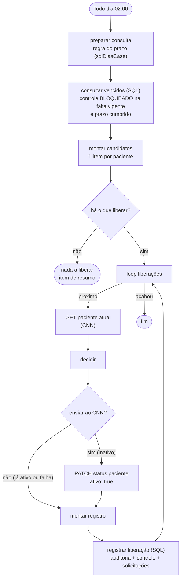

# Liberação automática (02:00)

Voltar ao [índice](README.md). Arquivo: [workflows/liberacaoPacientesFaltas.json](../workflows/liberacaoPacientesFaltas.json). Código: [liberacao-preparar-consulta.js](../workflows/code/liberacao-preparar-consulta.js), [liberacao-montar-candidatos.js](../workflows/code/liberacao-montar-candidatos.js), [liberacao-decidir.js](../workflows/code/liberacao-decidir.js), [liberacao-montar-registro.js](../workflows/code/liberacao-montar-registro.js).

## Para que serve

Todo dia às 02:00, depois do bloqueio da 01:00, libera no CNN quem **cumpriu o prazo** (60, 90 ou 180 dias) da falta vigente.

- **Antes do prazo**, liberar só com uma [solicitação de desbloqueio](fluxos/solicitacoes.md) aprovada pelo administrador.
- **Depois do prazo**, esta rotina libera sozinha, sem pedido.

> **Histórico:** a liberação automática existiu antes do painel, sem registro. Foi **desativada em outubro de 2026**, quando a liberação passou a ser manual pelo painel. Em **outubro de 2026** ela voltou, refeita: agora grava a auditoria, atualiza o controle e só reativa quem o próprio sistema bloqueou. A versão antiga (`liberacaoPacientesFaltasautomaticas--Desativado.json`) saiu do repositório.

## Quem entra

Só quem o **próprio sistema bloqueou** e já cumpriu o prazo:

- tem linha `BLOQUEADO` em `dbo.CtlCnnControlePaciente`;
- essa linha aponta para a **falta vigente de agora** (`IdAgendaReferencia` = falta vigente);
- o fim do prazo dessa falta já passou (fim do prazo < hoje).

Um paciente inativo no CNN por outro motivo (por exemplo, baixa cadastral) não tem essa linha e **nunca é reativado**. Esse era o problema da versão antiga.

Quem teve uma falta nova depois do bloqueio também não entra: a falta vigente mudou, o prazo recomeçou, e o bloqueio das 01:00 cuida dele.

## Fluxograma

## Passo a passo

| # | Nó | Tipo | O que faz |
|---|---|---|---|
| 1 | `Todo dia 02:00` | Schedule Trigger | Cron `0 2 * * *`, uma hora depois do bloqueio |
| 2 | [`preparar consulta`](../workflows/code/liberacao-preparar-consulta.js) | Code | Monta a consulta com o início do ciclo, hoje (São Paulo) e o prazo por número de falta (`sqlDiasCase`, da [regra](../workflows/code/_regra.js)) |
| 3 | `consultar vencidos` | Microsoft SQL | Falta vigente de cada paciente com controle `BLOQUEADO`; fica quem está bloqueado por ela e já cumpriu o prazo |
| 4 | [`montar candidatos`](../workflows/code/liberacao-montar-candidatos.js) | Code | Um item por paciente (sem repetir). Ninguém, ou falha no SQL: um item `{ nadaALiberar: true }` com o motivo |
| 5 | `há o que liberar?` | If | Sem ninguém, vai para `nada a liberar` e termina mostrando o motivo |
| 6 | `loop liberações` | Split in Batches | Um paciente por vez |
| 7 | `GET paciente atual` | HTTP Request | `GET /paciente/{id}` no CNN (Full Response, Never Error) |
| 8 | [`decidir`](../workflows/code/liberacao-decidir.js) | Code | Inativo: enviar o PATCH. Já ativo (alguém liberou direto no CNN): só registrar. GET falhou ou 404: não envia nada e registra a falha |
| 9 | `enviar ao CNN?` | If | `enviar === true` vai ao PATCH; o resto vai direto ao registro |
| 10 | `PATCH status paciente` | HTTP Request | `PATCH /paciente/{id}/status` com `{ "ativo": true }` |
| 11 | [`montar registro`](../workflows/code/liberacao-montar-registro.js) | Code | `sqlRegistrarAcao` com `Acao = LIBERACAO`, `Origem = AUTOMATICO`, `Usuario = n8n` e o motivo "Prazo de N dias da falta X cumprido" |
| 12 | `registrar liberação` | Microsoft SQL | Numa transação: auditoria sempre; se deu certo, controle `LIBERADO` e as solicitações abertas do paciente `ENCERRADA` ("Prazo cumprido") |

## Resultado no painel

- O paciente sai de **Apto a liberar** e passa a **Liberado**.
- **Histórico de ações:** aparece uma liberação **Automático**.
- **Configuração:** mostra a data da última liberação automática.
- Se o CNN falhar, a auditoria guarda a falha (`Sucesso = 0`) e o paciente continua **Apto**. Na noite seguinte a rotina tenta de novo, e um Editor ou Admin também pode liberar na hora pelo painel.

## Junto com o bloqueio da 01:00

- **Prazo cumprido não bloqueia:** o bloqueio da 01:00 deixa de fora quem já cumpriu o prazo da falta vigente (por exemplo, uma falta lançada atrasada no CNN). Assim ninguém é bloqueado à 01:00 para ser liberado às 02:00.
- **Liberado pelo prazo, sem bloqueio de novo:** depois da liberação, o controle fica `LIBERADO` para aquela falta, e o bloqueio da 01:00 não volta a bloquear por ela. Só uma falta nova bloqueia de novo.

## Settings e implantação

- **Credenciais:** `API CNN AUTH` nos nós HTTP e `TST Araguari` nos nós SQL.
- **Settings:** salvar todas as execuções (é o rastro da rotina) e o Error workflow do monitoramento.
- **Ativar:** só depois de rodar [sql/criar_tabelas_solicitacoes.sql](../sql/criar_tabelas_solicitacoes.sql) (a auditoria ganha `IdSolicitacao`).
- **Na primeira execução:** são liberados todos que estão **Apto a liberar** no painel. Confira a lista antes de ativar ([operacao.md](operacao.md)).
