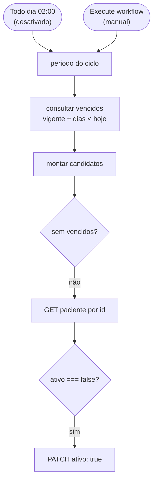

# Fluxo de liberação após o prazo — DESATIVADO

Voltar ao [índice](README.md). Arquivo: [workflows/liberacaoPacientesFaltas.json](../workflows/liberacaoPacientesFaltas.json).

> **Desativado em outubro de 2026.** A liberação passou a ser manual, pelo painel ([front-end.md](front-end.md)), com motivo e auditoria. Quem faz o PATCH `{ "ativo": true }` agora é o workflow [CNN Painel - Ações](fluxos/acoes.md).
>
> O workflow continua no repositório só como referência. O gatilho `Todo dia 02:00` está `disabled` no JSON e o workflow deve ficar **inativo** no n8n. Se ele for reativado, volta a liberar todo mundo com prazo vencido, sem registro na auditoria.

## O que ele fazia

Todo dia às 02:00, achava quem tinha cumprido o prazo da falta vigente (`DataFalta + 60/90/180 < hoje`) e, se o paciente ainda estava `ativo: false` no CNN, mandava `{ "ativo": true }`. Não gravava nada no banco.

## Uso que ainda faz sentido

No **corte** para o painel, ele é executado manualmente **uma última vez** antes de ser desativado, para não deixar ninguém com prazo vencido bloqueado. Logo depois roda a carga inicial da tabela de controle. Passo a passo em [operacao.md](operacao.md#corte-da-liberação-automática).

## Por que saiu

- A equipe pediu que a liberação seja decidida por uma pessoa, com motivo.
- Ele não deixava rastro: o PATCH só aparecia na execução do n8n.
- Ele não distinguia `ativo: false` por bloqueio de falta de `ativo: false` por baixa cadastral: reativava os dois.

No painel, quem tem o prazo vencido aparece como **Apto a liberar**, e a liberação passa pelo [workflow Ações](fluxos/acoes.md), que confere o CNN antes e grava a auditoria depois.
