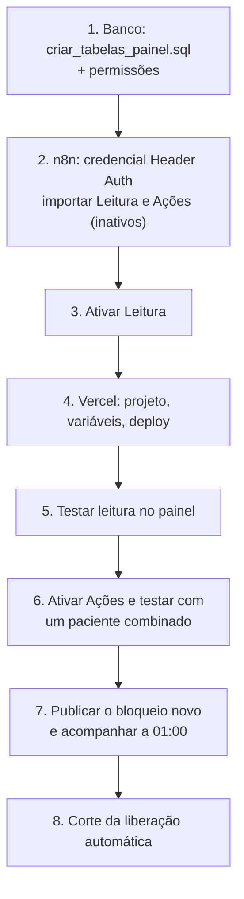
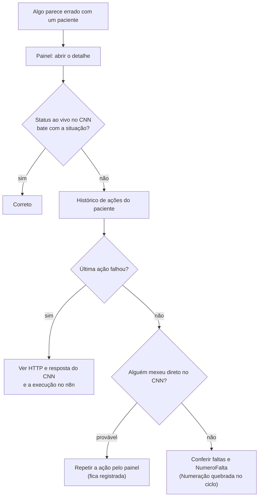

# Operação

Voltar ao [índice](README.md).

## Checklist de implantação (estado atual)

Para subir tudo do zero ou conferir um ambiente. Cada item tem o detalhe nas seções abaixo.

| # | Onde | O quê |
|---|---|---|
| 1 | SSMS | `sql/criar_tabelas_bloqueio.sql` (faltas, procedimentos, cadastros), `sql/criar_tabelas_painel.sql` (controle e auditoria), `sql/criar_tabelas_usuarios.sql` (usuários), `sql/criar_tabelas_solicitacoes.sql` (solicitações e `IdSolicitacao` na auditoria) e os `GRANT` do fim de cada script |
| 2 | Terminal + SSMS | `npm run admin` e o `INSERT` do primeiro admin; guardar a senha temporária |
| 3 | n8n | Credenciais `API CNN AUTH`, `TST Araguari` e Header Auth `X-Monitor-Key` |
| 4 | n8n | Importar e ativar **Bloqueio**, **Liberação automática**, **Leitura**, **Ações**, **Usuários** e **Solicitações**; conferir credenciais, Error workflow e a paginação de `GET agenda do ciclo` |
| 5 | Vercel | `SESSION_SECRET`, `N8N_LEITURA_URL`, `N8N_ACOES_URL`, `N8N_USUARIOS_URL`, `N8N_SOLICITACOES_URL`, `N8N_WEBHOOK_SECRET`; Framework Preset **Other** |
| 6 | Painel | Entrar como `admin`, trocar a senha, criar os usuários |
| 7 | n8n | 1ª execução do bloqueio pelo editor com o PATCH desconectado; conferir faltas e cadastros no banco; religar |
| 8 | Painel | Testar num paciente combinado com a clínica: Bloquear → Solicitar desbloqueio (como Leitor) → Aprovar (Admin) → Liberar (Editor) → Bloquear |

## Implantação das solicitações e da liberação automática (outubro de 2026)

Para um ambiente que já tem o painel funcionando. **A ordem importa:** o banco primeiro, porque os workflows novos gravam `IdSolicitacao` na auditoria e atualizam `CtlCnnSolicitacao`.

1. **Banco.** No SSMS, banco `INTEGRACAO`, rode [sql/criar_tabelas_solicitacoes.sql](../sql/criar_tabelas_solicitacoes.sql) e o `GRANT` do comentário no fim. O resultado final lista `CtlCnnSolicitacao` e o tamanho da coluna `IdSolicitacao` na auditoria (8 bytes).
2. **n8n, workflow novo:** importe [workflows/cnn-painel-solicitacoes.json](../workflows/cnn-painel-solicitacoes.json).
   - Confira a credencial Header Auth no `Webhook` e `TST Araguari` no `Executar`.
   - Em **Settings**: "Save successful executions = Do not save" e o Error workflow.
   - **Publique** e copie a Production URL.
3. **n8n, workflows que mudaram:** cole de novo **Ações**, **Leitura** e **Bloqueio** (ver "Lógica de um workflow"). Sem isso, liberar antes do prazo continua sem exigir solicitação, e a lista não mostra as solicitações.
4. **n8n, liberação automática:** importe [workflows/liberacaoPacientesFaltas.json](../workflows/liberacaoPacientesFaltas.json).
   - Credenciais `API CNN AUTH` (HTTP) e `TST Araguari` (SQL); Error workflow; salvar todas as execuções.
   - **Antes de ativar:** veja no painel quem está **Apto a liberar**. Esses pacientes serão liberados na primeira execução (02:00). Se quiser, rode uma vez pelo editor, de dia, para acompanhar.
   - Ative.
   - Se o workflow antigo de liberação ainda existir no n8n, apague-o.
5. **Vercel:** crie `N8N_SOLICITACOES_URL` em Production e Preview e publique (`vercel deploy --prod`).
6. **Teste:**
   - Um Leitor abre uma solicitação.
   - O contador do menu aparece.
   - O Admin aprova.
   - Um Editor libera.
   - A auditoria mostra a liberação com `IdSolicitacao`.
7. **Avise a equipe:** pedidos de desbloqueio não vão mais por e-mail. A recepção usa **Solicitar desbloqueio** no painel, e o administrador acompanha pela tela **Solicitações**.

## Implantação do painel (a partir do sistema antigo)

A ordem importa: o painel lê as tabelas novas, e a liberação automática só sai quando a manual está testada.

1. **Banco.** No SSMS, banco `INTEGRACAO`, rode [sql/criar_tabelas_painel.sql](../sql/criar_tabelas_painel.sql). O resultado final lista `CtlCnnAcaoPaciente` e `CtlCnnControlePaciente`. Dê ao usuário da credencial `TST Araguari` as permissões do comentário no fim do script. **Não** rode a carga inicial ainda.
2. **n8n.**
   - Crie uma credencial **Header Auth**: nome `X-Monitor-Key`, valor = um segredo novo e longo (não reaproveite o do monitoramento).
   - Importe [workflows/cnn-painel-leitura.json](../workflows/cnn-painel-leitura.json) e [workflows/cnn-painel-acoes.json](../workflows/cnn-painel-acoes.json).
   - Em cada um: no nó `Webhook`, escolha a credencial Header Auth; confira `API CNN AUTH` nos nós HTTP e `TST Araguari` nos nós SQL; em **Settings**, escolha o **Error workflow** (Error Handler do monitoramento). A Leitura já vem com "Save successful executions = Do not save" e as Ações com "salvar todas"; confira.
   - Copie a **Production URL** de cada webhook.
3. **Ative a Leitura.** Sem isso a URL de produção responde 404.
4. **Vercel.**
   - Novo projeto ligado a este repositório (Framework: Other; sem comando de build; Output Directory `.`).
   - Variáveis (Project → Settings → Environment Variables), em **Production**: `SESSION_SECRET`, `N8N_LEITURA_URL`, `N8N_ACOES_URL`, `N8N_USUARIOS_URL`, `N8N_WEBHOOK_SECRET`. Em **Preview**: as mesmas, **menos `N8N_ACOES_URL`** (um deploy de branch não pode alterar paciente).
   - Deploy. Mudou uma variável depois? Faça **Redeploy**: ela só vale no deploy seguinte.
5. **Teste a leitura:** entre em `/pacientes`, abra o detalhe de um paciente, veja `/relatorios`, `/historico` (vazio) e `/configuracao`.
6. **Ative as Ações** e teste com **um paciente combinado com a clínica**: Bloquear → Liberar → Bloquear de novo. Depois de cada passo, confira a ficha no CNN e as duas tabelas (consultas em [banco-de-dados.md](banco-de-dados.md#auditoria-do-dia)). Confira no primeiro bloquear que a execução de `GET agenda do paciente` trouxe só agendamentos desse paciente (`codigoPaciente`).
7. **Bloqueio.** Publique a versão nova de [workflows/bloqueioPacientesFaltas.json](../workflows/bloqueioPacientesFaltas.json) (ver "Lógica de um workflow" abaixo). Na primeira vez, rode pelo editor com o `PATCH status paciente` desconectado e confira a saída de `consultar bloqueios`. Na manhã seguinte, confira as linhas `AUTOMATICO` na auditoria.
8. **Corte da liberação automática** (abaixo).

### Corte da liberação automática

> **Histórico.** Este corte aconteceu em outubro de 2026, quando a liberação passou a ser só manual. A liberação automática **voltou** depois, refeita, só para quem cumpriu o prazo (ver [Implantação das solicitações e da liberação automática](#implantação-das-solicitações-e-da-liberação-automática-outubro-de-2026)). Os passos abaixo ficam como registro; o arquivo antigo do workflow saiu do repositório.

1. No n8n, abra o workflow de liberação e **execute manualmente uma última vez** (gatilho manual). Assim ninguém com prazo vencido fica bloqueado.
2. **Desative** o workflow (Active/Publish desligado).
3. **Só se a automação antiga bloqueou de verdade:** rode [sql/carga_inicial_controle.sql](../sql/carga_inicial_controle.sql) em `INTEGRACAO`. Se as faltas foram carregadas sem PATCH, pule este passo; a execução das 01:00 bloqueia ou registra cada um. Ele grava a situação que a automação deixou (prazo correndo = `BLOQUEADO`, vencido = `LIBERADO`). Rodar de novo não muda nada.
4. Avise a equipe: a partir daqui, quem vence o prazo aparece em **Aptos a liberar** e só sai com a liberação no painel.

Enquanto a carga inicial não roda, o painel mostra um aviso: quem tem prazo vencido aparece como "Apto a liberar" mesmo que a automação antiga já o tenha liberado.

## Instalação do zero (banco vazio)

Siga o [checklist](#checklist-de-implantação-estado-atual). Credenciais: `API CNN AUTH` (HTTP Basic Auth) e `TST Araguari` (Microsoft SQL, com `SELECT`, `INSERT` e `UPDATE` nas tabelas do sistema e `DELETE` em `CtlCnnFaltaProcedimento`). O fuso da instância n8n precisa ser `America/Sao_Paulo`. A carga inicial é opcional.

## Usuários do painel

Cada pessoa tem o próprio usuário, com um perfil: **Leitor** (vê e abre solicitações de desbloqueio), **Editor** (também bloqueia e libera o que foi aprovado ou cumpriu o prazo) ou **Admin** (também aprova e recusa solicitações e gerencia usuários). A auditoria grava quem liberou e quem bloqueou. Detalhes do fluxo em [fluxos/usuarios.md](fluxos/usuarios.md).

### Implantação (uma vez)

1. **Banco.** No SSMS, banco `INTEGRACAO`, rode [sql/criar_tabelas_usuarios.sql](../sql/criar_tabelas_usuarios.sql) e dê ao usuário da credencial `TST Araguari` as permissões do comentário no fim do script.
2. **Primeiro admin.** Na sua máquina, no repositório: `npm run admin`. O comando imprime uma **senha aleatória** e um `INSERT` (login `admin`). Rode o `INSERT` no SSMS e guarde a senha: ela não fica gravada em lugar nenhum. Para outro login: `npm run admin -- maria.souza "Maria Souza"`.
3. **n8n.** Importe [workflows/cnn-painel-usuarios.json](../workflows/cnn-painel-usuarios.json). No `Webhook`, escolha a credencial Header Auth (a mesma das outras); no `Executar`, `TST Araguari`; em **Settings**, confira "Save successful executions = Do not save" e o Error workflow. **Ative** e copie a Production URL.
4. **Vercel.** Crie `SESSION_SECRET` (gere com `node -e "console.log(require('crypto').randomBytes(32).toString('hex'))"`) e `N8N_USUARIOS_URL` em Production (e em Preview, se quiser testar lá). Apague `DASHBOARD_USERS`. **Redeploy.**
5. Entre como `admin` com a senha do passo 2. O painel pede uma senha nova. Depois, crie os usuários pela tela **Usuários**.

Para testar antes em localhost: preencha `SESSION_SECRET` e `N8N_USUARIOS_URL` no `.env.local` e rode `npm run dev`.

### Rotina (tela Usuários, só admin)

| Situação | O que fazer |
|---|---|
| Pessoa nova | **Novo usuário** → login, nome, perfil. Copie a senha temporária (aparece uma vez) e repasse por um canal seguro. No primeiro acesso a pessoa define a própria senha (mínimo 6 caracteres, com um número e um caractere especial) |
| Mudar o que a pessoa pode fazer | **Editar** → perfil. A sessão aberta dela perde as ações: ela entra de novo |
| Esqueceu a senha | **Redefinir senha** → nova senha temporária. A antiga deixa de valer na hora |
| Login bloqueado (5 senhas erradas) | Espere 15 minutos ou use **Redefinir senha**, que desbloqueia |
| Saiu da equipe | **Desativar**. Não entra mais, e o nome continua no histórico. **Reativar** devolve o acesso com a senha que ela tinha |
| Trocar a própria senha | **Trocar senha**, no menu lateral (qualquer perfil) |

O admin não muda o próprio perfil nem se desativa: outro admin faz isso. O banco não deixa desativar ou rebaixar o último admin ativo.

**Todos os admins perderam a senha:** rode `npm run admin` e troque o `INSERT` por `UPDATE dbo.CtlCnnUsuario SET SenhaSalt = '...', SenhaHash = '...', TrocarSenha = 1, VersaoSessao = VersaoSessao + 1, TentativasFalhas = 0, BloqueadoAte = NULL WHERE Login = N'admin';` com o salt e o hash impressos.

**Deslogar todo mundo:** troque o `SESSION_SECRET` na Vercel e faça Redeploy.

## Como publicar cada tipo de mudança

| Mudança | Onde mexer | Como publicar |
|---|---|---|
| Painel (páginas, css, js, `api/`, `lib/`) | Raiz do repo | Teste antes com `npm run dev`. Commit e push na `main` e publique com `vercel deploy --prod`, logado na conta do time (o deploy automático do push fica bloqueado quando o autor do commit não é membro do time na Vercel) |
| Lógica de um workflow | `workflows/code/*.js` (nós Code); demais nós, no JSON ou no n8n | Rode `npm run inject` e `npm run check`. No n8n, abra o workflow, **apague os nós e cole o JSON** no canvas: continua o mesmo workflow, com o mesmo id e a mesma URL de webhook. Confira as credenciais e salve. Commit. Se mexeu no n8n, exporte e copie o código de volta para `workflows/code/` |
| Prazos 60 / 90 / 180 ou início do ciclo | [`workflows/code/_regra.js`](../workflows/code/_regra.js) | `npm run inject`, `npm run check`, publicar **bloqueio, liberação automática, Leitura, Ações e Solicitações**. O início do ciclo também está escrito na URL do nó `GET agenda do ciclo` (1/10) e em `sql/carga_inicial_controle.sql` |
| Horário do bloqueio ou da liberação | Nós `Todo dia 01:00` / `Todo dia 02:00` e `horarioBloqueio` / `horarioLiberacao` em `_regra.js` (só exibição) | Os dois juntos. A liberação deve rodar **depois** do bloqueio |
| Nome de nó | Qualquer nó citado por `$('…')` ou pelo `inject.mjs` | `npm run check` aponta referência quebrada |
| Tabela | `sql/criar_tabelas_bloqueio.sql`, `criar_tabelas_painel.sql` ou `criar_tabelas_usuarios.sql` | Mantenha idempotente (`OBJECT_ID`, `COL_LENGTH`, `IF NOT EXISTS`). Rode em `INTEGRACAO` antes de publicar os workflows que usam a coluna |
| Variável | Vercel | Redeploy |
| Usuário | Tela Usuários (admin) | Nada a publicar: vale na hora |
| Credencial | Só no n8n | Nada no repositório, se o nome continuar o mesmo |
| Documentação | `docs/*.md`, `CHANGELOG.md` | `npm run word` (gera de novo os `.docx` de [word/](word/)) e commit. Na 1ª vez: `npm --prefix docs/word/gerador install` (na rede da empresa, se der erro de certificado: `NODE_OPTIONS=--use-system-ca`). Precisa do Google Chrome ou do Edge instalado (desenha os diagramas). Ao abrir o `.docx`, o Word pergunta se quer atualizar os campos: **Sim** monta o sumário |

Nunca deixe duas cópias de um workflow ativas: o PATCH sai em dobro.

### Desenvolvimento local

- Copie `.env.example` para `.env.local` e preencha (pode apontar para os webhooks reais de Leitura; para Ações, prefira deixar vazio).
- `npm run dev` sobe [dev-server.js](../dev-server.js) em `http://localhost:3000`: as mesmas páginas, os mesmos rewrites e os mesmos handlers de `api/`.
- Rota nova em `api/` precisa ser registrada também no `dev-server.js`.

## Rotina

| Quando | O quê |
|---|---|
| Todo dia | Painel → **Aptos a liberar**: liberar quem já cumpriu o prazo |
| Todo dia, de manhã | Histórico → filtro **Origem: Automático**, **Resultado: Falhou**. Execução "verde" no n8n não garante que o PATCH deu certo |
| Toda semana | "Numeração quebrada no ciclo" e "Controle diferente da última auditoria" em [banco-de-dados.md](banco-de-dados.md#consultas-úteis) (devem vir vazias) |
| Toda semana | "Linhas gravadas sem dados do CNN" |
| Em 1º de outubro | Pacientes de ciclo anterior ainda bloqueados aparecem na lista com "ciclo anterior"; libere pelo painel quem já cumpriu o prazo |
| Ao longo do ciclo | Volume da agenda: o bloqueio lê todas as páginas do ciclo (teto de 1000 páginas, 100.000 agendamentos); a execução fica mais longa até setembro |

## Problemas conhecidos

| Sintoma | Causa provável | O que fazer |
|---|---|---|
| Painel: "N8N_LEITURA_URL é obrigatório" (ou `N8N_ACOES_URL`) | Variável ausente no ambiente | Configure e faça Redeploy. Em Preview, a falta de `N8N_ACOES_URL` é proposital |
| Painel: "Authorization data is wrong!" ou 403 | `N8N_WEBHOOK_SECRET` diferente do valor da credencial Header Auth | Igualar os dois e Redeploy |
| Painel: 404 do webhook | Workflow inativo no n8n | Ativar |
| Painel: "O n8n não respondeu a tempo" | Ação demorou mais de 55 s (CNN lento, agenda grande) | **Confira o Histórico e o CNN antes de repetir**: a ação pode ter sido concluída |
| Build da Vercel falha com "No entrypoint found" | O projeto na Vercel está com um Framework Preset de servidor Node | Em *Settings → Build and Deployment*, deixe o Framework Preset em **Other**. O `vercel.json` já define `"framework": null` |
| Login sempre recusado | Usuário desativado, senha errada, ou `N8N_USUARIOS_URL` apontando para o workflow errado | Confira na tela Usuários (outro admin) ou em `CtlCnnUsuario`. Um admin pode **Redefinir senha** |
| "SESSION_SECRET é obrigatório" | Variável ausente no ambiente | Crie e faça Redeploy |
| "Muitas tentativas erradas" | 5 senhas erradas seguidas | Espere 15 minutos ou peça a um admin para redefinir a senha |
| "Seu acesso mudou desde o login. Entre de novo." | O admin mudou o perfil, desativou ou redefiniu a senha depois do login | Entre de novo |
| "Seu perfil não permite esta ação." | Leitor tentando agir, ou não-admin na tela Usuários | Peça a um admin para mudar o perfil |
| Paciente liberado no painel voltou a ser bloqueado | Falta nova no ciclo (a vigente mudou) | Comportamento esperado. Veja o detalhe: a falta vigente é outra |
| Paciente reativado **direto no CNN** volta a ser bloqueado | O bloqueio das 01:00 bloqueia todo paciente com falta no período que esteja ativo e não tenha sido liberado pelo painel | Libere pelo painel |
| "Apto a liberar" para quem já está ativo no CNN | Carga inicial não rodou, ou liberação feita direto no CNN | O detalhe mostra o status ao vivo. Liberar responde 409 sem mexer em nada |
| Falta desfeita no CNN continua contando | A linha nunca é apagada | Apague a linha do `IdAgenda` em `CtlCnnFaltaPaciente`. A próxima execução renumera |
| Ação com aviso "não foi gravada na auditoria" | O PATCH deu certo e o SQL de auditoria falhou | Registre à mão a partir da execução do n8n (o painel mostra o número) |
| Bloquear pelo painel muito lento | A API ignorou `codigoPaciente` e trouxe a agenda inteira | Ver [fluxos/acoes.md](fluxos/acoes.md#limites-e-tempo) |
| Bloqueio termina "sem faltas", mas havia faltas | `GET agenda do ciclo` falhou (credencial, `clinicaNasNuvens-cid`, API fora) | Abra a saída do nó, corrija e execute de novo pelo editor |
| Cron dispara em horário errado | Fuso do n8n diferente de `America/Sao_Paulo` | Ajuste o fuso da instância |
| `NomePaciente` vazio | O GET do paciente daquele dia falhou | A execução seguinte completa sozinha |
| Profissional, tipo de consulta ou rótulo sem nome (aparece "Código …") | A lista de cadastro falhou ou o item é novo | A execução seguinte atualiza `CtlCnnCadastro`. Veja a tela Configuração → Cadastros do CNN |
| Só faltas de **um dia** no banco (todas da mesma data) | A paginação do `GET agenda do ciclo` foi desligada no n8n: só a 1ª página (100 agendamentos) é lida | Cole de novo o JSON do repositório ou ligue a paginação no nó (Options → Pagination) |
| `gravar faltas` devolve erro | Falha de conexão ou de conversão | A transação é desfeita. Corrija e execute de novo: falta já gravada é atualizada, não duplicada |
| Nó de código falha com referência a outro nó | Nó renomeado | `npm run check` aponta onde |
| PATCH em dobro | Duas cópias do workflow ativas | Desative a cópia |

## Diagnóstico

