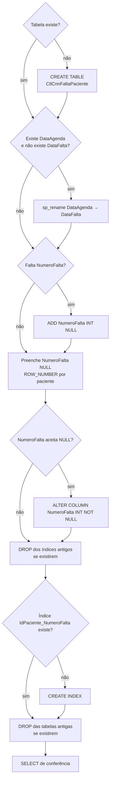

# Scripts de banco

Voltar ao [índice](README.md).

| Script | Para quê | Quando |
|---|---|---|
| [sql/criar_tabelas_bloqueio.sql](../sql/criar_tabelas_bloqueio.sql) | Cria ou migra `dbo.CtlCnnFaltaPaciente` | Instalação e sempre que mudar |
| [sql/criar_tabelas_painel.sql](../sql/criar_tabelas_painel.sql) | Cria `dbo.CtlCnnControlePaciente`, `dbo.CtlCnnAcaoPaciente` e os índices do painel | Implantação do painel e sempre que mudar |
| [sql/carga_inicial_controle.sql](../sql/carga_inicial_controle.sql) | Preenche o controle com a situação deixada pela automação | **Uma vez**, no corte da liberação automática |

Os três rodam no banco `INTEGRACAO`, no SSMS ou num nó `executeQuery` do n8n (com `USE INTEGRACAO;` na primeira linha). Nenhum tem `GO` nem `USE`.

## criar_tabelas_bloqueio.sql

## Para que serve

Cria `dbo.CtlCnnFaltaPaciente` numa instalação nova. Numa base antiga, leva a tabela ao formato atual e remove as tabelas que não são mais usadas.

Pode rodar mais de uma vez. Cada passo confere antes de agir.

## Quando roda

- Uma vez, na instalação, antes de ativar os workflows.
- De novo sempre que o script mudar no repositório.
- Não roda sozinho. Nenhum workflow chama este script.

## Onde rodar

- No SSMS, com o banco `INTEGRACAO` selecionado.
- Ou num nó Microsoft SQL do n8n com `executeQuery`, colocando `USE INTEGRACAO;` na primeira linha.

O script **não tem** `USE INTEGRACAO`. Sem escolher o banco, a tabela nasce no banco padrão do login.

O script também não tem `GO`. O driver do n8n não entende `GO`; ele é do SSMS.

## Fluxograma

## Passo a passo

| # | Linhas | O que faz |
|---|---|---|
| 1 | [7–34](../sql/criar_tabelas_bloqueio.sql#L7-L34) | Cria a tabela se `OBJECT_ID` for `NULL`. Ver colunas em [banco-de-dados.md](banco-de-dados.md#dicionário-de-dados) |
| 2 | [36–40](../sql/criar_tabelas_bloqueio.sql#L36-L40) | Se ainda existe a coluna antiga `DataAgenda` e não existe `DataFalta`, renomeia |
| 3 | [42–45](../sql/criar_tabelas_bloqueio.sql#L42-L45) | Adiciona `NumeroFalta INT NULL` se não existir |
| 4 | [47–63](../sql/criar_tabelas_bloqueio.sql#L47-L63) | Preenche só os `NumeroFalta` nulos com `ROW_NUMBER() OVER (PARTITION BY IdPaciente ORDER BY DataFalta, IdAgenda)`. Roda em `EXEC (N'…')` para compilar mesmo quando a coluna acabou de ser criada |
| 5 | [65–74](../sql/criar_tabelas_bloqueio.sql#L65-L74) | Torna `NumeroFalta` `NOT NULL` |
| 6 | [76–90](../sql/criar_tabelas_bloqueio.sql#L76-L90) | Remove `IX_CtlCnnFaltaPaciente_IdPaciente_DataAgenda` e `IX_CtlCnnFaltaPaciente_IdPaciente_DataFalta`, se existirem |
| 7 | [92–105](../sql/criar_tabelas_bloqueio.sql#L92-L105) | Cria `IX_CtlCnnFaltaPaciente_IdPaciente_NumeroFalta` se não existir |
| 8 | [107–111](../sql/criar_tabelas_bloqueio.sql#L107-L111) | **Apaga** `dbo.CtlCnnBloqueioPaciente` e `dbo.CtlCnnRegraBloqueioFalta`, se existirem |
| 9 | [113–124](../sql/criar_tabelas_bloqueio.sql#L113-L124) | Mostra banco, esquema, tabela, número de colunas e `COL_LENGTH` de `NumeroFalta` |

O passo 4 numera pelo histórico inteiro do paciente, sem ciclo. Os workflows depois renumeram só dentro do ciclo, e só para os pacientes que aparecem na agenda.

O passo 8 apaga dados. Numa base com essas tabelas, faça backup antes se o conteúdo tiver valor.

## Entradas e saídas

| | O quê |
|---|---|
| Entrada | O banco atual (pode estar vazio ou numa versão antiga) |
| Saída | `dbo.CtlCnnFaltaPaciente` no formato atual, com o índice novo |
| Saída | Um resultado com `Banco`, `Esquema`, `Tabela`, `QuantidadeColunas`, `BytesNumeroFalta` |

Numa instalação nova, espere `Tabela = CtlCnnFaltaPaciente`, `QuantidadeColunas = 20` e `BytesNumeroFalta = 4` (tamanho de um `INT`). Sem linha no resultado, a tabela não existe no banco em que o script rodou.

## Limites conhecidos

- `CREATE TABLE` não "afeta linhas". No n8n o nó mostra 0 linhas afetadas. O `SELECT` do fim é que confirma.
- Não há script de volta (rollback).
- Não cria permissões. O login da credencial `TST Araguari` precisa de `SELECT`, `INSERT` e `UPDATE` na tabela.

## criar_tabelas_painel.sql

Cria as duas tabelas do painel. Pode rodar mais de uma vez: cada passo confere antes (`OBJECT_ID`, `sys.indexes`) e **nada é apagado**.

| # | O que faz |
|---|---|
| 1 | Cria `dbo.CtlCnnControlePaciente` (chave `IdPaciente`, CHECK em `Situacao`, `UltimaAcao` e `OrigemUltimaAcao`) |
| 2 | Cria `dbo.CtlCnnAcaoPaciente` (`Id IDENTITY`, CHECK em `Acao` e `Origem`, defaults de `Antecipada` e `CriadoEm`) |
| 3 | Índices `IX_CtlCnnAcaoPaciente_IdPaciente_CriadoEm`, `IX_CtlCnnAcaoPaciente_CriadoEm`, `IX_CtlCnnControlePaciente_Situacao` |
| 4 | Índice `IX_CtlCnnFaltaPaciente_DataFalta` na tabela de faltas (relatórios por período) |
| 5 | Comentário com os `GRANT` para o usuário da credencial `TST Araguari` (troque o nome e rode à mão) |
| 6 | `SELECT` de conferência: as duas tabelas e o número de colunas (controle = 13, auditoria = 19) |

Colunas: [banco-de-dados.md](banco-de-dados.md#dboctlcnncontrolepaciente).

## carga_inicial_controle.sql

Roda no corte da liberação automática, **depois** da última execução manual dela ([operacao.md](operacao.md#corte-da-liberação-automática)).

> **Só rode se a automação antiga realmente bloqueou** (o PATCH rodou). O script supõe que todo paciente com prazo correndo está inativo no CNN. Se as faltas foram gravadas sem PATCH (fluxo cortado antes do laço, por exemplo), **não rode**: os pacientes ficariam "Bloqueado" no painel sem estar bloqueados. Sem a carga, eles aparecem como "Aguardando bloqueio", e a execução das 01:00 bloqueia quem está ativo e registra quem já está inativo.

- Calcula hoje em São Paulo (`SYSUTCDATETIME()` − 3 h) e o início do ciclo (1/8).
- Para cada paciente com falta no ciclo, pega a falta vigente (maior `NumeroFalta`) e o prazo 60/90/180.
- Prazo correndo → `BLOQUEADO`; vencido → `LIBERADO`. `OrigemUltimaAcao = CARGA_INICIAL`, `UltimaAcaoPor = carga-inicial`.
- Só insere quem ainda não tem linha no controle. Não grava auditoria (não houve PATCH).
- Termina com a contagem por situação.

Os prazos e o ciclo estão escritos no script: se mudarem em `workflows/code/_regra.js`, mude aqui também.
