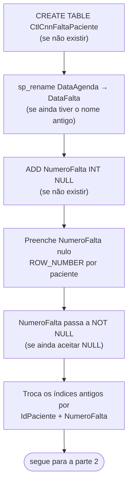
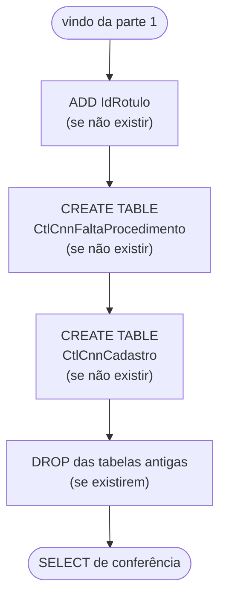

# Scripts de banco

Voltar ao [índice](README.md).

| Script | Para quê | Quando |
|---|---|---|
| [sql/criar_tabelas_bloqueio.sql](../sql/criar_tabelas_bloqueio.sql) | Cria ou migra `dbo.CtlCnnFaltaPaciente`, `dbo.CtlCnnFaltaProcedimento` e `dbo.CtlCnnCadastro` | Instalação e sempre que mudar |
| [sql/criar_tabelas_painel.sql](../sql/criar_tabelas_painel.sql) | Cria `dbo.CtlCnnControlePaciente`, `dbo.CtlCnnAcaoPaciente` e os índices do painel | Implantação do painel e sempre que mudar |
| [sql/criar_tabelas_usuarios.sql](../sql/criar_tabelas_usuarios.sql) | Cria `dbo.CtlCnnUsuario` e `dbo.CtlCnnUsuarioEvento` (usuários do painel) | Implantação da gestão de usuários e sempre que mudar. Depois, o `INSERT` do primeiro admin (`npm run admin`) |
| [sql/criar_tabelas_solicitacoes.sql](../sql/criar_tabelas_solicitacoes.sql) | Cria `dbo.CtlCnnSolicitacao` (solicitações de desbloqueio) e a coluna `IdSolicitacao` na auditoria | Implantação das solicitações, **antes** de colar os workflows novos, e sempre que mudar |
| [sql/criar_tabelas_unidades.sql](../sql/criar_tabelas_unidades.sql) | Cria `dbo.CtlCnnUnidade` e `dbo.CtlCnnUsuarioUnidade`, põe `IdUnidade` em todas as tabelas de dados e refaz as chaves com a unidade | Implantação das unidades, **depois** dos outros scripts e **antes** de colar os workflows novos |
| [sql/carga_inicial_controle.sql](../sql/carga_inicial_controle.sql) | Preenche o controle com a situação deixada pela automação | **Uma vez**, no corte da liberação automática (histórico) |

Os seis rodam no banco `INTEGRACAO`, no SSMS ou num nó `executeQuery` do n8n (com `USE INTEGRACAO;` na primeira linha). Nenhum tem `GO` nem `USE`.

## criar_tabelas_bloqueio.sql

### Para que serve

Cria as três tabelas usadas pelo bloqueio das 01:00 numa instalação nova:

- `dbo.CtlCnnFaltaPaciente`: as faltas;
- `dbo.CtlCnnFaltaProcedimento`: os procedimentos de cada falta;
- `dbo.CtlCnnCadastro`: os nomes das listas do CNN.

Numa base antiga, leva a tabela de faltas ao formato atual e remove as tabelas que não são mais usadas.

Pode rodar mais de uma vez. Cada passo confere antes de agir.

### Quando roda

- Uma vez, na instalação, antes de ativar os workflows.
- De novo sempre que o script mudar no repositório.
- Não roda sozinho. Nenhum workflow chama este script.

### Onde rodar

- No SSMS, com o banco `INTEGRACAO` selecionado.
- Ou num nó Microsoft SQL do n8n com `executeQuery`, colocando `USE INTEGRACAO;` na primeira linha.

O script **não tem** `USE INTEGRACAO`. Sem escolher o banco, as tabelas nascem no banco padrão do login.

O script também não tem `GO`. O driver do n8n não entende `GO`; ele é do SSMS.

### Fluxograma

O script tem duas partes: primeiro acerta a tabela de faltas; depois cria as tabelas novas e limpa as antigas.

#### Parte 1: tabela de faltas

#### Parte 2: tabelas novas e limpeza

### Passo a passo

| # | Linhas | O que faz |
|---|---|---|
| 1 | [7–34](../sql/criar_tabelas_bloqueio.sql#L7-L34) | Cria `CtlCnnFaltaPaciente` se `OBJECT_ID` for `NULL`. Ver colunas em [banco-de-dados.md](banco-de-dados.md#dicionário-de-dados) |
| 2 | [36–40](../sql/criar_tabelas_bloqueio.sql#L36-L40) | Se ainda existe a coluna antiga `DataAgenda` e não existe `DataFalta`, renomeia |
| 3 | [42–45](../sql/criar_tabelas_bloqueio.sql#L42-L45) | Adiciona `NumeroFalta INT NULL` se não existir |
| 4 | [47–63](../sql/criar_tabelas_bloqueio.sql#L47-L63) | Preenche só os `NumeroFalta` nulos com `ROW_NUMBER() OVER (PARTITION BY IdPaciente ORDER BY DataFalta, IdAgenda)`. Roda em `EXEC (N'…')` para compilar mesmo quando a coluna acabou de ser criada |
| 5 | [65–74](../sql/criar_tabelas_bloqueio.sql#L65-L74) | Torna `NumeroFalta` `NOT NULL` |
| 6 | [76–90](../sql/criar_tabelas_bloqueio.sql#L76-L90) | Remove `IX_CtlCnnFaltaPaciente_IdPaciente_DataAgenda` e `IX_CtlCnnFaltaPaciente_IdPaciente_DataFalta`, se existirem |
| 7 | [92–105](../sql/criar_tabelas_bloqueio.sql#L92-L105) | Cria `IX_CtlCnnFaltaPaciente_IdPaciente_NumeroFalta` se não existir |
| 8 | [107–111](../sql/criar_tabelas_bloqueio.sql#L107-L111) | Adiciona `IdRotulo BIGINT NULL` em `CtlCnnFaltaPaciente`, se não existir |
| 9 | [113–124](../sql/criar_tabelas_bloqueio.sql#L113-L124) | Cria `dbo.CtlCnnFaltaProcedimento` (chave `IdAgenda, IdTipoProcedimento`), se não existir |
| 10 | [126–139](../sql/criar_tabelas_bloqueio.sql#L126-L139) | Cria `dbo.CtlCnnCadastro` (chave `Tipo, Id`, CHECK em `Tipo`), se não existir |
| 11 | [141–146](../sql/criar_tabelas_bloqueio.sql#L141-L146) | Comentário com os `GRANT`. A tabela de procedimentos precisa de `DELETE` |
| 12 | [148–152](../sql/criar_tabelas_bloqueio.sql#L148-L152) | **Apaga** `dbo.CtlCnnBloqueioPaciente` e `dbo.CtlCnnRegraBloqueioFalta`, se existirem |
| 13 | [154–169](../sql/criar_tabelas_bloqueio.sql#L154-L169) | Mostra banco, esquema, tabela e número de colunas das três tabelas, e o `COL_LENGTH` de `NumeroFalta` |

O passo 4 numera pelo histórico inteiro do paciente, sem ciclo. Os workflows depois renumeram só dentro do ciclo, e só para os pacientes que aparecem na agenda.

O passo 12 apaga dados. Numa base com essas tabelas, faça backup antes se o conteúdo tiver valor.

### Entradas e saídas

| | O quê |
|---|---|
| Entrada | O banco atual (pode estar vazio ou numa versão antiga) |
| Saída | As três tabelas no formato atual, com o índice novo |
| Saída | Um resultado com `Banco`, `Esquema`, `Tabela`, `QuantidadeColunas`, `BytesNumeroFalta` (uma linha por tabela) |

Numa instalação nova, espere três linhas:

| Tabela | QuantidadeColunas |
|---|---|
| `CtlCnnFaltaPaciente` | 21 |
| `CtlCnnFaltaProcedimento` | 5 |
| `CtlCnnCadastro` | 5 |

`BytesNumeroFalta = 4` (tamanho de um `INT`). Sem linha no resultado, a tabela não existe no banco em que o script rodou.

### Limites conhecidos

- `CREATE TABLE` não "afeta linhas". No n8n o nó mostra 0 linhas afetadas. O `SELECT` do fim é que confirma.
- Não há script de volta (rollback).
- Não cria permissões. O login da credencial `TST Araguari - Integracao` precisa de `SELECT`, `INSERT` e `UPDATE` nas três tabelas, e também de `DELETE` em `CtlCnnFaltaProcedimento`.

## criar_tabelas_painel.sql

Cria as duas tabelas do painel. Pode rodar mais de uma vez: cada passo confere antes (`OBJECT_ID`, `sys.indexes`) e **nada é apagado**.

| # | O que faz |
|---|---|
| 1 | Cria `dbo.CtlCnnControlePaciente` (chave `IdPaciente`, CHECK em `Situacao`, `UltimaAcao` e `OrigemUltimaAcao`) |
| 2 | Cria `dbo.CtlCnnAcaoPaciente` (`Id IDENTITY`, CHECK em `Acao` e `Origem`, defaults de `Antecipada` e `CriadoEm`) |
| 3 | Índices `IX_CtlCnnAcaoPaciente_IdPaciente_CriadoEm`, `IX_CtlCnnAcaoPaciente_CriadoEm`, `IX_CtlCnnControlePaciente_Situacao` |
| 4 | Índice `IX_CtlCnnFaltaPaciente_DataFalta` na tabela de faltas (relatórios por período) |
| 5 | Comentário com os `GRANT` para o usuário da credencial `TST Araguari - Integracao` (troque o nome e rode à mão) |
| 6 | `SELECT` de conferência: as duas tabelas e o número de colunas (controle = 13, auditoria = 19) |

Colunas: [banco-de-dados.md](banco-de-dados.md#dboctlcnncontrolepaciente).

## criar_tabelas_usuarios.sql

Cria as tabelas de usuários. Pode rodar mais de uma vez e **nada é apagado**.

| # | O que faz |
|---|---|
| 1 | Cria `dbo.CtlCnnUsuario` (`IdUsuario IDENTITY`, `Login` único, CHECK em `Perfil`, defaults de `Ativo`, `TrocarSenha`, `VersaoSessao`, `TentativasFalhas`, `CriadoEm`) |
| 2 | Cria `dbo.CtlCnnUsuarioEvento` (`Id IDENTITY`, CHECK em `Evento`) e o índice `IX_CtlCnnUsuarioEvento_CriadoEm` |
| 3 | Comentário com os `GRANT` para o usuário da credencial `TST Araguari - Integracao` |
| 4 | `SELECT` de conferência: as duas tabelas e o número de colunas (usuário = 16, evento = 6) |

O script não cria usuário nenhum. O primeiro admin sai de `npm run admin` ([scripts/criar-admin.mjs](../scripts/criar-admin.mjs)): senha aleatória impressa uma vez e um `INSERT` para colar no SSMS. Colunas: [banco-de-dados.md](banco-de-dados.md#dboctlcnnusuario).

## criar_tabelas_solicitacoes.sql

Cria a tabela das solicitações de desbloqueio. Pode rodar mais de uma vez e **nada é apagado**.

| # | O que faz |
|---|---|
| 1 | Cria `dbo.CtlCnnSolicitacao` (`Id IDENTITY`, CHECK em `Status`, defaults de `Status` = `PENDENTE`, `SolicitadoEm` e `AtualizadoEm`) |
| 2 | Índice único filtrado `UX_CtlCnnSolicitacao_Aberta` em `IdPaciente` só para `PENDENTE` e `APROVADA`: uma solicitação aberta por paciente. Fica dentro de `EXEC (N'…')` |
| 3 | Índices `IX_CtlCnnSolicitacao_Status_SolicitadoEm` e `IX_CtlCnnSolicitacao_IdPaciente_SolicitadoEm` |
| 4 | `ALTER TABLE dbo.CtlCnnAcaoPaciente ADD IdSolicitacao BIGINT NULL`, se não existir |
| 5 | Comentário com o `GRANT` (`SELECT, INSERT, UPDATE` em `CtlCnnSolicitacao`) para o usuário da credencial `TST Araguari - Integracao` |
| 6 | `SELECT` de conferência: `CtlCnnSolicitacao` (19 colunas), `CtlCnnAcaoPaciente` e `BytesIdSolicitacaoNaAuditoria` = 8 |

**Rode antes de colar os workflows novos.** O `sqlRegistrarAcao` (Ações, Bloqueio e Liberação automática) grava `IdSolicitacao` e atualiza `CtlCnnSolicitacao`. Sem a tabela, o registro da auditoria falha. Colunas: [banco-de-dados.md](banco-de-dados.md#dboctlcnnsolicitacao).

## criar_tabelas_unidades.sql

Multiunidade ([unidades.md](unidades.md)). Pode rodar mais de uma vez e **nada é apagado**. Usa `SET XACT_ABORT ON`; cada troca de chave roda numa transação.

| # | O que faz |
|---|---|
| 1 | Cria `dbo.CtlCnnUnidade` e insere Salvador (1, `ZARNS_SALVADOR`) e Pouso Alegre (2, `ZARNS_POUSO_ALEGRE`), se não existirem |
| 2 | Cria `dbo.CtlCnnUsuarioUnidade` |
| 3 | Em `CtlCnnFaltaPaciente`, `CtlCnnFaltaProcedimento`, `CtlCnnCadastro`, `CtlCnnControlePaciente`, `CtlCnnAcaoPaciente` e `CtlCnnSolicitacao`: coluna `IdUnidade SMALLINT NOT NULL DEFAULT 1` (o que existe fica em Salvador) e chave estrangeira para `CtlCnnUnidade` |
| 4 | Refaz as chaves e os índices com `IdUnidade` na frente, **com os mesmos nomes** (os scripts antigos conferem pelo nome e não recriam a versão sem unidade). Se o índice já tem `IdUnidade`, não mexe. Lista em [banco-de-dados.md](banco-de-dados.md#unidades) |
| 5 | Inclui `UNIDADES_ALTERADAS` no CHECK de `CtlCnnUsuarioEvento.Evento` |
| 6 | Liga a Salvador quem é Leitor ou Editor e ainda não tem unidade |
| 7 | Comentário com os `GRANT` (`SELECT` em `CtlCnnUnidade`; `SELECT, INSERT, DELETE` em `CtlCnnUsuarioUnidade`) |
| 8 | `SELECT` de conferência: as unidades, o nome da variável do CID no n8n e quantos usuários cada uma tem |

**Rode antes de colar os workflows novos.** Eles gravam e filtram `IdUnidade`. Com o `DEFAULT 1`, os workflows antigos continuam funcionando enquanto isso (tudo em Salvador).

## carga_inicial_controle.sql

Roda no corte da liberação automática, **depois** da última execução manual dela ([operacao.md](operacao.md#corte-da-liberação-automática)).

> **Só rode se a automação antiga realmente bloqueou** (o PATCH rodou). O script supõe que todo paciente com prazo correndo está inativo no CNN. Se as faltas foram gravadas sem PATCH (fluxo cortado antes do laço, por exemplo), **não rode**: os pacientes ficariam "Bloqueado" no painel sem estar bloqueados. Sem a carga, eles aparecem como "Aguardando bloqueio", e a execução das 01:00 bloqueia quem está ativo e registra quem já está inativo.

- Calcula hoje em São Paulo (`SYSUTCDATETIME()` − 3 h) e o início do ciclo (1/10).
- Para cada paciente com falta no ciclo, pega a falta vigente (maior `NumeroFalta`) e o prazo 60/90/180.
- Prazo correndo → `BLOQUEADO`; vencido → `LIBERADO`. `OrigemUltimaAcao = CARGA_INICIAL`, `UltimaAcaoPor = carga-inicial`.
- Só insere quem ainda não tem linha no controle. Não grava auditoria (não houve PATCH).
- Por unidade: a falta vigente é calculada dentro de cada unidade e a linha de controle leva o `IdUnidade` da falta. Por isso precisa rodar **depois** de `criar_tabelas_unidades.sql`.
- Termina com a contagem por unidade e situação.

Os prazos e o ciclo estão escritos no script: se mudarem em `workflows/code/_regra.js`, mude aqui também.
