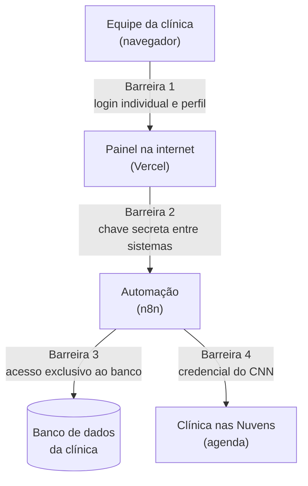

# Segurança: resumo para a liderança

Voltar ao [índice](README.md). Este documento explica, sem termos técnicos, como o sistema de bloqueio por faltas protege os dados dos pacientes, o que já está implantado e o que recomendamos para os próximos passos. O detalhe técnico está em [seguranca.md](seguranca.md).

> **Em uma frase:** os dados dos pacientes ficam no banco da clínica, que não tem acesso direto pela internet. Só pessoas cadastradas, cada uma com o próprio login, veem o painel, e cada ação fica registrada com nome, data e motivo.

## O que estamos protegendo

O sistema trabalha com **dados de pacientes**: nome, CPF, datas das faltas e o procedimento que estava marcado. Pela LGPD, informação ligada a atendimento de saúde é **dado pessoal sensível** e exige cuidado maior.

| Dado | Onde fica | Aparece no painel? |
|---|---|---|
| Nome do paciente | Banco da clínica | Sim |
| CPF | Banco da clínica | **Só mascarado** (`***.456.789-**`) |
| Telefone e e-mail | Banco da clínica | **Não** |
| Faltas, prazos e procedimento | Banco da clínica | Sim |
| Quem liberou ou bloqueou, quando e por quê | Banco da clínica (auditoria) | Sim, no Histórico |

## Como a informação circula

O caminho tem **quatro barreiras**. Para chegar aos dados, seria preciso passar por todas.

| Barreira | O que impede | Comparação |
|---|---|---|
| **1. Login individual e perfil** | Que alguém sem cadastro veja o painel, e que uma pessoa faça mais do que o perfil dela permite | Crachá na portaria, com acesso só às salas autorizadas |
| **2. Chave secreta entre sistemas** | Que alguém chame a automação direto, pulando o painel, mesmo que descubra o endereço | Porta interna que só abre com a chave que fica com a portaria |
| **3. Acesso exclusivo ao banco** | Que o banco seja acessado pela internet. Só a automação tem a senha dele | Cofre dentro do prédio, sem porta para a rua |
| **4. Credencial do CNN** | Que outra pessoa bloqueie ou libere pacientes no CNN em nome da clínica | Assinatura autorizada da clínica |

Todo o tráfego é **criptografado** (HTTPS, o "cadeado" do navegador), do computador da equipe até o painel e do painel até a automação.

## Quem pode fazer o quê

Cada pessoa tem **login e senha próprios**. Não existe usuário compartilhado.

| Perfil | Ver as telas | Pedir desbloqueio | Liberar e bloquear pacientes | Aprovar pedidos | Criar e desativar usuários |
|---|---|---|---|---|---|
| **Leitor** | ✔ | ✔ | — | — | — |
| **Editor** | ✔ | ✔ | ✔ (pedidos aprovados e prazo cumprido) | — | — |
| **Administrador** | ✔ | ✔ | ✔ | ✔ | ✔ |

- **A permissão é conferida no servidor**, não só na tela. Mesmo que alguém altere a página no próprio navegador, o sistema recusa o que o perfil não permite.
- **Senha forte obrigatória:** pelo menos 6 caracteres, com número e caractere especial. A senha é guardada **embaralhada**: nem o administrador nem a equipe técnica conseguem lê-la.
- **Proteção contra tentativa e erro:** depois de 5 senhas erradas seguidas, o login fica travado por 15 minutos.
- **Primeiro acesso:** a pessoa recebe uma senha temporária e é obrigada a criar a própria.
- **Sessão com prazo:** o acesso expira em 8 horas e termina ao fechar a aba do navegador.

## Tudo fica registrado

Cada bloqueio e cada liberação gera um registro **permanente**, que não pode ser apagado pelo painel:

- **quem** fez (o login da pessoa, ou "automação" no bloqueio das 01:00 e na liberação das 02:00);
- **quando** fez (data e hora);
- **por quê** (o motivo é obrigatório para pedir, recusar, liberar e bloquear pelo painel);
- **o que o CNN respondeu** (se a operação deu certo ou não).

A criação de usuários, as mudanças de perfil, as trocas de senha e as tentativas de login erradas também ficam registradas.

Cada **pedido de desbloqueio** também fica registrado: quem pediu, quando, o motivo, quem aprovou ou recusou (e por quê) e quem liberou no CNN. Antes, esses pedidos iam por e-mail e ficavam fora do controle.

> **Ninguém é liberado antes do prazo sem aprovação.** Antes do fim do prazo, liberar exige um pedido aprovado pelo administrador, com motivo, e tudo fica no histórico. Depois do prazo, a automação libera sozinha e também registra.

## Proteção de dados (LGPD)

| Princípio da LGPD | Como o sistema atende |
|---|---|
| **Necessidade** (usar só o necessário) | O painel mostra só o que a equipe precisa para decidir. CPF mascarado; telefone e e-mail não saem do banco; a planilha exportada também não tem contato |
| **Segurança** | As quatro barreiras acima, tráfego criptografado e senhas embaralhadas |
| **Prevenção** | O painel não guarda dados no computador: o que ele carrega some ao fechar a aba |
| **Responsabilização** | Registro permanente de quem fez cada ação, com motivo |
| **Acesso restrito** | Perfis por pessoa; o administrador desativa quem sai da equipe |

Os dados dos pacientes também **não ficam no código do sistema**: ali há uma trava que impede que arquivos com dados de pacientes sejam guardados ou publicados por engano.

## E se acontecer...

| Situação | O que acontece |
|---|---|
| **Alguém descobre o endereço do painel** | Cai na tela de login. Sem usuário e senha, não vê nada |
| **Alguém descobre o endereço da automação** | A automação recusa o pedido: falta a chave secreta, que nunca sai do servidor |
| **Alguém tenta adivinhar uma senha** | Na 5ª tentativa errada, o login trava por 15 minutos, e as tentativas ficam registradas |
| **Um colaborador sai da empresa** | O administrador desativa o usuário na tela Usuários. A pessoa não entra mais e não consegue liberar nem bloquear. O histórico dela continua guardado |
| **É preciso cortar todos os acessos de uma vez** | A equipe técnica troca a chave das sessões, e todo mundo é desconectado na hora |
| **Alguém tenta abrir o painel dentro de outro site** | O navegador bloqueia (proteção contra páginas falsas que imitam o painel) |
| **Um computador da equipe fica aberto** | O acesso expira em 8 horas; fechar a aba encerra a sessão |
| **Alguém tenta liberar um paciente antes do prazo sem pedido** | O sistema recusa, inclusive para o administrador pelo caminho comum: é preciso um pedido aprovado, e ele fica registrado |
| **Alguém libera o paciente direto no CNN, fora do painel** | Se o prazo ainda corre, a automação da madrugada bloqueia de novo, porque não houve aprovação |
| **Uma versão de teste do painel é publicada** | A versão de teste não consegue liberar nem bloquear pacientes: só a versão oficial tem essa permissão |

## O que já está implantado

| Proteção | Situação |
|---|---|
| Login individual com perfis (Leitor, Editor, Administrador) | ✔ Implantado |
| Senha forte, guardada embaralhada, com trava após 5 erros | ✔ Implantado |
| Chave secreta entre o painel e a automação | ✔ Implantado |
| Banco sem acesso direto pela internet | ✔ Implantado |
| Tráfego criptografado (HTTPS) e proteções do navegador | ✔ Implantado |
| CPF mascarado; telefone e e-mail fora do painel | ✔ Implantado |
| Registro permanente de bloqueios, liberações e usuários | ✔ Implantado |
| Liberação antes do prazo só com pedido aprovado pelo administrador | ✔ Implantado |
| Pedidos de desbloqueio registrados no painel (fim do e-mail) | ✔ Implantado |
| Liberação automática só de quem o próprio sistema bloqueou | ✔ Implantado |
| Versão de teste sem poder de alterar pacientes | ✔ Implantado |

## Próximos passos recomendados

Nenhum destes pontos é uma falha aberta. São melhorias para deixar o sistema ainda mais robusto, em ordem de prioridade.

| # | Recomendação | Por que | Quem decide ou executa |
|---|---|---|---|
| 1 | **Restringir quem acessa a ferramenta de automação (n8n)** e definir por quanto tempo ela guarda o histórico de execuções | O histórico técnico da automação guarda dados dos pacientes que passaram por ela | Liderança define quem precisa de acesso; TI aplica |
| 2 | **Usuário de banco exclusivo para este sistema**, com acesso só às tabelas dele | Hoje a automação usa um acesso de banco compartilhado, provavelmente mais amplo que o necessário | TI / administrador do banco |
| 3 | **Revisão periódica de acessos** (por exemplo, a cada 3 meses): usuários do painel, da automação, da hospedagem e do código | Garante que só quem precisa continua com acesso | Liderança, com apoio da TI |
| 4 | **Limite de tentativas por endereço de internet** | Reforça a proteção contra quem tenta muitos usuários diferentes | TI |
| 5 | **Login com a conta corporativa (Microsoft)** no lugar de usuário e senha próprios | Ao desligar a pessoa da empresa, o acesso cai junto, automaticamente | Liderança decide; TI implanta |

## Responsabilidades

| Quem | Responsabilidade |
|---|---|
| **Liderança** | Definir quem precisa de acesso e com qual perfil; aprovar a revisão periódica de acessos |
| **Administrador do painel** | Criar usuários com o perfil certo; desativar quem sai da equipe no mesmo dia |
| **Equipe técnica** | Guardar as chaves no cofre de senhas da empresa; trocá-las quando alguém com acesso sair; manter as proteções |
| **Cada usuário** | Não compartilhar a senha; fechar a aba ao terminar; liberar pacientes só pelo painel, com motivo |
