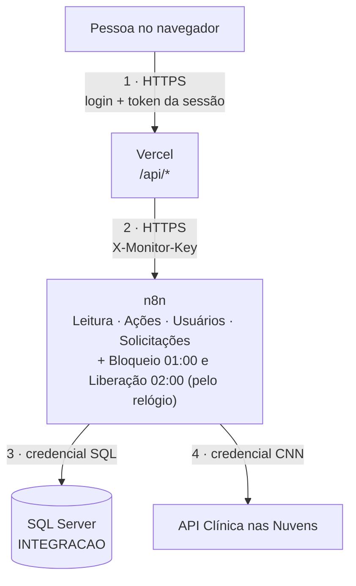
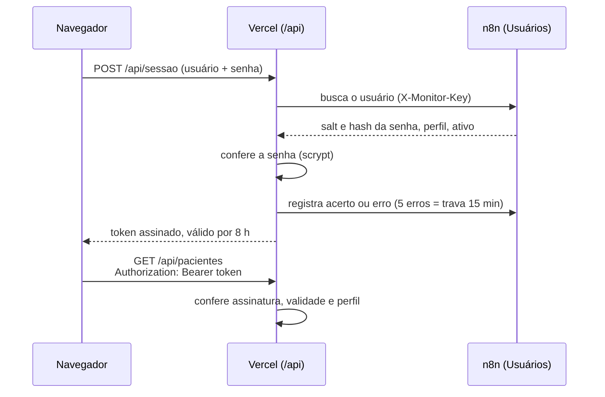
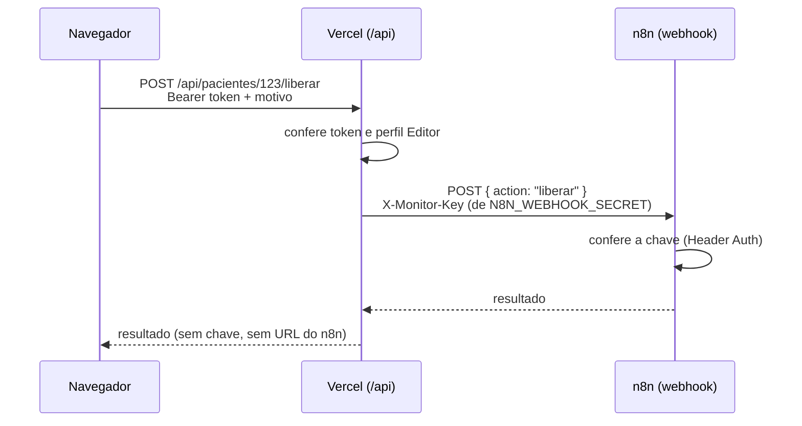

# Segurança

Voltar ao [índice](README.md). Versão para a liderança, sem termos técnicos: [seguranca-resumo.md](seguranca-resumo.md).

Como o painel protege os dados dos pacientes: quem pode chamar o quê, onde cada segredo fica, como criar e trocar as chaves, como testar e o que ainda falta melhorar.

## Em um minuto

- **O banco nunca fica exposto na internet.** Só o n8n tem a credencial do SQL Server.
- **Cada pessoa tem o próprio login.** A senha fica guardada embaralhada (scrypt) no banco e é conferida no servidor da Vercel. 5 senhas erradas seguidas travam o login por 15 minutos.
- **Cada perfil só faz o que pode.** Leitor só vê; Editor libera e bloqueia; Admin também cuida dos usuários. Quem confere é o servidor, não a tela.
- **O n8n só responde a quem apresenta uma chave secreta** (`X-Monitor-Key`). A chave fica no servidor da Vercel, nunca no navegador.
- **O navegador não vê nenhum segredo:** nem senha de banco, nem chave do n8n, nem credencial do CNN.
- **Dado de paciente é dado de saúde (LGPD).** O painel mostra só o necessário: CPF mascarado, sem telefone e sem e-mail.

Esconder a URL do webhook (ela fica numa variável de ambiente e tem um UUID aleatório no caminho) **ajuda, mas não é a proteção**. Uma URL pode vazar por log, print ou histórico. Quem protege de verdade é a chave: sem ela, o n8n recusa o pedido mesmo com a URL certa.

## Camadas



| # | Trecho | Proteção | Onde está |
|---|---|---|---|
| 1 | Navegador → Vercel | HTTPS. Login com usuário e senha; depois, um token de sessão assinado (8 h) em cada chamada. Sem token válido, a resposta é 401. Sem o perfil exigido, 403 | [lib/auth.js](../lib/auth.js) |
| 2 | Vercel → n8n | Cabeçalho `X-Monitor-Key`, conferido pela credencial **Header Auth** dos quatro webhooks. Sem a chave, o n8n recusa (403) | [lib/n8n.js](../lib/n8n.js), nós `Webhook` da [Leitura](fluxos/leitura.md), das [Ações](fluxos/acoes.md), dos [Usuários](fluxos/usuarios.md) e das [Solicitações](fluxos/solicitacoes.md) |
| 3 | n8n → SQL Server | Credencial `TST Araguari`, só no n8n. O banco não tem porta aberta para a internet | Credenciais do n8n |
| 4 | n8n → API do CNN | Credencial `API CNN AUTH` (Basic) e o cabeçalho `clinicaNasNuvens-cid` | Credenciais e nós HTTP do n8n |

O bloqueio das 01:00 e a liberação das 02:00 não têm porta de entrada: são disparados pelo relógio do próprio n8n.

## Login, sessão e perfis



- **A senha nunca chega ao n8n nem ao banco.** O n8n devolve só o salt e o hash; quem compara é a Vercel, em tempo constante (impede descobrir a senha medindo o tempo da resposta).
- **Regra da senha:** de 6 a 200 caracteres, com pelo menos um número e um caractere especial.
- **Senha temporária:** quem é criado ou tem a senha redefinida recebe uma senha aleatória e precisa trocá-la no primeiro acesso. Até trocar, todas as rotas respondem 403, menos a de troca de senha.
- **Token:** assinado com `SESSION_SECRET` (HMAC-SHA256), vale 8 horas e fica no `sessionStorage` da aba. Fechou a aba, saiu.
- **Escritas conferem o banco de novo:** liberar, bloquear e mexer em usuários consultam o usuário antes de agir (ativo, perfil e `VersaoSessao`). Se o admin desativou a pessoa, mudou o perfil ou redefiniu a senha, a ação é recusada na hora.

| Rota | Perfil mínimo | Confere o banco de novo? |
|---|---|---|
| `GET /api/pacientes`, `/api/pacientes/:id`, `/api/faltas`, `/api/acoes`, `/api/parametros`, `/api/solicitacoes` | Leitor | Não (confia no token até expirar) |
| `POST /api/solicitacoes` (abrir pedido) e `PATCH /api/solicitacoes/:id` com `cancelar` | Leitor (cancelar: só quem abriu, ou admin) | Sim |
| `PATCH /api/solicitacoes/:id` com `aprovar` ou `recusar`; `aprovarELiberar` e `aprovar: true` | Admin | Sim |
| `POST /api/pacientes/:id/liberar` e `/bloquear`; `POST /api/solicitacoes/:id/liberar` | Editor | Sim |
| `/api/usuarios` e `/api/usuarios/:login` | Admin | Sim, nas alterações |
| `POST /api/senha` | Leitor (aceita sessão com troca obrigatória) | — |

## Onde fica cada segredo

| Segredo | Para que serve | Onde fica | Quem vê |
|---|---|---|---|
| `SESSION_SECRET` | Assinar os tokens de sessão | Variável da Vercel; `.env.local` no desenvolvimento | Só quem administra a Vercel |
| `N8N_WEBHOOK_SECRET` | Chave enviada no `X-Monitor-Key` | Variável da Vercel **e** Value da credencial Header Auth no n8n (os dois iguais) | Só quem administra a Vercel e o n8n |
| `N8N_LEITURA_URL`, `N8N_ACOES_URL`, `N8N_USUARIOS_URL`, `N8N_SOLICITACOES_URL` | Endereço dos webhooks | Variáveis da Vercel | Só quem administra a Vercel |
| Credencial SQL (`TST Araguari`) | Ler e gravar no banco | Credenciais do n8n | Só quem administra o n8n |
| Credencial `API CNN AUTH` | Chamar a API do CNN | Credenciais do n8n | Só quem administra o n8n |
| `clinicaNasNuvens-cid` | Identifica a clínica na API do CNN | Escrito nos nós HTTP e, por isso, nos JSON de `workflows/` | Quem tem acesso ao repositório |
| Senhas dos usuários | Login no painel | Só salt e hash no `dbo.CtlCnnUsuario` | Ninguém (nem o admin vê a senha) |

Nenhum segredo vai para o Git: o `.gitignore` cobre `.env` e `.env.local`, e o [.env.example](../.env.example) lista só os nomes. Nenhum vai para o navegador.

Também não vão para o site publicado: o [.vercelignore](../.vercelignore) deixa de fora `workflows/`, `sql/`, `docs/`, `scripts/`, `.env*` e arquivos com resultado de execução (`*result*.json`, `*resultado*.json`), que costumam ter dados de pacientes.

### A chave nunca vai para o front



O navegador só conhece o próprio token. A Vercel lê a chave da variável de ambiente e a põe no cabeçalho de cada chamada ao n8n ([lib/n8n.js](../lib/n8n.js)).

## Como criar as chaves

### Chave dos webhooks (`N8N_WEBHOOK_SECRET`)

1. **Gerar um segredo** longo e aleatório:

   ```powershell
   node -e "console.log(require('crypto').randomBytes(32).toString('hex'))"
   ```

   Guarde no cofre de senhas da empresa. Nunca em arquivo do repositório nem em chat. **Não reaproveite** a chave do painel de monitoramento: cada sistema tem a sua.

2. **Credencial no n8n:** Credentials → Add credential → **Header Auth**:
   - **Name:** `X-Monitor-Key` (é o nome do cabeçalho; tem que ser exatamente esse);
   - **Value:** o segredo, sem espaço nem quebra de linha nas pontas.

3. **Nos quatro webhooks** (Leitura, Ações, Usuários e Solicitações): nó `Webhook` → Authentication = **Header Auth** → escolher a credencial → salvar → **Publish**. Nas versões novas do n8n, Save não muda a produção: a URL de produção roda a versão publicada.

4. **Vercel:** Project → Settings → Environment Variables → `N8N_WEBHOOK_SECRET` = o mesmo segredo (Production e Preview) → **Redeploy**.

5. **Desenvolvimento local:** a mesma linha `N8N_WEBHOOK_SECRET=...` no `.env.local`.

### Segredo da sessão (`SESSION_SECRET`)

Gere com o mesmo comando acima e grave na Vercel (Production e Preview) e no `.env.local`. Sem ele, ninguém entra: a API responde "SESSION_SECRET é obrigatório".

### Credencial e projetos do n8n

No n8n, cada credencial pertence a um **projeto** (ou ao espaço pessoal de quem a criou). Na execução, o n8n não verifica se **você** pode usar a credencial: verifica se o **projeto onde o workflow mora** pode.

- **Sintoma:** você escolhe a credencial no nó, mas a chamada falha com `Node "Webhook" does not have access to the credential`, e o painel recebe 500.
- **Causa:** o workflow está num projeto, e a credencial foi criada em outro (ou no espaço pessoal de alguém), sem ter sido compartilhada.
- **Como resolver** (uma das opções):
  - criar a credencial **dentro do projeto do workflow**, com o mesmo Name e o mesmo Value;
  - ou abrir a credencial → aba **Sharing** → adicionar o **projeto** do workflow (o projeto, não o seu usuário);
  - ou mover o workflow para o mesmo projeto da credencial.

  Depois, selecionar de novo a credencial no nó e clicar em **Publish**.

O mais simples é manter os seis workflows (Bloqueio, Liberação, Leitura, Ações, Usuários e Solicitações) **no mesmo projeto** das credenciais.

## Trocar as chaves

Troque quando alguém que conhecia a chave sair da equipe, se houver suspeita de vazamento, ou periodicamente (por exemplo, a cada 6 meses).

| O que trocar | Como | Efeito |
|---|---|---|
| `N8N_WEBHOOK_SECRET` | Gere um segredo novo → atualize o Value da credencial Header Auth no n8n → atualize a variável na Vercel → Redeploy | Entre um passo e outro, o painel fica sem dados por alguns minutos. Faça fora do horário de uso |
| `SESSION_SECRET` | Gere um segredo novo → atualize na Vercel → Redeploy | **Desloga todo mundo na hora.** Use também quando precisar cortar o acesso de alguém imediatamente |
| Senha de um usuário | Tela Usuários → **Redefinir senha** | A pessoa recebe uma senha temporária; o login atual dela deixa de valer para escritas |
| Tirar o acesso de alguém | Tela Usuários → **Desativar** | Não entra mais e não consegue liberar nem bloquear. Ver o risco "leitura até 8 h" abaixo |
| Credenciais do CNN ou do SQL | No n8n, editar a credencial | Vale para todos os workflows ao mesmo tempo |

## Proteções no código

| Proteção | Como funciona |
|---|---|
| Perfil conferido no servidor | Cada rota da Vercel chama `requireAuth` com o perfil mínimo. Esconder um botão na tela é só conforto: quem barra é o servidor |
| Lista fechada de ações | Cada webhook aceita só as suas `action`. Qualquer outra recebe 400 |
| Validação da entrada | Ids só com dígitos (até 15); datas no formato `AAAA-MM-DD`; login com letras, números, `.`, `_` e `-`; motivo de 5 a 500 caracteres; senha até 200 caracteres. O n8n valida de novo |
| Escape de texto no SQL | Todo texto que entra numa consulta passa por `sqlS` (troca `'` por `''` e corta no tamanho da coluna); números por `sqlN`; datas por `sqlDate` ([_sql.js](../workflows/code/_sql.js)). Ninguém consegue "fechar" o texto e emendar outro comando |
| Nenhum SQL vem do navegador | O navegador manda só a ação e os filtros. Quem escreve o SQL é o n8n |
| Dados pessoais filtrados na origem | A Leitura devolve o CPF mascarado (`***.456.789-**`) e não consulta telefone nem e-mail. O CSV exportado também não tem contato |
| Preview não altera paciente | `N8N_ACOES_URL` existe só em Production. Um deploy de teste não consegue liberar nem bloquear |
| Respostas sem cache | `/api/*` responde com `Cache-Control: no-store`. Dados não ficam em cache de proxy nem de navegador compartilhado |
| Cache só na aba | O que o painel guarda fica no `sessionStorage` da aba e some ao fechá-la. É apagado também no login, no 401 e no Sair |
| Arquivos internos fora do site | `.vercelignore` (ver acima). O servidor local também só serve páginas, `css/`, `js/` e `img/` |
| Cabeçalhos de segurança | Em todas as respostas ([vercel.json](../vercel.json)), detalhados abaixo. O servidor local (`npm run dev`) aplica os mesmos |
| Execuções no n8n | Leitura e Usuários não salvam execuções de sucesso: os dados consultados e os hashes de senha não ficam no histórico do n8n |

Cabeçalhos de segurança enviados em todas as respostas:

| Cabeçalho | Valor | Efeito |
|---|---|---|
| `X-Frame-Options` | `DENY` | O painel não pode ser aberto dentro de outro site (evita clique enganado) |
| `Strict-Transport-Security` | `max-age=63072000; includeSubDomains` | O navegador só acessa por HTTPS, por 2 anos |
| `X-Content-Type-Options` | `nosniff` | O navegador não "adivinha" o tipo de um arquivo |
| `Referrer-Policy` | `no-referrer` | Links externos não recebem o endereço do painel |
| `Permissions-Policy` | `camera=(), microphone=(), geolocation=(), payment=(), usb=()` | Câmera, microfone, localização, pagamento e USB desligados |

## Como testar

| Teste | Resultado esperado |
|---|---|
| Entrar com senha errada | "Usuário ou senha inválidos." |
| Errar a senha 5 vezes seguidas | Login travado por 15 minutos |
| Chamar `/api/pacientes` sem login (comando abaixo) | 401 |
| Com um usuário **Leitor**, tentar liberar (pela API) | 403 "Seu perfil não permite esta ação." |
| POST num webhook **sem** `X-Monitor-Key` (comando abaixo) | 403 (ou 401) |
| Ver os cabeçalhos de uma página (comando abaixo) | Os cinco cabeçalhos da tabela acima |
| Abrir o painel dentro de um `<iframe>` em outro site | Bloqueado |
| Abrir `/workflows/cnn-painel-acoes.json` ou `/docs/seguranca.md` no site | 404 |

```powershell
# Sem login: deve dar 401
Invoke-WebRequest -Uri "https://<endereço do painel>/api/pacientes" -SkipHttpErrorCheck | Select-Object StatusCode

# Webhook sem a chave: deve dar 403 (ou 401)
Invoke-WebRequest -Method Post -Uri "<URL do webhook>" -ContentType "application/json" -Body '{"action":"pacientes"}'

# Cabeçalhos de segurança
(Invoke-WebRequest -Uri "https://<endereço do painel>/pacientes" -Method Head).Headers
```

O `-SkipHttpErrorCheck` só existe no PowerShell 7; no Windows PowerShell 5.1, o 401 aparece como erro vermelho com "(401) Não Autorizado", o que também confirma o teste.

Se o POST sem chave devolver dados, o webhook está aberto: ative a Header Auth nele na hora.

## Riscos conhecidos e próximos passos

Para um painel interno, o nível atual é bom. Estes são os pontos a melhorar, em ordem de prioridade:

| Risco | Por que importa | O que fazer |
|---|---|---|
| **Histórico do n8n com dados de paciente** | As Ações salvam todas as execuções, de propósito (a auditoria aponta para o número da execução). O Bloqueio usa o padrão da instância, que normalmente também salva. Ali aparecem nome, CPF e contato do paciente que veio do CNN. Quem tem acesso ao n8n vê tudo. É dado de saúde (LGPD) | Restringir quem acessa o n8n; definir por quanto tempo o n8n guarda execuções (*pruning*) |
| **Usuário de banco com permissão ampla** | `TST Araguari` provavelmente alcança muito mais que as 7 tabelas do sistema | Usuário próprio do sistema, só com `SELECT/INSERT/UPDATE` nas tabelas `CtlCnn*` e `DELETE` só em `CtlCnnFaltaProcedimento` |
| **Leitura até 8 h depois de desativado** | As leituras confiam no token até ele expirar. Quem foi desativado ainda consegue **ver** a lista por até 8 horas (mas não libera, não bloqueia e não entra de novo) | Se for urgente, trocar o `SESSION_SECRET` (desloga todos). Depois: conferir o banco também nas leituras, ou encurtar o token |
| **Sem limite de chamadas por IP** | O login trava por usuário, mas alguém pode testar muitos usuários diferentes; e quem tem login pode chamar a API em loop, gerando execuções no n8n | Limite por IP no Vercel Firewall |
| **`clinicaNasNuvens-cid` no repositório** | Está escrito nos JSON dos workflows. Sozinho não dá acesso (a API exige também a credencial), mas ajuda quem tentar | Manter o repositório privado e interno; se possível, mover para uma credencial do n8n |
| **SQL montado como texto** | O escape funciona, mas consulta parametrizada é mais robusta | Migrar para parâmetros quando mexer nesses nós |
| **n8n na internet** | A instância do n8n é pública; o login e as contas do próprio n8n também protegem os dados | Senhas fortes e 2FA nas contas do n8n; revisar periodicamente quem tem acesso |
| **Token na aba** | Fica no `sessionStorage` enquanto a aba está aberta; um script malicioso na página poderia lê-lo (não a senha) | Só scripts do próprio projeto rodam na página. Próximo passo: uma `Content-Security-Policy` |

## Quem tem acesso a quê

Revise esta lista quando alguém entrar ou sair da equipe:

- **Painel:** a lista da tela **Usuários** (só admin vê). Desative quem saiu.
- **Vercel:** quem vê e muda as variáveis (segredos e URLs) e faz deploy.
- **n8n:** quem edita os workflows e as credenciais (banco, CNN, `X-Monitor-Key`) e quem vê o histórico de execuções, que tem dados de pacientes.
- **Repositório no GitHub:** quem muda o código. Não há senha no repositório, mas há o `clinicaNasNuvens-cid`, e uma mudança de código chega à produção com um deploy.
- **SQL Server:** quem administra o banco `INTEGRACAO`.

Regras de negócio sobre usuários e LGPD: [regras.md](regras.md).
