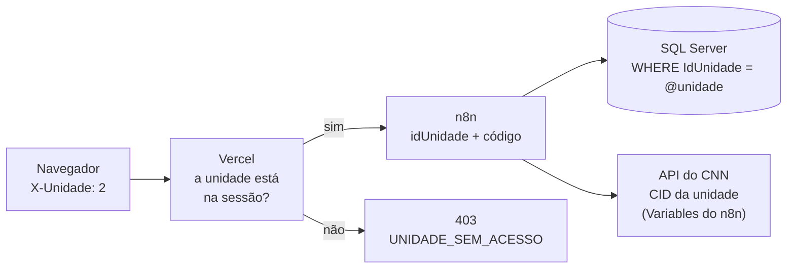

# Unidades (multiunidade)

Voltar ao [índice](README.md). O painel atende mais de uma clínica do CNN. Hoje são duas:

| IdUnidade | Código | Nome | Variável do CID no n8n |
|---|---|---|---|
| 1 | `ZARNS_SALVADOR` | Clínica Escola Zarns Salvador | `CNN_CID_ZARNS_SALVADOR` |
| 2 | `ZARNS_POUSO_ALEGRE` | Clínica Escola Zarns Pouso Alegre | `CNN_CID_ZARNS_POUSO_ALEGRE` |

A variável do CID fica na tela **Variables** do n8n.

Cada unidade tem os seus pacientes, faltas, bloqueios, solicitações e cadastros. **Nada de uma unidade aparece na outra.** As regras (prazos 60/90/180, ciclo em 1/10, 01:00 e 02:00) são as mesmas para todas.

## Para quem usa o painel

1. **Ao entrar**, quem tem mais de uma unidade escolhe em qual vai trabalhar. A escolha aparece **antes** de qualquer dado carregar. Quem tem uma unidade só entra direto.
2. **Tudo o que aparece é da unidade escolhida:** Dashboard, Pacientes, Solicitações, Relatórios, Histórico e Configuração.
3. **A unidade atual** aparece no topo da tela (ao lado do botão do menu) e no menu lateral. Com mais de uma unidade, **Trocar** muda de unidade sem sair. Voltar para uma unidade já vista na mesma aba é instantâneo, porque o dado dela fica guardado.
4. Bloquear, liberar, pedir, aprovar ou recusar vale **só na unidade escolhida**.

| Perfil | Unidades |
|---|---|
| Admin | **Todas** as unidades ativas, inclusive as que forem criadas depois. Não precisa marcar nada. Troca uma por vez |
| Editor e Leitor | As **marcadas no cadastro** (tela Usuários). Pelo menos uma |

Na tela **Usuários**, o admin marca as unidades ao criar ou editar uma pessoa. A coluna **Unidades** mostra as de cada uma ("Todas" para o admin). Mudar as unidades de alguém fica nos **Eventos** ("Unidades alteradas") e encerra as ações da sessão aberta da pessoa: ela entra de novo para continuar.

Usuário Leitor ou Editor sem nenhuma unidade não consegue entrar. A mensagem é "Seu usuário não tem nenhuma unidade liberada".

## Como a unidade é protegida

A unidade é conferida em três camadas. Esconder na tela não basta, e por isso nenhuma das camadas confia só na anterior.

| Camada | O que confere | Resposta |
|---|---|---|
| **Vercel** ([lib/auth.js](../lib/auth.js) `lerUnidade`) | O header `X-Unidade` tem que estar entre as unidades da sessão (o token assinado guarda a lista do login) | 400 `UNIDADE_OBRIGATORIA` sem o header; 403 `UNIDADE_SEM_ACESSO` fora da lista |
| **Vercel**, nas escritas (`revalidarSessao`) | Consulta o banco: a pessoa **ainda** tem a unidade? | 403 na hora em que o admin tira a unidade |
| **n8n** (nós `Preparar`/`Validar`) | Toda consulta e toda gravação levam `IdUnidade = @unidade`. Um id de paciente ou de solicitação de outra unidade simplesmente não é encontrado | 404 |

Nas leituras, tirar a unidade de alguém vale no próximo login (no máximo 8 horas, a duração da sessão), como já acontece com o perfil.

## O CID de cada unidade (Variables do n8n)

A API do CNN identifica a clínica pelo header `clinicaNasNuvens-cid`. Cada unidade tem o seu CID. Ele **não fica no banco, nem nos fluxos, nem no Git**. Ele fica nas **Variables** do n8n (no projeto, aba **Variables**):

| Key | Value |
|---|---|
| `CNN_CID_ZARNS_SALVADOR` | CID de Salvador |
| `CNN_CID_ZARNS_POUSO_ALEGRE` | CID de Pouso Alegre |

O nome é sempre `CNN_CID_` mais o **código** da unidade em `dbo.CtlCnnUnidade`. Nos nós HTTP, o header é uma expressão, por exemplo `={{ $vars['CNN_CID_' + $('Validar').first().json.codigoUnidade] || $env['CNN_CID_' + $('Validar').first().json.codigoUnidade] }}`: lê primeiro as Variables (`$vars`) e, se não tiver, a variável de ambiente do servidor (`$env`) com o mesmo nome. Os nós Code fazem o mesmo (`cidDaUnidade` em [`_unidade.js`](../workflows/code/_unidade.js)). O `npm run check` recusa um CID escrito direto no nó.

**Como configurar:**
1. No n8n, abra o projeto dos workflows, aba **Variables**, e crie as duas variáveis acima. Não precisa reiniciar o n8n.
2. As Variables têm que estar disponíveis para o projeto onde estão os workflows (globais, ou do mesmo projeto).
3. Confira: abra o workflow Ações e rode um teste. Se faltar o CID, o nó `Validar` responde "CID da unidade … não configurado no n8n (variável CNN_CID_… em Variables)".

**Alternativa sem a tela Variables** (por exemplo, se o plano do n8n não tiver Variables): crie as mesmas variáveis no ambiente do servidor do n8n (`.env` do docker-compose ou `environment:` do serviço), defina `N8N_BLOCK_ENV_ACCESS_IN_NODE=false` se o `$env` estiver bloqueado, e reinicie o n8n.

**Sem o CID de uma unidade:**

| Onde | O que acontece |
|---|---|
| Painel (Ações e detalhe do paciente) | Erro 500 com a mensagem acima. Nada é enviado ao CNN |
| Bloqueio das 01:00 | O subfluxo daquela unidade para no nó `conferir unidade`. **As outras unidades seguem** |
| Liberação das 02:00 | A unidade fica de fora da rodada e aparece no resumo da execução. As outras seguem |

O CID de Salvador estava escrito nos JSON do repositório até esta mudança. Ele continua no **histórico do Git**: se a TI considerar necessário, peça um CID novo ao CNN.

## Fluxos do n8n

| Workflow | Como trata a unidade |
|---|---|
| **Bloqueio de faltas** (`bloqueioPacientesFaltas.json`, 01:00) | Fluxo principal: lê as unidades ativas (`dbo.CtlCnnUnidade`) e chama o subfluxo **uma vez por unidade**, uma de cada vez. Erro numa unidade não para a outra (`bloquear unidade` continua com erro) |
| **Bloqueio por unidade** (`bloqueioPacientesFaltasUnidade.json`, subfluxo) | O bloqueio de sempre (listas, agenda, faltas, PATCH), para a unidade que chegou no nó `Unidade`. Detalhes em [bloqueio.md](bloqueio.md) |
| **Liberação** (`liberacaoPacientesFaltas.json`, 02:00) | Uma consulta só, com todas as unidades ativas. Cada paciente traz a unidade e o código; o GET e o PATCH usam o CID dele |
| **Ações, Leitura, Solicitações** | Recebem `idUnidade` e `codigoUnidade` da Vercel em todo pedido e filtram por eles |
| **Usuários** | O login e a sessão devolvem as unidades da pessoa; criar e alterar gravam as unidades (`dbo.CtlCnnUsuarioUnidade`) |

O código comum está em [`workflows/code/_unidade.js`](../workflows/code/_unidade.js) (`lerUnidade`, `unidadeAtual`, `cidDaUnidade`).

## Banco de dados

Script: [sql/criar_tabelas_unidades.sql](../sql/criar_tabelas_unidades.sql). Pode rodar mais de uma vez.

- **`dbo.CtlCnnUnidade`**: `IdUnidade`, `Codigo` (só A–Z, 0–9 e `_`, porque vira nome de variável), `Nome`, `Ativa`.
- **`dbo.CtlCnnUsuarioUnidade`**: `IdUsuario` + `IdUnidade` dos Leitores e Editores. O Admin não tem linha.
- **`IdUnidade`** (`DEFAULT 1`) em faltas, procedimentos, cadastros, controle, auditoria e solicitações. O que já existia ficou em Salvador.
- **Chaves com a unidade na frente.** Por exemplo, o controle passa a ser `(IdUnidade, IdPaciente)`. O mesmo número de paciente pode existir nas duas clínicas.

Detalhes em [banco-de-dados.md](banco-de-dados.md#unidades).

## Incluir uma unidade nova

1. **Banco:** `INSERT INTO dbo.CtlCnnUnidade (IdUnidade, Codigo, Nome) VALUES (3, N'ZARNS_X', N'Clínica Escola Zarns X');`
2. **n8n:** em **Variables**, crie `CNN_CID_ZARNS_X` com o CID da clínica.
3. **Usuários:** marque a unidade nova nas pessoas que vão usá-la. O admin já tem acesso, mas precisa **entrar de novo** para a unidade aparecer na lista.
4. Na madrugada seguinte, o bloqueio das 01:00 já roda para ela. Pela regra, o primeiro dia **bloqueia todo mundo** com falta no ciclo e prazo correndo.

Para tirar uma unidade de operação sem apagar nada: `UPDATE dbo.CtlCnnUnidade SET Ativa = 0 WHERE IdUnidade = 3;`. Ela some da escolha, do bloqueio e da liberação; os dados continuam no banco.

## Implantação desta mudança

Fazer fora dos horários das 01:00 e das 02:00, nesta ordem:

1. **Banco:** rode `sql/criar_tabelas_unidades.sql` no INTEGRACAO. Com o `DEFAULT 1`, os fluxos atuais continuam funcionando com Salvador.
2. **n8n, Variables:** crie `CNN_CID_ZARNS_SALVADOR` e `CNN_CID_ZARNS_POUSO_ALEGRE`.
3. **n8n:** cole os workflows novos:
   - Ações, Leitura, Solicitações, Usuários e Liberação: como sempre (apague os nós e cole o JSON).
   - **Subfluxo:** crie um workflow novo, "CNN - Bloqueio por unidade", e cole `bloqueioPacientesFaltasUnidade.json`.
   - **Bloqueio de faltas:** cole `bloqueioPacientesFaltas.json`; no nó `bloquear unidade`, escolha o workflow do subfluxo; publique.
4. **Painel:** commit e push (publica na Vercel). Quem estava com o painel aberto entra de novo.
5. **Usuários:** na tela Usuários, confira as unidades de cada pessoa. Quem já existia ficou com Salvador.

Entre o passo 3 e o 4, o painel antigo não manda a unidade e recebe "Unidade inválida". Por isso os dois passos vão juntos.

## Perguntas frequentes

**Um paciente que frequenta as duas clínicas é bloqueado nas duas?**
Cada clínica tem o seu cadastro no CNN, com o seu número. A falta numa clínica bloqueia o paciente **naquela** clínica.

**O admin consegue ver as duas unidades juntas?**
Não. Ele troca de unidade pelo topo da tela ou pelo menu. Uma por vez.

**Onde vejo se o bloqueio rodou nas duas?**
No n8n, a execução do "Bloqueio de faltas" mostra um item por unidade no nó `bloquear unidade`, e cada unidade tem a sua execução do subfluxo. No painel, **Configuração** mostra o último bloqueio e a última liberação **da unidade escolhida**.
