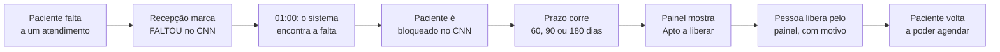
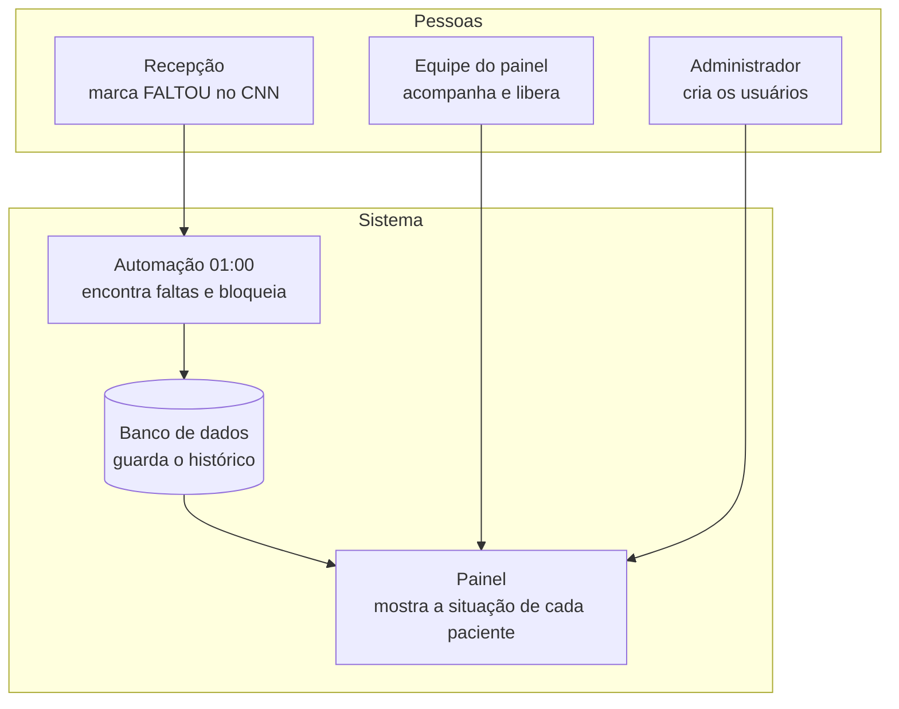
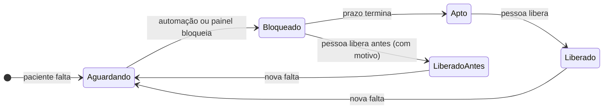

# Visão geral do sistema

Voltar ao [índice](README.md). Documento para quem **não é técnico**: coordenação, recepção, gestão e quem vai começar a usar o painel. Os detalhes técnicos estão nos outros documentos.

## O problema que o sistema resolve

Quando um paciente marca um atendimento na clínica e **não comparece nem avisa**, aquele horário fica perdido: outro paciente poderia ter sido atendido. Para reduzir as faltas, a clínica adota uma regra: **quem falta fica bloqueado por um tempo** e não consegue marcar novos atendimentos pelo Clínica nas Nuvens (CNN), o sistema de agenda da clínica.

Fazer isso à mão, paciente por paciente, toma tempo e é fácil esquecer alguém. Este sistema faz o trabalho pesado sozinho e deixa para as pessoas só a decisão que precisa de bom senso: **quando liberar**.

## O que o sistema faz, em quatro frases

1. **Toda madrugada, à 01:00**, ele olha a agenda do CNN, encontra quem faltou e **bloqueia** esses pacientes no CNN.
2. Ele **guarda tudo num banco de dados**: cada falta, cada bloqueio e cada liberação, com data, hora e responsável.
3. Um **painel na internet** mostra a situação de cada paciente: quem está bloqueado, até quando e quem já pode ser liberado.
4. A **liberação é sempre feita por uma pessoa**, pelo painel, com um motivo escrito. Nada é liberado sozinho.

## Como funciona, de ponta a ponta

## Quanto tempo o paciente fica bloqueado

O prazo depende de **quantas vezes ele faltou no ciclo**. O ciclo é um "ano de contagem" que começa todo **1º de outubro**: a contagem de faltas zera nessa data.

| Falta no ciclo | Pode ser liberado depois de |
|---|---|
| 1ª falta | **60 dias** |
| 2ª falta | **90 dias** |
| 3ª falta ou mais | **180 dias** |

O prazo conta a partir da data da falta **mais recente** (a "falta vigente"). Se o paciente faltar de novo, o prazo recomeça a partir da nova falta, e já com o prazo maior.

**Exemplo:** Maria falta em 05/10 (1ª falta) e fica bloqueada. Ela pode ser liberada a partir de 04/12, 60 dias depois. Se ela faltar de novo em 20/11 (2ª falta), o prazo passa a contar de 20/11, e ela só pode ser liberada a partir de 18/02, 90 dias depois.

## Quem faz o quê

| Quem | O que faz | Onde |
|---|---|---|
| **Recepção** | Marca o atendimento como **FALTOU** no CNN, como já faz hoje | CNN |
| **Automação (01:00)** | Encontra as faltas, bloqueia quem ainda está ativo e registra tudo | Sozinha, toda madrugada |
| **Equipe do painel** | Acompanha a lista, libera quem cumpriu o prazo e, quando preciso, libera antes (com motivo) ou bloqueia na hora | Painel |
| **Administrador** | Cria os usuários do painel, define o que cada um pode fazer e redefine senhas | Painel → Usuários |

## As telas do painel

| Tela | Para que serve |
|---|---|
| **Pacientes** | A lista principal: cada paciente com falta, o que ele ia fazer (procedimento em vermelho), o prazo e a situação. Botões **Liberar** e **Bloquear** |
| **Relatórios de faltas** | Números e gráficos: faltas por mês, por dia da semana, por profissional, por tipo de consulta, por procedimento e por período do dia. Dá para exportar em planilha |
| **Histórico de ações** | Tudo o que foi feito: cada bloqueio e cada liberação, quem fez, quando e por quê |
| **Configuração** | Mostra as regras em uso (prazos, início do ciclo, horário da automação). Só leitura |
| **Usuários** | Só para administradores: criar, editar, desativar usuários e redefinir senhas |

## A situação de cada paciente

Cada paciente da lista tem um selo colorido que diz em que ponto ele está:

| Selo | O que significa | O que fazer |
|---|---|---|
| **Aguardando bloqueio** | A falta foi registrada, mas o bloqueio ainda não aconteceu | Nada: a automação das 01:00 bloqueia. Ou clique em **Bloquear** para bloquear na hora |
| **Bloqueado** | Bloqueado e dentro do prazo | Esperar o prazo. Se houver justificativa (atestado, por exemplo), **Liberar** antes, com motivo |
| **Apto a liberar** | O prazo já terminou | **Liberar** |
| **Liberado antes do prazo** | Foi liberado por alguém antes do fim do prazo | Nada |
| **Liberado** | Já cumpriu o prazo e foi liberado | Nada |

## Quem pode fazer o quê no painel

Cada pessoa tem o **próprio login e senha**. Nada de usuário compartilhado: o histórico mostra o nome de quem fez cada ação.

| Perfil | Pode ver as telas | Pode liberar e bloquear | Pode cuidar dos usuários |
|---|---|---|---|
| **Leitor** | Sim | Não | Não |
| **Editor** | Sim | Sim | Não |
| **Admin** | Sim | Sim | Sim |

- **No primeiro acesso,** a pessoa entra com uma **senha temporária**, que o administrador repassa, e precisa criar a própria senha.
- **A senha precisa ter** pelo menos 6 caracteres, um número e um caractere especial (por exemplo, `!`, `@`, `#`).
- **Depois de 5 senhas erradas seguidas,** o login fica travado por 15 minutos.

## Garantias do sistema

- **Rastreabilidade:** todo bloqueio e toda liberação ficam registrados para sempre, com quem fez, quando, por quê e o que o CNN respondeu.
- **Ninguém é liberado sozinho:** a liberação automática foi desligada. Sempre há uma pessoa e um motivo.
- **Uma liberação feita no painel é respeitada:** a automação das 01:00 não bloqueia de novo pela mesma falta. Só uma falta nova bloqueia outra vez.
- **Proteção de dados (LGPD):** o painel mostra só o necessário. O CPF aparece mascarado, e telefone e e-mail não aparecem. Os dados ficam guardados só na aba do navegador e somem ao fechá-la.
- **Rapidez:** ao entrar, o painel prepara todas as telas de uma vez. Depois disso, a navegação entre as telas é instantânea.

## Perguntas frequentes

**Um paciente foi liberado pelo painel e voltou a ser bloqueado. Por quê?**
Ele faltou de novo. Uma falta nova inicia um novo bloqueio, com prazo maior. O detalhe do paciente mostra a falta nova.

**Alguém liberou o paciente direto no CNN, e não pelo painel. O que acontece?**
Na madrugada seguinte, a automação bloqueia de novo, porque não houve liberação registrada no painel. Por isso as liberações devem ser feitas **sempre pelo painel**. Se isso já aconteceu, o detalhe do paciente mostra a diferença e oferece o botão **Registrar liberação feita no CNN**.

**O paciente tem atestado. Posso liberar antes do prazo?**
Sim. Clique em **Liberar** e escreva o motivo (por exemplo, "falta justificada com atestado"). A liberação fica marcada como "antes do prazo" no histórico.

**A falta foi lançada por engano. Como desfazer?**
Se o paciente ainda não foi bloqueado, abra o detalhe e use **Isentar esta falta**. A automação deixa de considerar essa falta. Se ele já foi bloqueado, use **Liberar** com o motivo "falta lançada por engano".

**O que muda em 1º de outubro?**
Começa um novo ciclo: a contagem de faltas zera. Quem ainda estiver bloqueado por falta do ciclo anterior continua na lista, marcado como "ciclo anterior", até ser liberado.

## Glossário

| Termo | Significado |
|---|---|
| **CNN** | Clínica nas Nuvens, o sistema de agenda e cadastro da clínica |
| **Falta** | Atendimento marcado como **FALTOU** no CNN |
| **Ciclo** | Período de contagem das faltas. Começa todo 1º de outubro |
| **Falta vigente** | A falta mais recente do paciente no ciclo. É dela que conta o prazo |
| **Prazo** | Tempo mínimo de bloqueio: 60, 90 ou 180 dias, conforme o número da falta |
| **Bloquear** | Desativar o paciente no CNN, para que ele não consiga agendar |
| **Liberar** | Reativar o paciente no CNN |
| **Liberação antecipada** | Liberar antes do fim do prazo, com motivo |
| **Isentar a falta** | Dizer ao sistema que aquela falta não deve gerar bloqueio |
| **Painel** | O site onde a equipe acompanha e libera os pacientes |
| **Automação / n8n** | A ferramenta que roda as tarefas automáticas (a busca das 01:00 e as ações do painel) |
| **Auditoria / Histórico** | O registro permanente de cada bloqueio e liberação |
