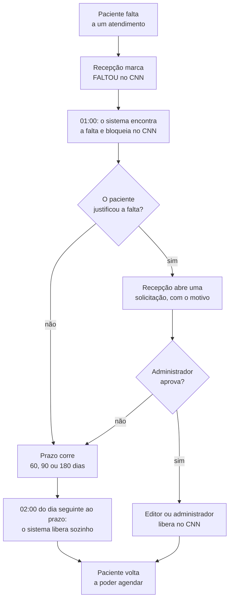
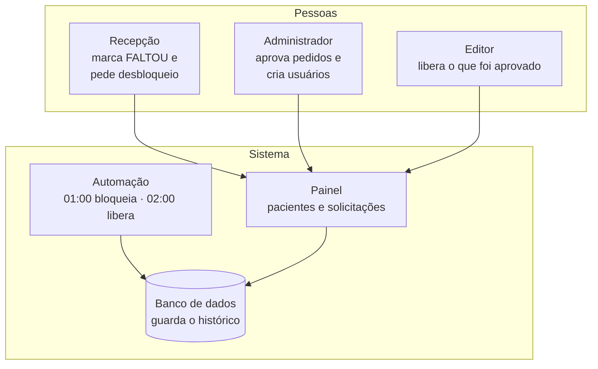
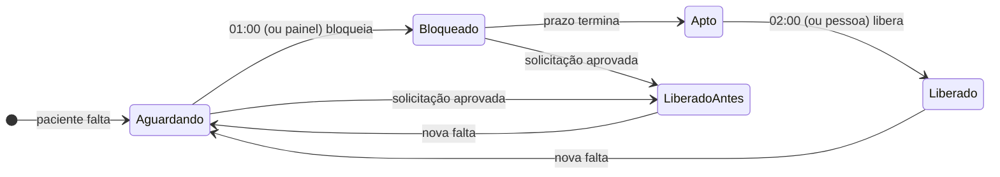

# Visão geral do sistema

Voltar ao [índice](README.md). Documento para quem **não é técnico**: coordenação, recepção, gestão e quem vai começar a usar o painel. Os detalhes técnicos estão nos outros documentos.

## O problema que o sistema resolve

Quando um paciente marca um atendimento na clínica e **não comparece nem avisa**, aquele horário fica perdido: outro paciente poderia ter sido atendido. Para reduzir as faltas, a clínica adota uma regra: **quem falta fica bloqueado por um tempo** e não consegue marcar novos atendimentos pelo Clínica nas Nuvens (CNN), o sistema de agenda da clínica.

Fazer isso à mão, paciente por paciente, toma tempo e é fácil esquecer alguém. Este sistema faz o trabalho pesado sozinho e deixa para as pessoas só a decisão que precisa de bom senso: **liberar antes do prazo quem justificou a falta**.

## O que o sistema faz, em cinco frases

1. **Toda madrugada, à 01:00**, ele olha a agenda do CNN, encontra quem faltou e **bloqueia** esses pacientes no CNN.
2. **Toda madrugada, às 02:00**, ele **libera** quem já cumpriu o prazo do bloqueio.
3. Quem **justificou a falta** (um atestado, por exemplo) pode ser liberado antes: a recepção abre uma **solicitação de desbloqueio** no painel e o **administrador aprova**.
4. Ele **guarda tudo num banco de dados**: cada falta, cada bloqueio, cada pedido e cada liberação, com data, hora e responsável.
5. Um **painel na internet** mostra a situação de cada paciente e de cada pedido. Nada fica por e-mail.

## Como funciona, de ponta a ponta

## Quanto tempo o paciente fica bloqueado

O prazo depende de **quantas vezes ele faltou no ciclo**. O ciclo é um "ano de contagem" que começa todo **1º de outubro**: a contagem de faltas zera nessa data.

| Falta no ciclo | O bloqueio dura |
|---|---|
| 1ª falta | **60 dias** |
| 2ª falta | **90 dias** |
| 3ª falta ou mais | **180 dias** |

O prazo conta a partir da data da falta **mais recente** (a "falta vigente"). Se o paciente faltar de novo, o prazo recomeça a partir da nova falta, e já com o prazo maior.

**Exemplo:** Maria falta em 05/10 (1ª falta) e fica bloqueada. O prazo vai até 04/12, 60 dias depois; na madrugada de 05/12, o sistema a libera. Se ela faltar de novo em 20/11 (2ª falta), o prazo passa a contar de 20/11 e vai até 18/02, 90 dias depois.

Se uma falta chega ao sistema **depois** que o prazo dela já acabou (por exemplo, lançada com muito atraso no CNN), o paciente **não é bloqueado**: o prazo já foi cumprido.

## Quem faz o quê

| Quem | O que faz | Onde |
|---|---|---|
| **Recepção** | Marca o atendimento como **FALTOU** no CNN, como já faz hoje. Quando o paciente liga e justifica a falta, abre uma **solicitação de desbloqueio**, com o motivo | CNN e painel |
| **Automação (01:00 e 02:00)** | Encontra as faltas e bloqueia quem ainda está no prazo; libera quem cumpriu o prazo; registra tudo | Sozinha, toda madrugada |
| **Administrador** | **Aprova ou recusa** as solicitações (pode também aprovar e liberar de uma vez). Cria os usuários do painel e define o que cada um pode fazer | Painel → Solicitações e Usuários |
| **Editor** | Libera no CNN as solicitações aprovadas; pode bloquear na hora e liberar quem já cumpriu o prazo | Painel |

## As telas do painel

| Tela | Para que serve |
|---|---|
| **Pacientes** | A lista principal: cada paciente com falta, o que ele ia fazer (procedimento em vermelho), o prazo e a situação. Botões **Solicitar desbloqueio**, **Liberar** e **Bloquear**, conforme o perfil |
| **Solicitações** | Os pedidos de desbloqueio: quem pediu, quando, por qual motivo, e o que foi decidido. O menu mostra quantos aguardam aprovação. O administrador aprova ou recusa aqui |
| **Relatórios de faltas** | Números e gráficos: faltas por mês, por dia da semana, por profissional, por tipo de consulta, por procedimento e por período do dia. Dá para exportar em planilha |
| **Histórico de ações** | Tudo o que foi feito: cada bloqueio e cada liberação, quem fez, quando e por quê |
| **Configuração** | Mostra as regras em uso (prazos, início do ciclo, horários da automação). Só leitura |
| **Usuários** | Só para administradores: criar, editar, desativar usuários e redefinir senhas |

## A situação de cada paciente

Cada paciente da lista tem um selo colorido que diz em que ponto ele está:

| Selo | O que significa | O que fazer |
|---|---|---|
| **Aguardando bloqueio** | A falta foi registrada e o prazo corre, mas o bloqueio ainda não aconteceu | Nada: a automação das 01:00 bloqueia. Se o paciente justificou a falta, **Solicitar desbloqueio** |
| **Bloqueado** | Bloqueado e dentro do prazo | Esperar o prazo. Se houver justificativa (atestado, por exemplo), **Solicitar desbloqueio** |
| **Apto a liberar** | O prazo já terminou | Nada: a automação das 02:00 libera. Editor ou administrador também pode **Liberar** na hora |
| **Liberado antes do prazo** | Foi liberado por uma solicitação aprovada | Nada |
| **Liberado** | Já cumpriu o prazo e foi liberado (ou o prazo acabou sem precisar de bloqueio) | Nada |

## Solicitações de desbloqueio

Antes, o pedido para liberar um paciente ia por e-mail para o administrador, e ninguém mais acompanhava. Agora tudo fica no painel:

1. **O paciente liga e justifica a falta.** A recepção abre uma solicitação no painel (tela **Solicitações** ou botão **Solicitar desbloqueio** na lista) e escreve o motivo.
2. **O administrador vê o pedido.** O menu mostra quantos aguardam aprovação. Ele **aprova** ou **recusa**, e a recusa também tem motivo.
3. **Alguém libera no CNN.** Um editor ou o próprio administrador clica em **Liberar**. O administrador também pode usar **Aprovar e liberar**, de uma vez.
4. **Todos acompanham.** A lista mostra quem pediu, quando, o motivo, quem decidiu e quem liberou.

| Situação do pedido | O que significa |
|---|---|
| **Aguardando aprovação** | O administrador ainda não decidiu |
| **Aprovada · falta liberar** | Aprovada; falta um editor ou administrador liberar no CNN |
| **Liberada** | O paciente foi reativado no CNN |
| **Recusada** | O administrador recusou, com motivo |
| **Cancelada** | Quem pediu desistiu (aberta por engano, por exemplo) |
| **Encerrada** | Perdeu o sentido: o prazo acabou e a automação liberou, ou o paciente teve uma falta nova |

Regras simples:

- **Só para quem está no prazo.** Quem já cumpriu o prazo é liberado pela automação, sem pedido.
- **Um pedido aberto por paciente.** Se já existe um, o painel avisa.
- **Uma falta nova invalida o pedido.** O pedido vale para a falta de quando foi aberto; com uma falta nova, é preciso pedir de novo.

## Quem pode fazer o quê no painel

Cada pessoa tem o **próprio login e senha**. Nada de usuário compartilhado: o histórico mostra o nome de quem fez cada ação.

| Perfil | Ver as telas | Pedir desbloqueio | Liberar e bloquear | Aprovar pedidos | Cuidar dos usuários |
|---|---|---|---|---|---|
| **Leitor** | Sim | Sim | Não | Não | Não |
| **Editor** | Sim | Sim | Sim (pedidos aprovados e quem cumpriu o prazo) | Não | Não |
| **Admin** | Sim | Sim | Sim | Sim | Sim |

- **No primeiro acesso,** a pessoa entra com uma **senha temporária**, que o administrador repassa, e precisa criar a própria senha.
- **A senha precisa ter** pelo menos 6 caracteres, um número e um caractere especial (por exemplo, `!`, `@`, `#`).
- **Depois de 5 senhas erradas seguidas,** o login fica travado por 15 minutos.

## Garantias do sistema

- **Rastreabilidade:** todo bloqueio, todo pedido e toda liberação ficam registrados, com quem fez, quando, por quê e o que o CNN respondeu.
- **Ninguém é liberado antes do prazo sem aprovação:** liberar antes do fim do prazo exige um pedido aprovado pelo administrador. Depois do prazo, a automação libera sozinha.
- **Uma liberação feita no painel é respeitada:** a automação das 01:00 não bloqueia de novo pela mesma falta. Só uma falta nova bloqueia outra vez.
- **A automação só reativa quem ela mesma bloqueou:** um paciente inativo no CNN por outro motivo nunca é reativado.
- **Proteção de dados (LGPD):** o painel mostra só o necessário. O CPF aparece mascarado, e telefone e e-mail não aparecem. Os dados ficam guardados só na aba do navegador e somem ao fechá-la.
- **Rapidez:** ao entrar, o painel prepara todas as telas de uma vez. Depois disso, a navegação entre as telas é instantânea.

## Perguntas frequentes

**Um paciente foi liberado e voltou a ser bloqueado. Por quê?**
Ele faltou de novo. Uma falta nova inicia um novo bloqueio, com prazo maior. O detalhe do paciente mostra a falta nova.

**Alguém liberou o paciente direto no CNN, e não pelo painel. O que acontece?**
Se o prazo ainda corre, na madrugada seguinte a automação bloqueia de novo, porque não houve liberação aprovada. Por isso a liberação antes do prazo deve ser feita **sempre pelo painel**, com uma solicitação. Se o prazo já acabou, o painel oferece o botão **Registrar liberação feita no CNN**, e a automação das 02:00 também registra.

**O paciente tem atestado. Posso liberar antes do prazo?**
Sim, pela solicitação. Clique em **Solicitar desbloqueio**, escreva o motivo (por exemplo, "falta justificada com atestado") e aguarde a aprovação do administrador. A liberação fica marcada como "antes do prazo" no histórico.

**A falta foi lançada por engano. Como desfazer?**
Abra uma solicitação de desbloqueio com o motivo "falta lançada por engano". Se o paciente ainda não foi bloqueado, a aprovação **isenta a falta** e a automação deixa de considerá-la. Se ele já foi bloqueado, a aprovação libera.

**Abri uma solicitação errada. E agora?**
Na tela Solicitações, clique em **Cancelar** na sua solicitação. Ela fica no histórico como cancelada.

**O que muda em 1º de outubro?**
Começa um novo ciclo: a contagem de faltas zera. Quem ainda estiver bloqueado por falta do ciclo anterior continua na lista, marcado como "ciclo anterior", até o prazo terminar.

## Glossário

| Termo | Significado |
|---|---|
| **CNN** | Clínica nas Nuvens, o sistema de agenda e cadastro da clínica |
| **Falta** | Atendimento marcado como **FALTOU** no CNN |
| **Ciclo** | Período de contagem das faltas. Começa todo 1º de outubro |
| **Falta vigente** | A falta mais recente do paciente no ciclo. É dela que conta o prazo |
| **Prazo** | Tempo do bloqueio: 60, 90 ou 180 dias, conforme o número da falta |
| **Bloquear** | Desativar o paciente no CNN, para que ele não consiga agendar |
| **Liberar** | Reativar o paciente no CNN |
| **Solicitação de desbloqueio** | Pedido para liberar um paciente antes do fim do prazo, com o motivo. O administrador aprova ou recusa |
| **Liberação antecipada** | Liberar antes do fim do prazo, por uma solicitação aprovada |
| **Isentar a falta** | Fazer a falta não gerar bloqueio (por uma solicitação aprovada antes do bloqueio) |
| **Painel** | O site onde a equipe acompanha os pacientes e os pedidos |
| **Automação / n8n** | A ferramenta que roda as tarefas automáticas (o bloqueio das 01:00, a liberação das 02:00 e as ações do painel) |
| **Auditoria / Histórico** | O registro permanente de cada bloqueio e liberação |
